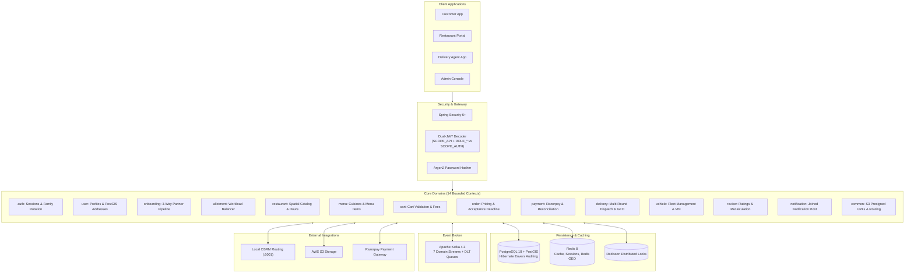
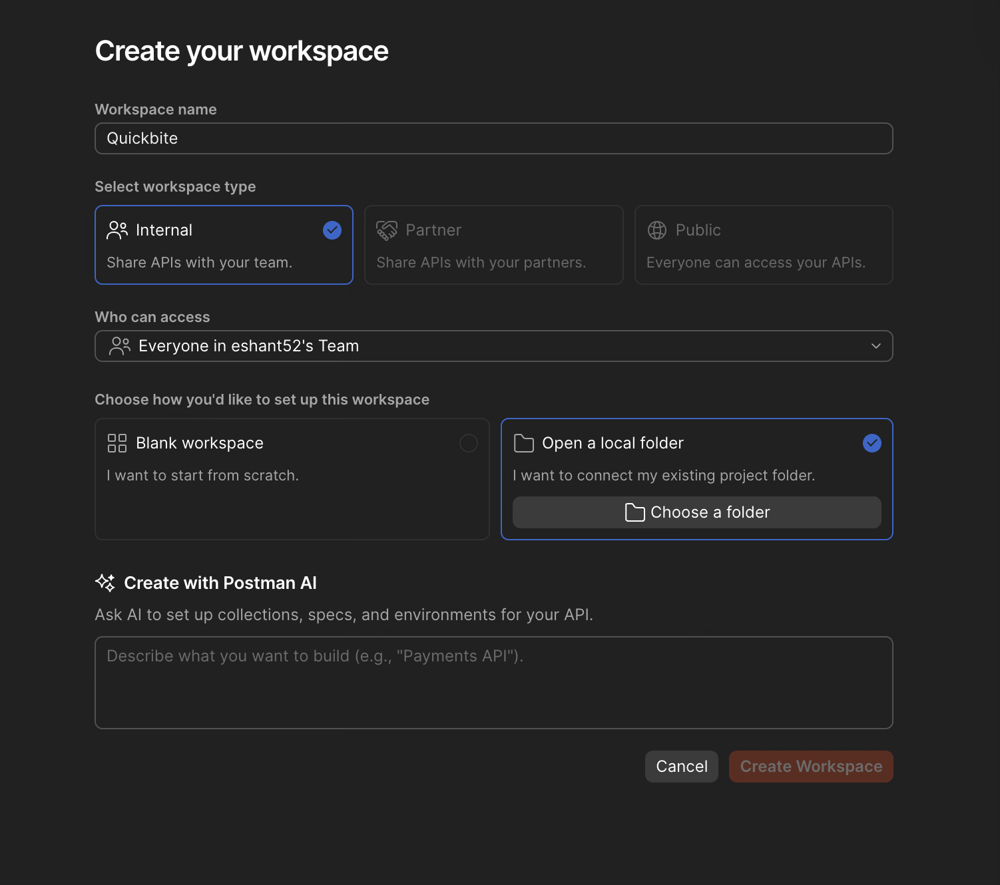
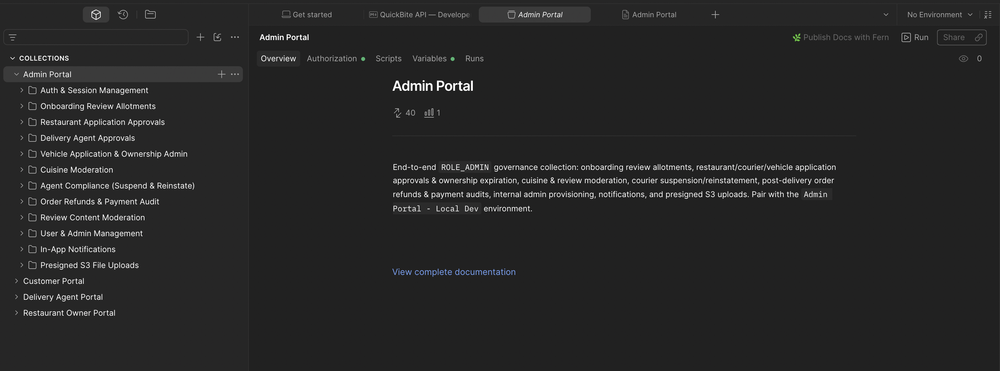
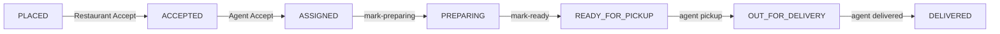

# QuickBite Backend

[](https://openjdk.org/)
[](https://spring.io/projects/spring-boot)
[](https://postgis.net/)
[](https://redis.io/)
[](https://kafka.apache.org/)
[](https://www.docker.com/)
[](LICENSE)

QuickBite is an enterprise-grade, cloud-native food ordering, restaurant management, and hyper-local delivery backend. Built using a **Domain-Driven Vertical Slice Architecture** on **Java 25** and **Spring Boot 4.1.0**, the platform leverages **PostgreSQL (PostGIS)** for spatial queries, **Redis (Redisson)** for distributed locking and real-time geospatial driver tracking, and **Apache Kafka** for cross-domain event choreography.

---

## Table of Contents

- [Architecture Overview](#architecture-overview)
- [Key Features & Domain Capabilities](#key-features--domain-capabilities)
  - [1. Security, Identity & Stateful Sessions (`auth`)](#1-security-identity--stateful-sessions-auth)
  - [2. Multi-Round Dispatch & Geospatial Tracking (`delivery`)](#2-multi-round-dispatch--geospatial-tracking-delivery)
  - [3. Order Engine & Pricing Subsystem (`order`, `cart`)](#3-order-engine--pricing-subsystem-order-cart)
  - [4. Payments, Webhooks & Automated Reconciliation (`payment`)](#4-payments-webhooks--automated-reconciliation-payment)
  - [5. Multi-Tier Composite Routing Gateway (`common/routing`)](#5-multi-tier-composite-routing-gateway-commonrouting)
  - [6. Onboarding Pipelines & Workload-Balanced Allotment (`onboarding`, `allotment`)](#6-onboarding-pipelines--workload-balanced-allotment-onboarding-allotment)
  - [7. Restaurant Catalog, Cuisines & Menu Items (`restaurant`, `menu`)](#7-restaurant-catalog-cuisines--menu-items-restaurant-menu)
  - [8. Reviews & Rating Recalculation (`review`)](#8-reviews--rating-recalculation-review)
  - [9. Joined-Inheritance Notification Center (`notification`)](#9-joined-inheritance-notification-center-notification)
- [Technology Stack](#technology-stack)
- [Role-Based Access Control (RBAC) Matrix](#role-based-access-control-rbac-matrix)
- [Quickstart](#quickstart)
  - [1. Clone & Configure Environment](#1-clone--configure-environment)
  - [2. Start Infrastructure Services](#2-start-infrastructure-services)
  - [3. Generate Cryptographic RSA Keys](#3-generate-cryptographic-rsa-keys)
  - [4. Run the Application](#4-run-the-application)
  - [5. Postman Workspace Setup (Local View)](#5-postman-workspace-setup-local-view)
- [🎬 End-to-End Demo Guide: Placing an Order & Delivery Offer Tracking](#-end-to-end-demo-guide-placing-an-order--delivery-offer-tracking)
  - [Step 1: Start the Interactive Delivery Agent Tracker CLI](#step-1-start-the-interactive-delivery-agent-tracker-cli)
  - [Step 2: Authenticate in Postman / cURL](#step-2-authenticate-in-postman--curl)
  - [Step 3: Add Menu Item to Cart (Customer)](#step-3-add-menu-item-to-cart-customer)
  - [Step 4: Place Order via Cash on Delivery (Customer)](#step-4-place-order-via-cash-on-delivery-customer)
  - [Step 5: Restaurant Owner Accepts Order (Triggers Dispatch)](#step-5-restaurant-owner-accepts-order-triggers-dispatch)
  - [Step 6: Accept Offer in the Python CLI Tracker](#step-6-accept-offer-in-the-python-cli-tracker)
  - [Step 7: Complete Kitchen Prep & Delivery (Optional)](#step-7-complete-kitchen-prep--delivery-optional)
- [Documentation Directory](#documentation-directory)
- [Project Status & Milestone Checklist](#project-status--milestone-checklist)

---

## Architecture Overview



---

## Key Features & Domain Capabilities

### 1. Security, Identity & Stateful Sessions (`auth`)
* **Dual-JWT Token Architecture**: Asymmetric RSA256 tokens separating business API access (`aud: quickbite-api`, `type: access`, 15m) from session challenge tasks (`aud: quickbite-auth`, `type: session-limit`, 5m).
* **Client-Aware Hybrid Refresh Token Transport (`X-Client-Type`)**:
  - **`WEB_BROWSER` (`web_browser`)**: Refresh tokens are delivered exclusively via `HttpOnly`, `Secure`, `SameSite=Strict` cookies (`qb_refresh_token`) and stripped (`null`) from JSON bodies.
  - **`MOBILE_APP` (`mobile_app`)**: Refresh tokens are returned directly in the `AuthResponse` JSON payload and accepted via `RefreshRequest` JSON bodies for native Keychain/Keystore storage.
* **Generation-Tracked Token Families & Breach Detection**: Refresh tokens belong to a `RefreshTokenFamily` with monotonically increasing `generation` counters and SHA-256 hashes in PostgreSQL. Replaying an already-used token (`used_at != null`) outside the 2-second Redis grace window triggers an immediate `REQUIRES_NEW` breach revocation.
* **3-Step Session Concurrency Challenge**: Enforces 3 concurrent active sessions per user. Exceeding the limit returns `409 Conflict` with a 5-minute `challengeToken` to list (`GET /sessions`), evict (`DELETE /sessions/{id}`), and claim (`POST /claim-session`) a session slot.
* **Automated Stale Token Retention Cleanup**: Daily cron (`RefreshTokenCleanupScheduler`) purges used, expired, or revoked tokens older than 30 days while retaining recent history for breach detection.

### 2. Multi-Round Dispatch & Geospatial Tracking (`delivery`)
* **3-Round Concentric Dispatch**: Orders automatically expand across candidate pools:
  - **Round 1**: 3 km radius (2-minute window)
  - **Round 2**: 6 km radius (3-minute window)
  - **Round 3**: 10 km radius (5-minute window)
* **Driver Offer Timeout**: 45-second timer per candidate driver with automated failover to the next best driver.
* **Redis GEO Real-Time Tracking**: Drivers transmit live GPS coordinates stored in Redis using `GEOADD`. Proximity candidate searches execute in sub-millisecond time via `GEORADIUSBYMEMBER`.
* **Heartbeat & DB Sync**: Active drivers maintain a 60-second Redis heartbeat TTL. A background scheduler syncs coordinates into PostgreSQL every 30 seconds.
* **Fair Driver Assignment**: `FairNearestDeliveryAssignmentStrategy` optimizes for distance while preventing driver starvation.

### 3. Order Engine & Pricing Subsystem (`order`, `cart`)
* **2-Phase Non-Holding Checkout & Cooldown**: 5-second Redisson cooldown prevents duplicate submissions; isolated transactions ensure external routing and payment gateway HTTP calls never hold open DB connections.
* **Price-Drift Protection (`expectedTotal`)**: Validates checkout totals against real-time pricing and aborts with `409 Conflict` (`PriceChangedException`) if item prices or surge fees changed.
* **Chain-of-Responsibility Fee Calculation**: Calculates Base Fee (₹15), Distance Fee (₹8/km), Surge Fee, Platform Fee (₹5), and 5% GST with min (₹20) and max (₹80) bounds and a 5-minute Redis route cache.
* **Dual-Layer Distributed Timeouts (Redisson Delayed Queues + Reapers)**: Event-driven `RDelayedQueue` + atomic `BLPOP` workers (`OrderTimeoutConsumer`) enforce the **2-minute restaurant acceptance deadline (`PT2M`)** and **15-minute payment abandonment window**, backed by safety-net cron schedulers.

### 4. Payments, Webhooks & Automated Reconciliation (`payment`)
* **Strategy Pattern**: Pluggable strategies for online methods (`UPI`, `CARD`, `NET_BANKING`, `WALLET` via `OnlinePaymentStrategy`), `COD` (`CodPaymentStrategy`), and `StubOnlinePaymentStrategy`.
* **HMAC-SHA256 Signature Verification**: Cryptographic validation for both frontend checkout signatures and backend webhooks.
* **Multi-Attempt Reconciliation (`First-Success-Wins`)**: Reconciles all payment attempts on poll or retry, auto-refunding duplicate captures or late captures on abandoned/cancelled orders.
* **Kafka-Driven Automated Refunds**: Event listeners automatically issue Razorpay refunds when orders are cancelled, declined, or refunded post-delivery by an admin.

### 5. Multi-Tier Composite Routing Gateway (`common/routing`)
* **Tier 1 (OSRM)**: Local native high-performance OpenStreetMap routing machine on port `5001`.
* **Tier 2 (Mapbox)**: Cloud Directions API fallback.
* **Tier 3 (Haversine)**: Mathematical spherical distance fallback with 25 km/h urban velocity to ensure zero downtime.

### 6. Onboarding Pipelines & Workload-Balanced Allotment (`onboarding`, `allotment`)
* **3 Independent Pipelines**: Multi-step applications for **Restaurants**, **Delivery Agents**, and **Vehicles**.
* **Document & Image Management**: AWS S3 presigned PUT URLs for direct, bandwidth-efficient uploads of KYC documents and facade photos.
* **Automated Admin Allotment Engine**: `WorkloadBalancedAdminSelectionStrategy` distributes pending partner applications equally among administrators up to a maximum limit (`max-assignees = 4`).

### 7. Restaurant Catalog, Cuisines & Menu Items (`restaurant`, `menu`)
* **PostGIS Spatial Search**: Spatial `/nearby` queries filtering active restaurants within a radius (`ST_DWithin` / `ST_DistanceSphere`).
* **Menu Management**: Dietary classifications (`VEG`, `NON_VEG`, `VEGAN`), opening hours, image galleries, and instant availability toggles.
* **Cuisine Moderation**: Global cuisine catalog with partner request and admin approval flows.

### 8. Reviews & Rating Recalculation (`review`)
* **Verified Customer Feedback**: Reviews restricted to completed orders.
* **Kafka Event Recalculation**: Submitting or deleting a review publishes a `ReviewChangedEvent`, automatically recalculating the restaurant's average rating and total review count.

### 9. Joined-Inheritance Notification Center (`notification`)
* **Single Root Aggregate**: Joined-table inheritance (`Notification`) with specialized subclasses: `OrderNotification`, `PaymentNotification`, `RestaurantApplicationNotification`, `DeliveryAgentApplicationNotification`, `VehicleApplicationNotification`, `CuisineNotification`.
* **Multi-Channel Delivery**: In-app notifications, push notifications, and email delivery strategies.

---

## Technology Stack

| Layer | Technologies |
| :--- | :--- |
| **Backend Framework** | Spring Boot 4.1.0, Spring Security 6+, Spring Data JPA, Spring Kafka, Spring Validation |
| **Language & Runtime** | Java 25 (Temurin / GraalVM) |
| **Relational Database** | PostgreSQL 18.1 with PostGIS 3.4 & Hibernate Spatial |
| **Auditing & Lineage** | Hibernate Envers (`@Audited`) on core aggregates (`User`, `Restaurant`, `Order`, `Payment`, `DeliveryAgent`) |
| **In-Memory & Cache** | Redis 8.4-alpine, Redisson 4.7.0 (Distributed Locks & Delayed Queues), Redis GEO |
| **Event Streaming** | Apache Kafka 4.3.0 (KRaft mode) + Spring Kafka Dead Letter Topics (`.DLT`) |
| **Cloud Storage** | AWS SDK for Java v2 (S3 Presigned URLs) |
| **Routing Engines** | OSRM (Open Source Routing Machine), Mapbox Directions API, Haversine Math Fallback |
| **Payment Gateway** | Razorpay Java SDK 1.4.10 (UPI, NetBanking, Cards, Webhooks) |
| **Security & Tokens** | Nimbus JOSE+JWT, Argon2 Password Encoder, BouncyCastle, Yauaa (User-Agent Analyzer) |

---

## Role-Based Access Control (RBAC) Matrix

| URL Prefix | Primary Role | Required Authority | Description |
| :--- | :--- | :--- | :--- |
| `/api/v1/auth/register/**`, `/login` | Public | None | Authentication & multi-role registration |
| `/api/v1/cuisines`, `/restaurants/**` | Public | None | Restaurant catalog, menus, and reviews |
| `/api/v1/webhooks/**` | Public (Signature) | None | Razorpay webhook notifications |
| `/actuator/health`, `/actuator/info` | Public | None | Service liveness and readiness probes |
| `/api/v1/auth/sessions/**`, `/claim-session` | Challenged User | `SCOPE_AUTH` | Session challenge resolution & eviction |
| `/api/v1/files/upload-url` | Authenticated | `SCOPE_API` | Direct S3 presigned PUT URL generation |
| `/api/v1/customer/**` | Customer | `SCOPE_API` + `ROLE_CUSTOMER` | Cart, orders, delivery addresses, reviews |
| `/api/v1/restaurant-owner/**` | Partner | `SCOPE_API` + `ROLE_RESTAURANT_OWNER` | Restaurant info, menus, order kitchen queue |
| `/api/v1/delivery-agent/**` | Driver | `SCOPE_API` + `ROLE_DELIVERY_AGENT` | Availability, location ping, offers, pickup/delivery |
| `/api/v1/admin/**` | Administrator | `SCOPE_API` + `ROLE_ADMIN` | Allotments, approvals, refunds, user management |
| `/actuator/**` (all other) | Administrator | `SCOPE_API` + `ROLE_ADMIN` | Prometheus metrics and internal diagnostics |

---

## Quickstart

### 1. Clone & Configure Environment
```bash
git clone https://github.com/eshant52/quickbite-backend.git
cd quickbite-backend

# Setup local Docker Compose environment
cp .env.local.example .env.local

# Setup Spring Boot application environment
cp .env.example .env
```

### 2. Start Infrastructure Services
```bash
docker compose --env-file .env.local --profile full up -d
```
This spins up PostgreSQL (`:5430`), Redis (`:6377`), and Kafka (`:9092`).

### 3. Generate Cryptographic RSA Keys
```bash
mkdir -p src/main/resources/certs
openssl genrsa -out src/main/resources/certs/private.pem 2048
openssl rsa -in src/main/resources/certs/private.pem -pubout -out src/main/resources/certs/public.pem
```

### 4. Run the Application
```bash
./mvnw spring-boot:run
```

Verify service readiness:
```bash
curl http://localhost:8080/actuator/health
```

*Default Super Admin Credentials (auto-seeded on startup):*
* **Email**: `super.admin@quickbite.com`
* **Password**: `Admin@123`

### 5. Postman Workspace Setup (Local View)

The repository includes a pre-configured [`postman/`](./postman) folder containing 4 role-based collections (**Customer Portal**, **Restaurant Owner Portal**, **Delivery Agent Portal**, **Admin Portal**), dedicated local environments, and the complete OpenAPI 3.1.0 specification.

To import and use the workspace in Postman:
1. Open the Postman Desktop App.
2. Click **Workspaces** &rarr; **Create Workspace** (or link a local directory).
3. **Important**: When prompted to choose the folder location, **select the root path folder of the project** (`QuickBite/app/QuickBite`). Postman will automatically read `.postman/resources.yaml` and recognize all collections, environments, and specs under the `postman/` directory.

<!-- Screenshot 1: Creating workspace and selecting the project root folder -->


4. Once opened, Postman will automatically display all 4 portal collections and matching local development environments in the left sidebar.

<!-- Screenshot 2: Collections UI in Postman -->


> [!TIP]
> For more details, comprehensive environment configuration, Docker setup, and routing engine options, look to the [Installation and Configuration Guide](./docs/installation.md). For detailed API endpoints, collection variables, and test scripts, see the [Postman Developer Guide](./postman/documents/QuickBite%20API%20%E2%80%94%20Developer%20Guide.md) and [REST API Catalog](./docs/api-guide.md).

---

## 🎬 End-to-End Demo Guide: Placing an Order & Delivery Offer Tracking

This step-by-step walkthrough demonstrates QuickBite's complete reactive order-to-delivery lifecycle:
1. **Interactive Delivery Agent Offer Tracker CLI** (`track_delivery_offers.py`): Logs in and tracks up to 10 delivery agents simultaneously, continuously pushes live Redis GEO heartbeats, polls for incoming offers, and renders real-time offer cards with countdown timers.
2. **Postman / cURL API Flow**: Customer places an order, Restaurant Owner accepts the order within the 2-minute deadline (triggering 3-round parallel dispatch), and the Delivery Agent accepts the offer with single-key prompt (`1`).

---

### Step 1: Start the Interactive Delivery Agent Tracker CLI

In your terminal, launch the Python offer tracker ([`track_delivery_offers.py`](./scripts/track_delivery_offers.py)):

```bash
# Local backend (default: http://localhost:8080)
python3 scripts/track_delivery_offers.py --auto-available

# Or point to a deployed QuickBite backend URL (no direct DB access needed!)
python3 scripts/track_delivery_offers.py --base-url https://api.your-domain.com --auto-available
```

> [!NOTE]
> * **100% REST API-Driven**: Polls `GET /api/v1/delivery-agent/offers/active` for each logged-in agent — requires zero direct database connection (`psql` is not needed).
> * Pre-configured with 6 verified delivery agents in [`scripts/agents.json`](./scripts/agents.json) (`aarav.sharma@example.com`, `vikram.singh@example.com`, `pooja.patel@example.com`, `mohammed.rizwan@example.com`, `sneha.mukherjee@example.com`, `rajesh.kumar@example.com`, password `Password@123`).
> * Automatically refreshes 15-minute JWTs and resolves `409 Conflict` (session limits) by evicting only the single oldest session.
> * Sends `PUT /api/v1/delivery-agent/location` heartbeats every 35s to keep active agents alive in Redis GEO.
> * Queues multiple incoming offers in FIFO order so you can review each offer without missing others.

Leave this terminal running — it will alert you as soon as an offer is dispatched!

---

### Step 2: Authenticate in Postman / cURL

Open Postman (or use cURL in a second terminal) with `Content-Type: application/json` and `X-Client-Type: mobile_app`.

*(Tip: If you linked the Postman workspace as shown in [Step 5](#5-postman-workspace-setup-local-view), you can run **Login with Email & Password** directly from the **Customer Portal** and **Restaurant Owner Portal** collections — tokens and sessions are captured automatically into collection variables!)*

#### 2.1 Customer Login
* **Method**: `POST`
* **URL**: `http://localhost:8080/api/v1/auth/login`
* **Headers**:
  ```http
  Content-Type: application/json
  X-Client-Type: mobile_app
  ```
* **Body**:
  ```json
  {
    "email": "eshantsonune52@gmail.com",
    "password": "Password@123"
  }
  ```
* **Action**: Copy the `accessToken` from the response JSON and save it as your `CUSTOMER_TOKEN`.

#### 2.2 Restaurant Owner Login
* **Method**: `POST`
* **URL**: `http://localhost:8080/api/v1/auth/login`
* **Headers**:
  ```http
  Content-Type: application/json
  X-Client-Type: mobile_app
  ```
* **Body**:
  ```json
  {
    "email": "rakesh.agarwal@haldiramsnagpur.com",
    "password": "Password@123"
  }
  ```
* **Action**: Copy the `accessToken` from the response JSON and save it as your `OWNER_TOKEN`.

---

### Step 3: Add Menu Item to Cart (Customer)

Add *Shahi Gulab Jamun (2 Pcs)* from *Haldiram's Planet Food* to the customer's cart.

* **Method**: `POST`
* **URL**: `http://localhost:8080/api/v1/customer/cart/items`
* **Headers**:
  ```http
  Content-Type: application/json
  Authorization: Bearer <CUSTOMER_TOKEN>
  ```
* **Body**:
  ```json
  {
    "menuItemId": "01a12644-4cf3-79a9-9908-278c7018020f",
    "quantity": 2
  }
  ```
* **Expected Response (`200 OK`)**:
  ```json
  {
    "restaurantId": "01a12520-fb45-781c-a3e5-27d7ad889ea3",
    "restaurantName": "Haldiram's Planet Food - Dharampeth",
    "items": [
      {
        "menuItemId": "01a12644-4cf3-79a9-9908-278c7018020f",
        "menuItemName": "Shahi Gulab Jamun (2 Pcs)",
        "quantity": 2,
        "unitPrice": 75.00,
        "subTotal": 150.00
      }
    ]
  }
  ```

---

### Step 4: Place Order via Cash on Delivery (Customer)

Place the order using the customer's saved address and `COD` payment method. For Cash on Delivery, QuickBite immediately confirms payment and transitions the order directly to `PLACED`.

* **Method**: `POST`
* **URL**: `http://localhost:8080/api/v1/customer/orders`
* **Headers**:
  ```http
  Content-Type: application/json
  Authorization: Bearer <CUSTOMER_TOKEN>
  ```
* **Body**:
  ```json
  {
    "addressId": "01a12aaf-4f26-7df3-a6f2-45ffec06dbfb",
    "paymentMethod": "COD",
    "tipAmount": 20.00
  }
  ```
* **Expected Response (`201 Created`)**:
  ```json
  {
    "orderId": "0195f000-xxxx-7000-xxxx-xxxxxxxxxxxx",
    "status": "PLACED",
    "type": "COD",
    "totalAmount": 222.50
  }
  ```
* **Action**: Copy the `orderId` value (e.g., `0195f000-...`). The 2-minute restaurant acceptance deadline countdown is now ticking in Redisson!

---

### Step 5: Restaurant Owner Accepts Order (Triggers Dispatch)

The restaurant owner accepts the order within the 2-minute deadline.

* **Method**: `POST`
* **URL**: `http://localhost:8080/api/v1/restaurant-owner/orders/<orderId>/accept?restaurantId=01a12520-fb45-781c-a3e5-27d7ad889ea3`
* **Headers**:
  ```http
  Authorization: Bearer <OWNER_TOKEN>
  ```
* **Expected Response (`200 OK`)**:
  ```json
  {
    "id": "<orderId>",
    "currentStatus": "ACCEPTED",
    "restaurantId": "01a12520-fb45-781c-a3e5-27d7ad889ea3"
  }
  ```

> [!IMPORTANT]
> **Dispatch Event Choreography**: Accepting the order publishes an `OrderAcceptedEvent` to Kafka. QuickBite's dispatch engine immediately calculates nearby candidate drivers in Redis GEO (Round 1: 3 km radius) and generates an offer in PostgreSQL with a 45-second expiration timer.

---

### Step 6: Accept Offer in the Python CLI Tracker

Switch back to the terminal running [`track_delivery_offers.py`](./scripts/track_delivery_offers.py). Within 1–2 seconds, an audible terminal bell will ring and the offer card will render:

```text
━━━━━━━━━━━━━━━━━━━━━━━━━━━━━━━━━━━━━━━━━━━━━━━━━━━━━━━━━━━━━━━━━━━━━━━━━━━━━━━━━━━━━━━━
🎯 ACTIVE DELIVERY OFFER  (Round #1, Radius 3.0 km) | Queue Empty (0 waiting)
━━━━━━━━━━━━━━━━━━━━━━━━━━━━━━━━━━━━━━━━━━━━━━━━━━━━━━━━━━━━━━━━━━━━━━━━━━━━━━━━━━━━━━━━
  👤 Delivery Agent : Aarav Sharma (aarav.sharma@example.com | +919876543210)
  🛵 Vehicle / ID   : MOTORCYCLE (MH-31-AB-1234)  [agentId: 0195e...]
  ────────────────────────────────────────────────────────────────────────────────────
  📦 Order ID       : 0195f000-...  [Status: ACCEPTED]
  🧑 Customer       : Eshant Sonune (+919876543210)  |  Order Bill: ₹222.50
  🍽️  Order Items    :
                      • 2 × Shahi Gulab Jamun (2 Pcs) (₹150.00)
  ────────────────────────────────────────────────────────────────────────────────────
  🏪 Restaurant     : Haldiram's Planet Food - Dharampeth
                      Dharampeth, Nagpur, Maharashtra
  📍 Drop Address   : Dharampeth Home Address, Nagpur
  🛣️  Distance / ETA : 1.85 km  |  ~320 sec (5m 20s)
  💰 Agent Payout   : ₹48.50 (Guaranteed: ₹28.50 + Tip: ₹20.00)
  ⏳ Expires In     : 43 seconds (at 18:25:10)
━━━━━━━━━━━━━━━━━━━━━━━━━━━━━━━━━━━━━━━━━━━━━━━━━━━━━━━━━━━━━━━━━━━━━━━━━━━━━━━━━━━━━━━━
👉 Action for Aarav Sharma [1=Accept, 2=Reject, 3=Skip, r=Refresh, s=Agents, q=Quit]: 
```

#### Choose Your Action:
* **Press `1` + Enter &rarr; Accept Offer**:
  Assigns the order to Aarav Sharma (`POST /api/v1/delivery-agent/orders/{orderId}/accept`).
  Terminal prints: `✅ ACCEPTED! Aarav Sharma is now assigned to Order <orderId>.`
* **Press `2` + Enter &rarr; Reject Offer**:
  Declines the offer (`POST /api/v1/delivery-agent/orders/{orderId}/reject`). QuickBite automatically escalates and offers the order to the next closest driver (e.g. Vikram Singh or Pooja Patel)!
* **Press `3` + Enter &rarr; Skip**:
  Leaves the offer untouched in `PENDING` state to let its natural 45-second timer expire.

---

### Step 7: Complete Kitchen Prep & Delivery (Optional)

Once the agent has accepted, you can step through the remaining kitchen and delivery states:



1. **Kitchen Starts Cooking (`ACCEPTED` &rarr; `PREPARING`)**:
   ```bash
   curl -X POST "http://localhost:8080/api/v1/restaurant-owner/orders/<orderId>/mark-preparing?restaurantId=01a12520-fb45-781c-a3e5-27d7ad889ea3" \
     -H "Authorization: Bearer <OWNER_TOKEN>"
   ```
2. **Food Ready for Pickup (`PREPARING` &rarr; `READY_FOR_PICKUP`)**:
   ```bash
   curl -X POST "http://localhost:8080/api/v1/restaurant-owner/orders/<orderId>/mark-ready?restaurantId=01a12520-fb45-781c-a3e5-27d7ad889ea3" \
     -H "Authorization: Bearer <OWNER_TOKEN>"
   ```
3. **Driver Picks Up Food (`READY_FOR_PICKUP` &rarr; `OUT_FOR_DELIVERY`)**:
   *Log in as the assigned driver (e.g. `aarav.sharma@example.com` / `Password@123`) to get `AGENT_TOKEN`:*
   ```bash
   curl -X POST "http://localhost:8080/api/v1/delivery-agent/orders/<orderId>/pickup" \
     -H "Authorization: Bearer <AGENT_TOKEN>"
   ```
4. **Driver Confirms Delivery (`OUT_FOR_DELIVERY` &rarr; `DELIVERED`)**:
   ```bash
   curl -X POST "http://localhost:8080/api/v1/delivery-agent/orders/<orderId>/delivered" \
     -H "Authorization: Bearer <AGENT_TOKEN>"
   ```

The order is now in its terminal state: `DELIVERED`! 🎉

---

## Documentation Directory

For in-depth architectural guides and developer specifications, consult the [`docs/`](docs/) directory:

* [**Documentation Hub (`docs/README.md`)**](docs/README.md) — Complete documentation index.
* [**System Architecture & Domain Design (`docs/architecture.md`)**](docs/architecture.md) — Event choreography, state machines, and concurrency patterns.
* [**Order & Cart Lifecycle Guide (`docs/order-process.md`)**](docs/order-process.md) — End-to-end cart, pricing chain, price-drift check, Redisson delayed queues, and fulfillment flow.
* [**REST API Reference & Security Matrix (`docs/api-guide.md`)**](docs/api-guide.md) — Comprehensive guide to all 35+ REST controllers.
* [**Dispatch Engine & Geospatial Routing (`docs/dispatch-and-routing.md`)**](docs/dispatch-and-routing.md) — Concentric dispatch, Redis GEO, and OSRM routing.
* [**Payments & Automated Reconciliation (`docs/payments-and-reconciliation.md`)**](docs/payments-and-reconciliation.md) — Razorpay integration, webhooks, and multi-attempt reconciliation.
* [**Installation & Environment Setup (`docs/installation.md`)**](docs/installation.md) — Detailed deployment and setup instructions.
* [**Client JWT & Session Integration Guide (`docs/jwt.md`)**](docs/jwt.md) — Guide for frontend and mobile client authentication.
* [**Authentication & Session Architecture (`docs/authentication.md`)**](docs/authentication.md) — Deep dive into dual tokens and family rotation.

---

## Project Status & Milestone Checklist

- [x] **Core Architecture & Framework Setup** (Spring Boot 4.1.0 on Java 25, Flyway V1–V35, Envers Auditing)
- [x] **Dual-JWT & Stateful Session Engine** (Self-issued RSA256, Refresh Token Family Rotation, 409 Session Challenge)
- [x] **PostgreSQL & Spatial Foundation** (PostGIS 18.1, JTS geometries, GIST indexing, spatial `/nearby` search with multi-criteria filtering)
- [x] **Redis & Distributed Concurrency** (Redisson locks for orders/payments/dispatch, Redis GEO real-time driver tracking)
- [x] **Kafka Event-Driven Messaging** (7 aggregate event streams, Jackson inferred polymorphic conversion, `.DLT` error handling)
- [x] **Multi-Step Onboarding & Allotment** (Restaurant, Driver, and Vehicle pipelines with Workload-Balanced Admin Allotment)
- [x] **Cart & Order Management** (Single-restaurant auto-clearing carts, dynamic fee engine, 2-minute kitchen acceptance deadline, delivered earnings analytics, actor-attributed status audit trail)
- [x] **Multi-Round Dispatch Subsystem** (3km/6km/10km expanding rounds, 45s driver offer timeout, fair assignment)
- [x] **Payment Processing & Webhooks** (Razorpay gateway, COD/Online strategies, HMAC-SHA256 verification, auto-reconciliation)
- [x] **Multi-Tier Routing Gateway** (Local native OSRM on port 5001 + Mapbox fallback + Haversine fallback)
- [x] **AWS S3 File Storage** (Presigned PUT URLs for direct client uploads with 10-minute expiry)
- [x] **Reviews & Automatic Ratings** (Kafka-driven restaurant rating and review count recalculation)
- [x] **Comprehensive Test Suite** (102 test classes / 574 tests across all domains covering unit, controller, and integration flows)
- [ ] WebSocket / SSE live order tracking updates for customer frontend
- [ ] Push notification gateway integration (Firebase Cloud Messaging / Apple APNs)
- [ ] Multi-region MSK Kafka deployment configuration