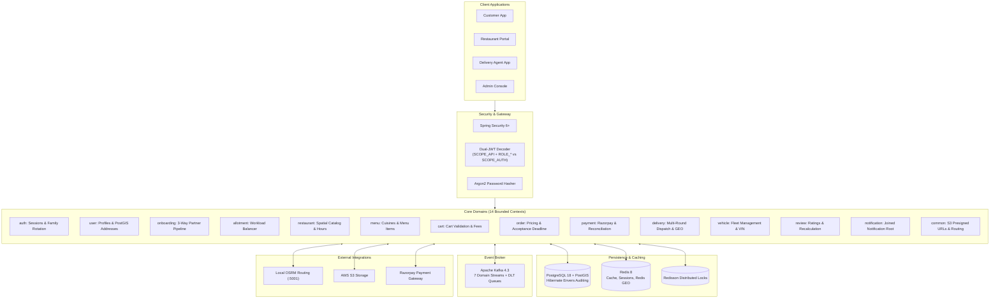

# QuickBite Backend

[](https://openjdk.org/)
[](https://spring.io/projects/spring-boot)
[](https://postgis.net/)
[](https://redis.io/)
[](https://kafka.apache.org/)
[](https://www.docker.com/)
[](LICENSE)

QuickBite is an enterprise-grade, cloud-native food ordering, restaurant management, and hyper-local delivery backend. Built using a **Domain-Driven Vertical Slice Architecture** on **Java 25** and **Spring Boot 4.1.0**, the platform leverages **PostgreSQL (PostGIS)** for spatial queries, **Redis (Redisson)** for distributed locking and real-time geospatial driver tracking, and **Apache Kafka** for cross-domain event choreography.

---

## Architecture Overview



---

## Key Features & Domain Capabilities

### 1. Security, Identity & Stateful Sessions (`auth`)
* **Dual-JWT Token Architecture**: Asymmetric RSA256 tokens separating business API access (`aud: quickbite-api`, `type: access`, 15m) from session challenge tasks (`aud: quickbite-auth`, `type: session-limit`, 5m).
* **Client-Aware Hybrid Refresh Token Transport (`X-Client-Type`)**:
  - **`WEB_BROWSER` (`web_browser`)**: Refresh tokens are delivered exclusively via `HttpOnly`, `Secure`, `SameSite=Strict` cookies (`qb_refresh_token`) and stripped (`null`) from JSON bodies.
  - **`MOBILE_APP` (`mobile_app`)**: Refresh tokens are returned directly in the `AuthResponse` JSON payload and accepted via `RefreshRequest` JSON bodies for native Keychain/Keystore storage.
* **Generation-Tracked Token Families & Breach Detection**: Refresh tokens belong to a `RefreshTokenFamily` with monotonically increasing `generation` counters and SHA-256 hashes in PostgreSQL. Replaying an already-used token (`used_at != null`) outside the 2-second Redis grace window triggers an immediate `REQUIRES_NEW` breach revocation.
* **3-Step Session Concurrency Challenge**: Enforces 3 concurrent active sessions per user. Exceeding the limit returns `409 Conflict` with a 5-minute `challengeToken` to list (`GET /sessions`), evict (`DELETE /sessions/{id}`), and claim (`POST /claim-session`) a session slot.
* **Automated Stale Token Retention Cleanup**: Daily cron (`RefreshTokenCleanupScheduler`) purges used, expired, or revoked tokens older than 30 days while retaining recent history for breach detection.

### 2. Multi-Round Dispatch & Geospatial Tracking (`delivery`)
* **3-Round Concentric Dispatch**: Orders automatically expand across candidate pools:
  - **Round 1**: 3 km radius (2-minute window)
  - **Round 2**: 6 km radius (3-minute window)
  - **Round 3**: 10 km radius (5-minute window)
* **Driver Offer Timeout**: 45-second timer per candidate driver with automated failover to the next best driver.
* **Redis GEO Real-Time Tracking**: Drivers transmit live GPS coordinates stored in Redis using `GEOADD`. Proximity candidate searches execute in sub-millisecond time via `GEORADIUSBYMEMBER`.
* **Heartbeat & DB Sync**: Active drivers maintain a 60-second Redis heartbeat TTL. A background scheduler syncs coordinates into PostgreSQL every 30 seconds.
* **Fair Driver Assignment**: `FairNearestDeliveryAssignmentStrategy` optimizes for distance while preventing driver starvation.

### 3. Order Engine & Pricing Subsystem (`order`, `cart`)
* **2-Phase Non-Holding Checkout & Cooldown**: 5-second Redisson cooldown prevents duplicate submissions; isolated transactions ensure external routing and payment gateway HTTP calls never hold open DB connections.
* **Price-Drift Protection (`expectedTotal`)**: Validates checkout totals against real-time pricing and aborts with `409 Conflict` (`PriceChangedException`) if item prices or surge fees changed.
* **Chain-of-Responsibility Fee Calculation**: Calculates Base Fee (₹15), Distance Fee (₹8/km), Surge Fee, Platform Fee (₹5), and 5% GST with min (₹20) and max (₹80) bounds and a 5-minute Redis route cache.
* **Dual-Layer Distributed Timeouts (Redisson Delayed Queues + Reapers)**: Event-driven `RDelayedQueue` + atomic `BLPOP` workers (`OrderTimeoutConsumer`) enforce the **2-minute restaurant acceptance deadline (`PT2M`)** and **15-minute payment abandonment window**, backed by safety-net cron schedulers.

### 4. Payments, Webhooks & Automated Reconciliation (`payment`)
* **Strategy Pattern**: Pluggable strategies for online methods (`UPI`, `CARD`, `NET_BANKING`, `WALLET` via `OnlinePaymentStrategy`), `COD` (`CodPaymentStrategy`), and `StubOnlinePaymentStrategy`.
* **HMAC-SHA256 Signature Verification**: Cryptographic validation for both frontend checkout signatures and backend webhooks.
* **Multi-Attempt Reconciliation (`First-Success-Wins`)**: Reconciles all payment attempts on poll or retry, auto-refunding duplicate captures or late captures on abandoned/cancelled orders.
* **Kafka-Driven Automated Refunds**: Event listeners automatically issue Razorpay refunds when orders are cancelled, declined, or refunded post-delivery by an admin.

### 5. Multi-Tier Composite Routing Gateway (`common/routing`)
* **Tier 1 (OSRM)**: Local native high-performance OpenStreetMap routing machine on port `5001`.
* **Tier 2 (Mapbox)**: Cloud Directions API fallback.
* **Tier 3 (Haversine)**: Mathematical spherical distance fallback with 25 km/h urban velocity to ensure zero downtime.

### 6. Onboarding Pipelines & Workload-Balanced Allotment (`onboarding`, `allotment`)
* **3 Independent Pipelines**: Multi-step applications for **Restaurants**, **Delivery Agents**, and **Vehicles**.
* **Document & Image Management**: AWS S3 presigned PUT URLs for direct, bandwidth-efficient uploads of KYC documents and facade photos.
* **Automated Admin Allotment Engine**: `WorkloadBalancedAdminSelectionStrategy` distributes pending partner applications equally among administrators up to a maximum limit (`max-assignees = 4`).

### 7. Restaurant Catalog, Cuisines & Menu Items (`restaurant`, `menu`)
* **PostGIS Spatial Search**: Spatial `/nearby` queries filtering active restaurants within a radius (`ST_DWithin` / `ST_DistanceSphere`).
* **Menu Management**: Dietary classifications (`VEG`, `NON_VEG`, `VEGAN`), opening hours, image galleries, and instant availability toggles.
* **Cuisine Moderation**: Global cuisine catalog with partner request and admin approval flows.

### 8. Reviews & Rating Recalculation (`review`)
* **Verified Customer Feedback**: Reviews restricted to completed orders.
* **Kafka Event Recalculation**: Submitting or deleting a review publishes a `ReviewChangedEvent`, automatically recalculating the restaurant's average rating and total review count.

### 9. Joined-Inheritance Notification Center (`notification`)
* **Single Root Aggregate**: Joined-table inheritance (`Notification`) with specialized subclasses: `OrderNotification`, `PaymentNotification`, `RestaurantApplicationNotification`, `DeliveryAgentApplicationNotification`, `VehicleApplicationNotification`, `CuisineNotification`.
* **Multi-Channel Delivery**: In-app notifications, push notifications, and email delivery strategies.

---

## Technology Stack

| Layer | Technologies |
| :--- | :--- |
| **Backend Framework** | Spring Boot 4.1.0, Spring Security 6+, Spring Data JPA, Spring Kafka, Spring Validation |
| **Language & Runtime** | Java 25 (Temurin / GraalVM) |
| **Relational Database** | PostgreSQL 18.1 with PostGIS 3.4 & Hibernate Spatial |
| **Auditing & Lineage** | Hibernate Envers (`@Audited`) on core aggregates (`User`, `Restaurant`, `Order`, `Payment`, `DeliveryAgent`) |
| **In-Memory & Cache** | Redis 8.4-alpine, Redisson 4.7.0 (Distributed Locks & Delayed Queues), Redis GEO |
| **Event Streaming** | Apache Kafka 4.3.0 (KRaft mode) + Spring Kafka Dead Letter Topics (`.DLT`) |
| **Cloud Storage** | AWS SDK for Java v2 (S3 Presigned URLs) |
| **Routing Engines** | OSRM (Open Source Routing Machine), Mapbox Directions API, Haversine Math Fallback |
| **Payment Gateway** | Razorpay Java SDK 1.4.10 (UPI, NetBanking, Cards, Webhooks) |
| **Security & Tokens** | Nimbus JOSE+JWT, Argon2 Password Encoder, BouncyCastle, Yauaa (User-Agent Analyzer) |

---

## Role-Based Access Control (RBAC) Matrix

| URL Prefix | Primary Role | Required Authority | Description |
| :--- | :--- | :--- | :--- |
| `/api/v1/auth/register/**`, `/login` | Public | None | Authentication & multi-role registration |
| `/api/v1/cuisines`, `/restaurants/**` | Public | None | Restaurant catalog, menus, and reviews |
| `/api/v1/webhooks/**` | Public (Signature) | None | Razorpay webhook notifications |
| `/actuator/health`, `/actuator/info` | Public | None | Service liveness and readiness probes |
| `/api/v1/auth/sessions/**`, `/claim-session` | Challenged User | `SCOPE_AUTH` | Session challenge resolution & eviction |
| `/api/v1/files/upload-url` | Authenticated | `SCOPE_API` | Direct S3 presigned PUT URL generation |
| `/api/v1/customer/**` | Customer | `SCOPE_API` + `ROLE_CUSTOMER` | Cart, orders, delivery addresses, reviews |
| `/api/v1/restaurant-owner/**` | Partner | `SCOPE_API` + `ROLE_RESTAURANT_OWNER` | Restaurant info, menus, order kitchen queue |
| `/api/v1/delivery-agent/**` | Driver | `SCOPE_API` + `ROLE_DELIVERY_AGENT` | Availability, location ping, offers, pickup/delivery |
| `/api/v1/admin/**` | Administrator | `SCOPE_API` + `ROLE_ADMIN` | Allotments, approvals, refunds, user management |
| `/actuator/**` (all other) | Administrator | `SCOPE_API` + `ROLE_ADMIN` | Prometheus metrics and internal diagnostics |

---

## Quickstart

### 1. Clone & Configure Environment
```bash
git clone https://github.com/eshant52/quickbite-backend.git
cd quickbite-backend

# Setup local Docker Compose environment
cp .env.local.example .env.local

# Setup Spring Boot application environment
cp .env.example .env
```

### 2. Start Infrastructure Services
```bash
docker compose --env-file .env.local --profile full up -d
```
This spins up PostgreSQL (`:5430`), Redis (`:6377`), and Kafka (`:9092`).

### 3. Generate Cryptographic RSA Keys
```bash
mkdir -p src/main/resources/certs
openssl genrsa -out src/main/resources/certs/private.pem 2048
openssl rsa -in src/main/resources/certs/private.pem -pubout -out src/main/resources/certs/public.pem
```

### 4. Run the Application
```bash
./mvnw spring-boot:run
```

Verify service readiness:
```bash
curl http://localhost:8080/actuator/health
```

*Default Super Admin Credentials (auto-seeded on startup):*
* **Email**: `super.admin@quickbite.com`
* **Password**: `Admin@123`

---

## Documentation Directory

For in-depth architectural guides and developer specifications, consult the [`docs/`](docs/) directory:

* [**Documentation Hub (`docs/README.md`)**](docs/README.md) — Complete documentation index.
* [**System Architecture & Domain Design (`docs/architecture.md`)**](docs/architecture.md) — Event choreography, state machines, and concurrency patterns.
* [**Order & Cart Lifecycle Guide (`docs/order-process.md`)**](docs/order-process.md) — End-to-end cart, pricing chain, price-drift check, Redisson delayed queues, and fulfillment flow.
* [**REST API Reference & Security Matrix (`docs/api-guide.md`)**](docs/api-guide.md) — Comprehensive guide to all 35+ REST controllers.
* [**Dispatch Engine & Geospatial Routing (`docs/dispatch-and-routing.md`)**](docs/dispatch-and-routing.md) — Concentric dispatch, Redis GEO, and OSRM routing.
* [**Payments & Automated Reconciliation (`docs/payments-and-reconciliation.md`)**](docs/payments-and-reconciliation.md) — Razorpay integration, webhooks, and multi-attempt reconciliation.
* [**Installation & Environment Setup (`docs/installation.md`)**](docs/installation.md) — Detailed deployment and setup instructions.
* [**Client JWT & Session Integration Guide (`docs/jwt.md`)**](docs/jwt.md) — Guide for frontend and mobile client authentication.
* [**Authentication & Session Architecture (`docs/authentication.md`)**](docs/authentication.md) — Deep dive into dual tokens and family rotation.

---

## Project Status & Milestone Checklist

- [x] **Core Architecture & Framework Setup** (Spring Boot 4.1.0 on Java 25, Flyway V1–V34, Envers Auditing)
- [x] **Dual-JWT & Stateful Session Engine** (Self-issued RSA256, Refresh Token Family Rotation, 409 Session Challenge)
- [x] **PostgreSQL & Spatial Foundation** (PostGIS 18.1, JTS geometries, GIST indexing, spatial `/nearby` search)
- [x] **Redis & Distributed Concurrency** (Redisson locks for orders/payments/dispatch, Redis GEO real-time driver tracking)
- [x] **Kafka Event-Driven Messaging** (7 aggregate event streams, Jackson inferred polymorphic conversion, `.DLT` error handling)
- [x] **Multi-Step Onboarding & Allotment** (Restaurant, Driver, and Vehicle pipelines with Workload-Balanced Admin Allotment)
- [x] **Cart & Order Management** (Single-restaurant carts, dynamic fee engine, 2-minute kitchen acceptance deadline)
- [x] **Multi-Round Dispatch Subsystem** (3km/6km/10km expanding rounds, 45s driver offer timeout, fair assignment)
- [x] **Payment Processing & Webhooks** (Razorpay gateway, COD/Online strategies, HMAC-SHA256 verification, auto-reconciliation)
- [x] **Multi-Tier Routing Gateway** (Local native OSRM on port 5001 + Mapbox fallback + Haversine fallback)
- [x] **AWS S3 File Storage** (Presigned PUT URLs for direct client uploads with 10-minute expiry)
- [x] **Reviews & Automatic Ratings** (Kafka-driven restaurant rating and review count recalculation)
- [x] **Comprehensive Test Suite** (100 test classes across all domains covering unit, controller, and integration flows)
- [ ] WebSocket / SSE live order tracking updates for customer frontend
- [ ] Push notification gateway integration (Firebase Cloud Messaging / Apple APNs)
- [ ] Multi-region MSK Kafka deployment configuration