# QuickBite Backend

[](https://openjdk.org/)
[](https://spring.io/projects/spring-boot)
[](https://postgis.net/)
[](https://redis.io/)
[](https://kafka.apache.org/)
[](https://www.docker.com/)
[](LICENSE)

QuickBite is an enterprise-grade, cloud-native food ordering, restaurant management, and hyper-local delivery backend. Built using a **Domain-Driven Vertical Slice Architecture** on **Java 25** and **Spring Boot 4.1.0**, the platform leverages **PostgreSQL (PostGIS)** for spatial queries, **Redis (Redisson)** for distributed locking and real-time geospatial driver tracking, and **Apache Kafka** for cross-domain event choreography.

---

## Table of Contents

- [Architecture Overview](#architecture-overview)
- [Key Features & Domain Capabilities](#key-features--domain-capabilities)
  - [1. Security, Identity & Stateful Sessions (`auth`)](#1-security-identity--stateful-sessions-auth)
  - [2. Multi-Round Dispatch & Geospatial Tracking (`delivery`)](#2-multi-round-dispatch--geospatial-tracking-delivery)
  - [3. Order Engine & Pricing Subsystem (`order`, `cart`)](#3-order-engine--pricing-subsystem-order-cart)
  - [4. Payments, Webhooks & Automated Reconciliation (`payment`)](#4-payments-webhooks--automated-reconciliation-payment)
  - [5. Multi-Tier Composite Routing Gateway (`common/routing`)](#5-multi-tier-composite-routing-gateway-commonrouting)
  - [6. Onboarding Pipelines & Workload-Balanced Allotment (`onboarding`, `allotment`)](#6-onboarding-pipelines--workload-balanced-allotment-onboarding-allotment)
  - [7. Restaurant Catalog, Cuisines & Menu Items (`restaurant`, `menu`)](#7-restaurant-catalog-cuisines--menu-items-restaurant-menu)
  - [8. Reviews & Rating Recalculation (`review`)](#8-reviews--rating-recalculation-review)
  - [9. Joined-Inheritance Notification Center (`notification`)](#9-joined-inheritance-notification-center-notification)
- [Technology Stack](#technology-stack)
- [Role-Based Access Control (RBAC) Matrix](#role-based-access-control-rbac-matrix)
- [Quickstart](#quickstart)
  - [1. Clone & Configure Environment](#1-clone--configure-environment)
  - [2. Start Infrastructure Services](#2-start-infrastructure-services)
  - [3. Generate Cryptographic RSA Keys](#3-generate-cryptographic-rsa-keys)
  - [4. Run the Application](#4-run-the-application)
  - [5. Postman Workspace & Collection Import Setup](#5-postman-workspace--collection-import-setup)
- [🎬 End-to-End Demo Guide: Placing an Order & Delivery Offer Tracking](#-end-to-end-demo-guide-placing-an-order--delivery-offer-tracking)
  - [Step 1: Start the Interactive Delivery Agent Tracker CLI](#step-1-start-the-interactive-delivery-agent-tracker-cli)
  - [Step 2: Authenticate in Postman (Customer & Restaurant Owner)](#step-2-authenticate-in-postman-customer--restaurant-owner)
  - [Step 3: Add Menu Item to Cart & Preview Checkout (Customer)](#step-3-add-menu-item-to-cart--preview-checkout-customer)
  - [Step 4: Place Order — Cash on Delivery (COD) or Online Payment (Razorpay)](#step-4-place-order--cash-on-delivery-cod-or-online-payment-razorpay)
  - [Step 5: Restaurant Owner Accepts & Prepares Order (Triggers Dispatch)](#step-5-restaurant-owner-accepts--prepares-order-triggers-dispatch)
  - [Step 6: Accept Dispatch Offer in Python CLI & Mark Order Ready](#step-6-accept-dispatch-offer-in-python-cli--mark-order-ready)
  - [Step 7: Delivery Agent Login, Session Challenge & Order Delivery](#step-7-delivery-agent-login-session-challenge--order-delivery)
- [Documentation Directory](#documentation-directory)
- [Project Status & Milestone Checklist](#project-status--milestone-checklist)

---

## Architecture Overview

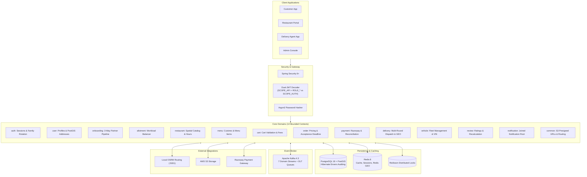

---

## Key Features & Domain Capabilities

### 1. Security, Identity & Stateful Sessions (`auth`)
* **Dual-JWT Token Architecture**: Asymmetric `RS256` (RSASSA-PKCS1-v1_5 using SHA-256) tokens separating business API access (`aud: quickbite-api`, `type: access`, 15m) from session challenge tasks (`aud: quickbite-auth`, `type: session-limit`, 5m).
* **Client-Aware Hybrid Refresh Token Transport (`X-Client-Type`)**:
  - **`WEB_BROWSER` (`web_browser`)**: Refresh tokens are delivered exclusively via `HttpOnly`, `Secure`, `SameSite=Strict` cookies (`qb_refresh_token`) and stripped (`null`) from JSON bodies.
  - **`MOBILE_APP` (`mobile_app`)**: Refresh tokens are returned directly in the `AuthResponse` JSON payload and accepted via `RefreshRequest` JSON bodies for native Keychain/Keystore storage.
* **Generation-Tracked Token Families & Breach Detection**: Refresh tokens belong to a `RefreshTokenFamily` with monotonically increasing `generation` counters and SHA-256 hashes in PostgreSQL. Replaying an already-used token (`used_at != null`) outside the 2-second Redis grace window triggers an immediate `REQUIRES_NEW` breach revocation.
* **3-Step Session Concurrency Challenge**: Enforces 3 concurrent active sessions per user. Exceeding the limit returns `409 Conflict` with a 5-minute `challengeToken` to list (`GET /sessions`), evict (`DELETE /sessions/{id}`), and claim (`POST /claim-session`) a session slot.
* **Automated Stale Token Retention Cleanup**: Daily cron (`RefreshTokenCleanupScheduler`) purges used, expired, or revoked tokens older than 30 days while retaining recent history for breach detection.

### 2. Multi-Round Dispatch & Geospatial Tracking (`delivery`)
* **3-Round Concentric Dispatch**: Orders automatically expand across candidate pools:
  - **Round 1**: 3 km radius (2-minute window)
  - **Round 2**: 6 km radius (3-minute window)
  - **Round 3**: 10 km radius (5-minute window)
* **Driver Offer Timeout**: 45-second timer per candidate driver with automated failover to the next best driver.
* **Redis GEO Real-Time Tracking**: Drivers transmit live GPS coordinates stored in Redis using `GEOADD`. Proximity candidate searches execute in sub-millisecond time via `GEOSEARCH`.
* **Heartbeat & DB Sync**: Active drivers maintain a 60-second Redis heartbeat TTL. A background scheduler syncs coordinates into PostgreSQL every 30 seconds.
* **Fair Driver Assignment**: `FairNearestDeliveryAssignmentStrategy` optimizes for distance while preventing driver starvation.

### 3. Order Engine & Pricing Subsystem (`order`, `cart`)
* **2-Phase Non-Holding Checkout & Cooldown**: 5-second Redisson cooldown prevents duplicate submissions; isolated transactions ensure external routing and payment gateway HTTP calls never hold open DB connections.
* **Price-Drift Protection (`expectedTotal`)**: Validates checkout totals against real-time pricing and aborts with `409 Conflict` (`PriceChangedException`) if item prices or surge fees changed.
* **Chain-of-Responsibility Fee Calculation**: Calculates Base Fee (₹15), Distance Fee (₹8/km), Surge Fee, Platform Fee (₹5), and 5% GST with min (₹20) and max (₹80) bounds and a 5-minute Redis route cache.
* **Dual-Layer Distributed Timeouts (Redisson Delayed Queues + Reapers)**: Event-driven `RDelayedQueue` + atomic `BLPOP` workers (`OrderTimeoutConsumer`) enforce the **2-minute restaurant acceptance deadline (`PT2M`)** and **15-minute payment abandonment window**, backed by safety-net cron schedulers.

### 4. Payments, Webhooks & Automated Reconciliation (`payment`)
* **Strategy Pattern**: Pluggable strategies for online methods (`UPI`, `CARD`, `NET_BANKING`, `WALLET` via `OnlinePaymentStrategy`), `COD` (`CodPaymentStrategy`), and `StubOnlinePaymentStrategy`.
* **HMAC-SHA256 Signature Verification**: Cryptographic validation for both frontend checkout signatures and backend webhooks.
* **Multi-Attempt Reconciliation (`First-Success-Wins`)**: Reconciles all payment attempts on poll or retry, auto-refunding duplicate captures or late captures on abandoned/cancelled orders.
* **Automated Refunds & COD Lifecycle**: Event listeners automatically issue Razorpay refunds when paid online orders are cancelled, declined, or refunded post-delivery by an admin, while COD payments stay `PENDING` until doorstep delivery collection (cancelled directly if canceled pre-delivery, or marked `REFUNDED` if refunded post-delivery).

### 5. Multi-Tier Composite Routing Gateway (`common/routing`)
* **Tier 1 (OSRM)**: Local native high-performance OpenStreetMap routing machine on port `5001`.
* **Tier 2 (Mapbox)**: Cloud Directions API fallback.
* **Tier 3 (Haversine)**: Mathematical spherical distance fallback with 25 km/h urban velocity to ensure zero downtime.

### 6. Onboarding Pipelines & Workload-Balanced Allotment (`onboarding`, `allotment`)
* **3 Independent Pipelines**: Multi-step applications for **Restaurants**, **Delivery Agents**, and **Vehicles**.
* **Document & Image Management**: AWS S3 presigned PUT URLs for direct, bandwidth-efficient uploads of KYC documents and facade photos.
* **Automated Admin Allotment Engine**: `WorkloadBalancedAdminSelectionStrategy` distributes pending partner applications equally among administrators up to a maximum limit (`max-assignees = 4`).

### 7. Restaurant Catalog, Cuisines & Menu Items (`restaurant`, `menu`)
* **PostGIS Spatial Search**: Spatial `/nearby` queries filtering active restaurants within a radius (`ST_DWithin` / `ST_DistanceSphere`).
* **Menu Management**: Dietary classifications (`VEG`, `NON_VEG`, `VEGAN`), opening hours, image galleries, and instant availability toggles.
* **Cuisine Moderation**: Global cuisine catalog with partner request and admin approval flows.

### 8. Reviews & Rating Recalculation (`review`)
* **Verified Customer Feedback**: Reviews restricted to completed orders.
* **Event-Driven Rating Recalculation**: Submitting or deleting a review publishes a `ReviewChangedEvent` (handled via Spring `@EventListener`), automatically recalculating the restaurant's average rating and total review count and evicting cached summaries.

### 9. Joined-Inheritance Notification Center (`notification`)
* **Single Root Aggregate**: Joined-table inheritance (`Notification`) with specialized subclasses: `OrderNotification`, `PaymentNotification`, `RestaurantApplicationNotification`, `DeliveryAgentApplicationNotification`, `VehicleApplicationNotification`, `CuisineNotification`.
* **Multi-Channel Delivery**: In-app notifications, push notifications, and email delivery strategies.

---

## Technology Stack

| Layer | Technologies |
| :--- | :--- |
| **Backend Framework** | Spring Boot 4.1.0, Spring Security 6+, Spring Data JPA, Spring Kafka, Spring Validation |
| **Language & Runtime** | Java 25 (Temurin / GraalVM) |
| **Relational Database** | PostgreSQL 18.1 with PostGIS 3.4 & Hibernate Spatial |
| **Auditing & Lineage** | Hibernate Envers (`@Audited`) on core aggregates (`User`, `Restaurant`, `Order`, `Payment`, `DeliveryAgent`) |
| **In-Memory & Cache** | Redis 8.4-alpine, Redisson 4.7.0 (Distributed Locks & Delayed Queues), Redis GEO |
| **Event Streaming** | Apache Kafka 4.3.0 (KRaft mode) + Spring Kafka Dead Letter Topics (`.DLT`) |
| **Cloud Storage** | AWS SDK for Java v2 (S3 Presigned URLs) |
| **Routing Engines** | OSRM (Open Source Routing Machine), Mapbox Directions API, Haversine Math Fallback |
| **Payment Gateway** | Razorpay Java SDK 1.4.10 (UPI, NetBanking, Cards, Webhooks) |
| **Security & Tokens** | Nimbus JOSE+JWT (`RS256`), Argon2id Password Encoder, BouncyCastle, Yauaa (User-Agent Analyzer) |

---

## Role-Based Access Control (RBAC) Matrix

| URL Prefix | Primary Role | Required Authority | Description |
| :--- | :--- | :--- | :--- |
| `/api/v1/auth/register/**`, `/login` | Public | None | Authentication & multi-role registration |
| `/api/v1/cuisines`, `/restaurants/**` | Public | None | Restaurant catalog, menus, and reviews |
| `/api/v1/webhooks/**` | Public (Signature) | None | Razorpay webhook notifications |
| `/actuator/health`, `/actuator/info` | Public | None | Service liveness and readiness probes |
| `/api/v1/auth/sessions/**`, `/claim-session` | Challenged User | `SCOPE_AUTH` | Session challenge resolution & eviction |
| `/api/v1/files/upload-url` | Authenticated | `SCOPE_API` | Direct S3 presigned PUT URL generation |
| `/api/v1/customer/**` | Customer | `SCOPE_API` + `ROLE_CUSTOMER` | Cart, orders, delivery addresses, reviews |
| `/api/v1/restaurant-owner/**` | Partner | `SCOPE_API` + `ROLE_RESTAURANT_OWNER` | Restaurant info, menus, order kitchen queue |
| `/api/v1/delivery-agent/**` | Driver | `SCOPE_API` + `ROLE_DELIVERY_AGENT` | Availability, location ping, offers, pickup/delivery |
| `/api/v1/admin/**` | Administrator | `SCOPE_API` + `ROLE_ADMIN` | Allotments, approvals, refunds, user management |
| `/actuator/**` (all other) | Administrator | `SCOPE_API` + `ROLE_ADMIN` | Prometheus metrics and internal diagnostics |

---

## Quickstart

### 1. Clone & Configure Environment
```bash
git clone https://github.com/eshant52/quickbite-backend.git
cd quickbite-backend

# Setup local Docker Compose environment
cp .env.local.example .env.local

# Setup Spring Boot application environment
cp .env.example .env
```

### 2. Start Infrastructure Services
```bash
docker compose --env-file .env.local --profile full up -d
```
This spins up PostgreSQL (`:5430`), Redis (`:6377`), and Kafka (`:9092`).

### 3. Generate Cryptographic RSA Keys
```bash
mkdir -p src/main/resources/certs
openssl genrsa -out src/main/resources/certs/private.pem 2048
openssl rsa -in src/main/resources/certs/private.pem -pubout -out src/main/resources/certs/public.pem
```

### 4. Run the Application
```bash
./mvnw spring-boot:run
```

Verify service readiness:
```bash
curl http://localhost:8080/actuator/health
```

*Default Super Admin Credentials (auto-seeded on startup):*
* **Email**: `super.admin@quickbite.com`
* **Password**: `Admin@123`

### 5. Postman Workspace & Collection Import Setup

The repository provides ready-to-import Postman collections (`Customer Portal`, `Restaurant Owner Portal`, `Delivery Agent Portal`, `Admin Portal`) and environment files under [`postman/exports/`](./postman/exports).

To import and use the collections in Postman:

1. **Create a New Workspace**: Open Postman, click **Workspaces** &rarr; **Create Workspace**, and create a workspace named **"Quickbite Internal"** as shown below:

   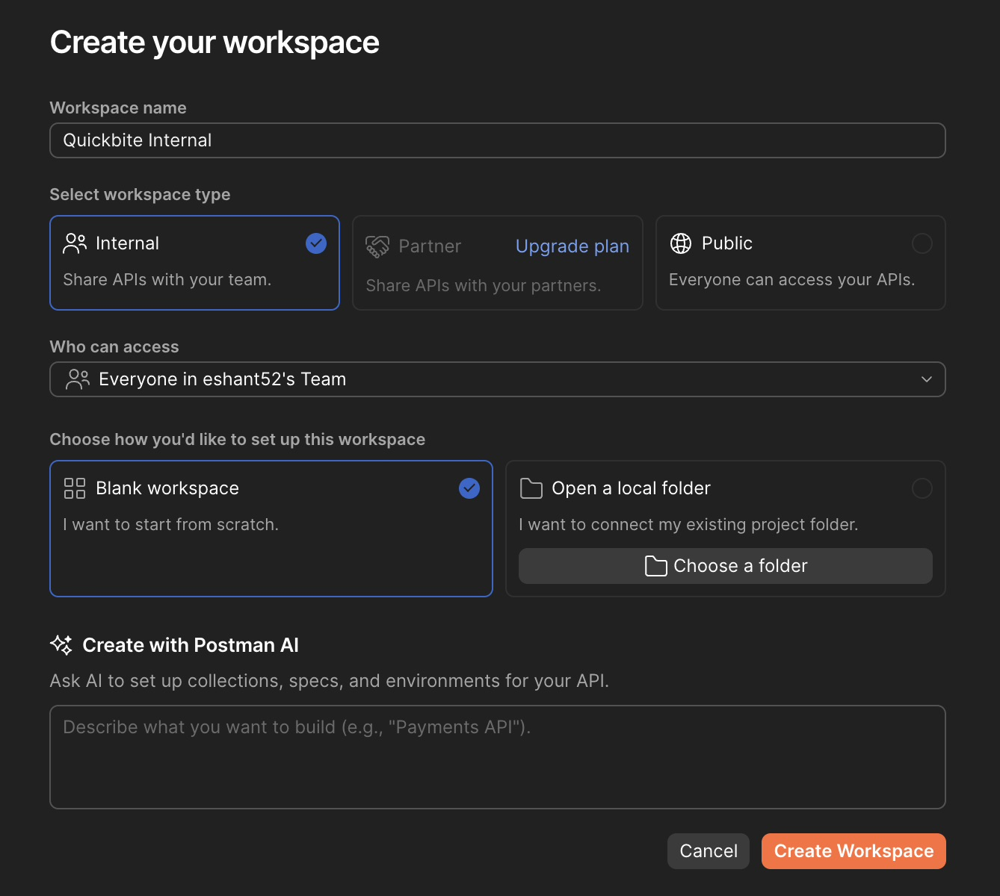

2. **Click Import**: Inside your new workspace, click the **Import** button in the top-left sidebar:

   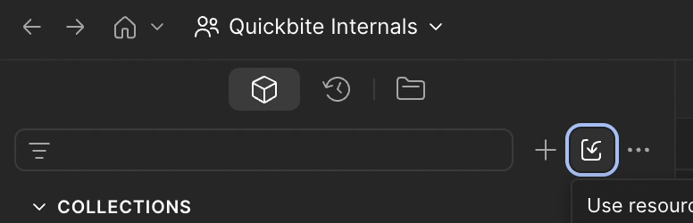

3. **Select `/postman/exports` Folder**: In the import dialog, click **Folders** and select the [`/postman/exports`](./postman/exports) folder from the project directory:

   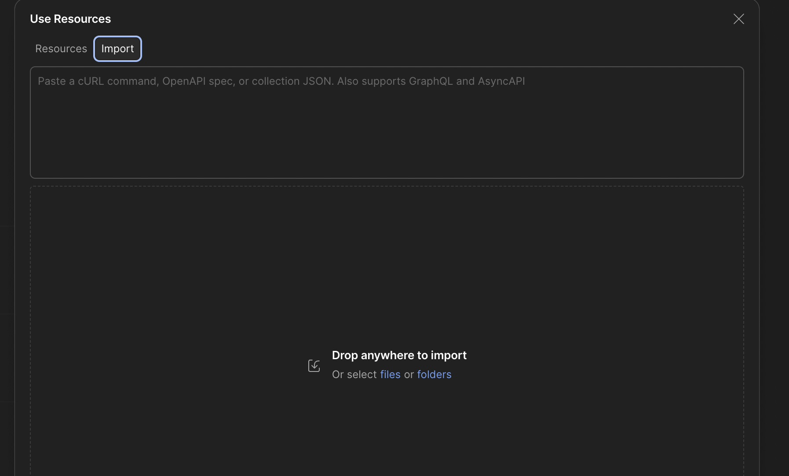

4. **Confirm & Import**: All 4 portal collections and the environment file (`Quickbite Local Dev`) will appear in the preview modal. Click **Import** — you can now immediately use the Postman API collections:

   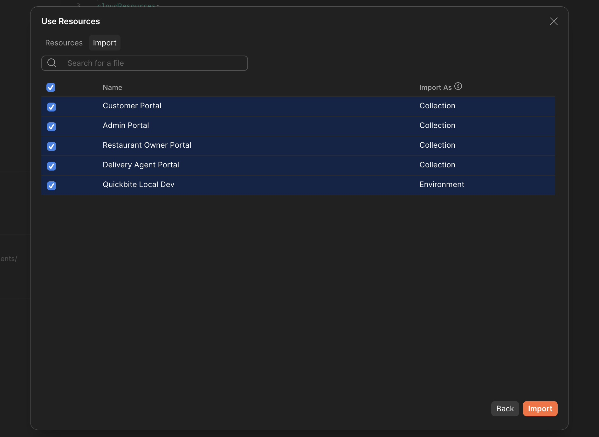

> [!TIP]
> For more details, comprehensive environment configuration, Docker setup, and routing engine options, look to the [Installation and Configuration Guide](./docs/installation.md). For detailed API endpoints, collection variables, and test scripts, see the [Postman Developer Guide](./postman/documents/QuickBite%20API%20%E2%80%94%20Developer%20Guide.md) and [REST API Catalog](./docs/api-guide.md).

---

## 🎬 End-to-End Demo Guide: Placing an Order & Delivery Offer Tracking

This step-by-step walkthrough demonstrates QuickBite's complete reactive order-to-delivery lifecycle:
1. **Automated Demo Data Seeder (`setup_demo_data.py`)**: 100% REST API-driven onboarding script that seeds **6 delivery agents** (with vehicles, KYC docs, admin approval, and live GPS), **6 restaurants across 6 diverse cuisines** (24 menu items total), and a **demo customer** with a default delivery address.
2. **Interactive Delivery Agent Offer Tracker CLI (`track_delivery_offers.py`)**: Logs in and tracks up to 10 delivery agents simultaneously, continuously pushes live Redis GEO heartbeats, polls `GET /api/v1/delivery-agent/offers/active`, and renders real-time offer cards with countdown timers.
3. **Postman / cURL API Flow**: Customer places an order, Restaurant Owner accepts the order within the 2-minute deadline (triggering 3-round parallel dispatch), and the Delivery Agent accepts the offer with single-key prompt (`1`).

---

### Step 0: Seed Complete Demo Data (Fresh Local or Deployed Backend)

Run [`scripts/setup_demo_data.py`](./scripts/setup_demo_data.py) once to register, onboard, and approve all demo accounts, vehicles, restaurants, cuisines, and menu items via QuickBite's official REST APIs (idempotent — safe to re-run at any time):

```bash
# Local backend (default: http://localhost:8080)
python3 scripts/setup_demo_data.py

# Or seed a deployed QuickBite backend URL (no direct DB access needed!)
python3 scripts/setup_demo_data.py --base-url https://api.your-domain.com
```

#### Seeded Restaurants & Cuisines (Password for all owners: `Password@123`)

| # | Restaurant Name | Cuisine | Owner Email | Sample Menu Items (4 per Restaurant) |
| :- | :--- | :--- | :--- | :--- |
| **1** | **Haldiram's Planet Food - Dharampeth** | North Indian & Sweets | `rakesh.agarwal@haldiramsnagpur.com` | Shahi Gulab Jamun, Kaju Katli, Royal Raj Kachori, Pindi Chole Bhature |
| **2** | **La Pino'z Woodfired Pizzeria - Sitabuldi** | Italian & Pizza | `marco.rossi@lapinoznagpur.com` | Classic Margherita Woodfired Pizza, Farmhouse Overload Pizza, Smoked Peri-Peri Paneer Pizza, Cheesy Garlic Breadsticks |
| **3** | **Burger Barn & Grill - Sadar** | Burgers & American | `jason.miller@burgerbarnnagpur.com` | Double Smash Cheese Burger, Crispy Fiery Peri-Peri Chicken Burger, Crunchy Paneer Zinger Burger, Loaded Cheesy Peri-Peri Fries |
| **4** | **Brewberrys Artisanal Cafe - Civil Lines** | Cafe & Bakery | `ananya.deshmukh@brewberryscafe.com` | Hazelnut Cold Frappe, Belgian Dark Chocolate Waffle, Grilled Pesto Panini Sandwich, Classic New York Baked Cheesecake |
| **5** | **Sip & Chill Beverage Lounge - Bajaj Nagar** | Beverages & Shakes | `kabir.mehta@sipandchill.com` | Alphonso Mango Thick Shake, Oreo Belgian Mudshake, Virgin Mojito Mint Cooler, Roasted Almond Kesar Badam Milk |
| **6** | **Dakshin Spice & Biryani House - Pratap Nagar** | South Indian & Biryani | `venkatesh.iyer@dakshinspice.com` | Hyderabadi Chicken Dum Biryani, Mysore Masala Dosa, Ghee Podi Thatte Idli, Traditional Kumbakonam Filter Kaapi |

> [!TIP]
> After running `setup_demo_data.py`, all generated UUIDs (`restaurantId`, `menuItemId`, `addressId`, `agentId`) are automatically saved to `scripts/demo_ids.json` and printed in a copy-paste summary table in your terminal.

---

### Step 1: Start the Interactive Delivery Agent Tracker CLI

In your terminal, launch the Python offer tracker ([`track_delivery_offers.py`](./scripts/track_delivery_offers.py)):

```bash
# Local backend (default: http://localhost:8080)
python3 scripts/track_delivery_offers.py --auto-available

# Or point to a deployed QuickBite backend URL (no direct DB access needed!)
python3 scripts/track_delivery_offers.py --base-url https://api.your-domain.com --auto-available
```

> [!NOTE]
> * **100% REST API-Driven**: Polls `GET /api/v1/delivery-agent/offers/active` for each logged-in agent — requires zero direct database connection (`psql` is not needed).
> * Pre-configured with 6 verified delivery agents in [`scripts/agents.json`](./scripts/agents.json) (`aarav.sharma@example.com`, `vikram.singh@example.com`, `pooja.patel@example.com`, `mohammed.rizwan@example.com`, `sneha.mukherjee@example.com`, `rajesh.kumar@example.com`, password `Password@123`).
> * Automatically refreshes 15-minute JWTs and resolves `409 Conflict` (session limits) by evicting only the single oldest session.
> * Sends `PUT /api/v1/delivery-agent/location` heartbeats every 35s to keep active agents alive in Redis GEO.
> * Queues multiple incoming offers in FIFO order so you can review each offer without missing others.

Leave this terminal running — it will alert you as soon as an offer is dispatched!

---

### Step 2: Authenticate in Postman (Customer & Restaurant Owner)

First, log in as the **Customer** (`Customer Portal` collection) and **Restaurant Owner** (`Restaurant Owner Portal` collection) in Postman via `Auth & Session Management → Login & Token Refresh → Login with Email & Password`.

> [!NOTE]
> * **Automatic Token & Session Capture**: When you call **Login with Email & Password** or **Refresh Access Token**, the Postman post-response script automatically sets `access_token`, `refresh_token`, `challenge_token`, and `session_id` in your **collection variables**.
> * **15-Minute Access Token Expiry**: `accessToken` expires in **15 minutes**. Whenever it expires, simply call the **Refresh Access Token** (`POST /api/v1/auth/refresh-token`) request provided in Postman to rotate and refresh your token automatically.
> * **Login & Session Challenge Screenshots**: Customer and Restaurant Owner login screenshots are omitted here for brevity — the complete login and **`409 Conflict` (`session_limit_exceeded`) device session challenge resolution flow** is shown step-by-step with screenshots in **[Step 7](#step-7-delivery-agent-login-session-challenge--order-delivery)** when logging in as the Delivery Agent.

#### 2.1 Customer Login (`Customer Portal`)
* **Endpoint**: `POST http://localhost:8080/api/v1/auth/login`
* **Body**:
  ```json
  {
    "email": "eshantsonune52@gmail.com",
    "password": "Password@123"
  }
  ```

#### 2.2 Restaurant Owner Login (`Restaurant Owner Portal`)
* **Endpoint**: `POST http://localhost:8080/api/v1/auth/login`
* **Body**:
  ```json
  {
    "email": "rakesh.agarwal@haldiramsnagpur.com",
    "password": "Password@123"
  }
  ```

---

### Step 3: Add Menu Item to Cart & Preview Checkout (Customer)

#### 3.1 Add Items to Cart
In the **Customer Portal** collection, open `Shopping Cart → Add Item to Cart` (`POST /api/v1/customer/cart/items`) and add items to your cart as a customer:

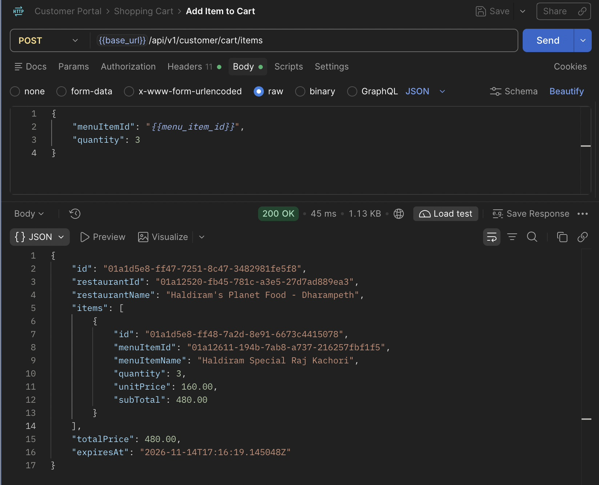

#### 3.2 Get Checkout Preview (Auto-Sets `total_order_amount`)
Call `Shopping Cart → Get Checkout Preview` (`GET /api/v1/customer/cart/checkout-preview?addressId={{address_id}}&tipAmount={{tip_amount}}`). The Postman test script automatically saves `priceBreakdown.totalAmount` into the `total_order_amount` collection variable so you don't need to copy-paste the final price manually:

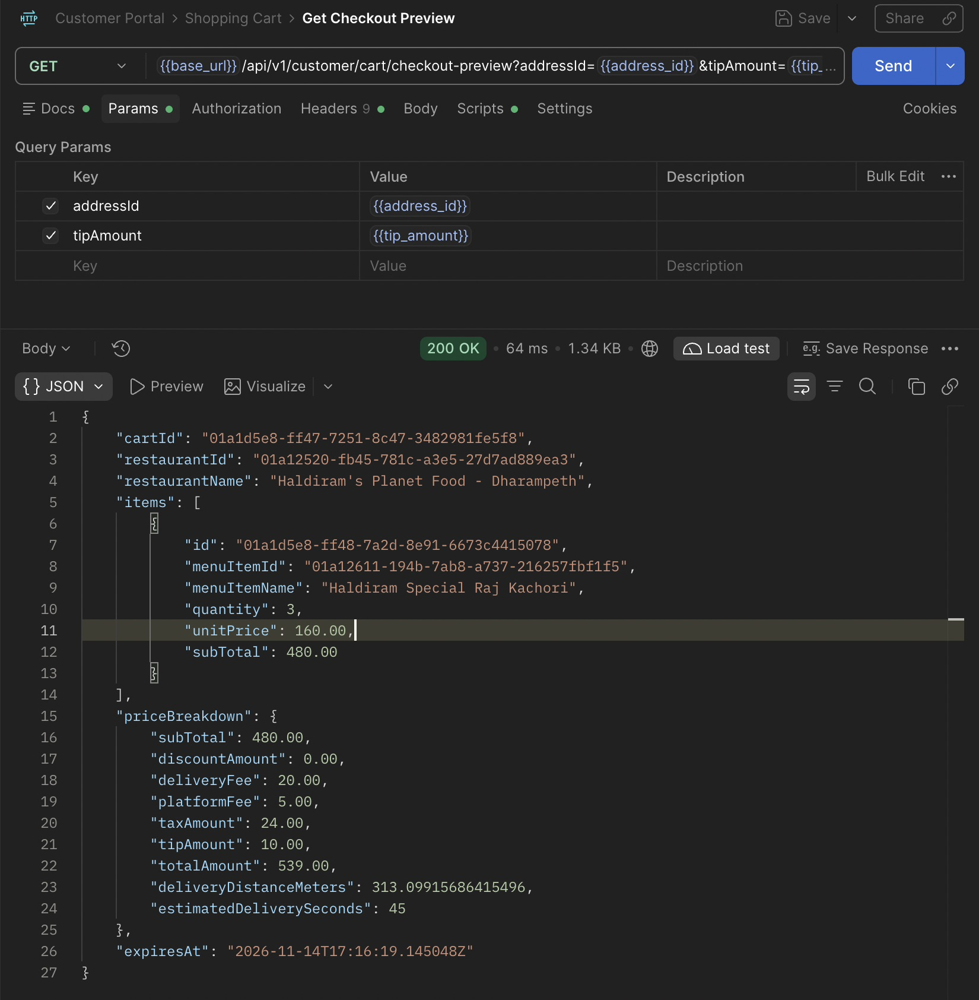

---

### Step 4: Place Order — Cash on Delivery (COD) or Online Payment (Razorpay)

> [!IMPORTANT]
> Make sure `address_id` and `tip_amount` are configured in your **Customer Portal** collection/environment variables before placing an order.

You can place an order using either **Option A (Cash on Delivery)** for instant placement, or **Option B (Online Payment via Razorpay)** to test the full gateway checkout and signature verification lifecycle.

#### Option A: Place Cash on Delivery (`COD`) Order
Open `Order Placement & Tracking → Place Order from Cart` (`POST /api/v1/customer/orders`) with `"paymentMethod": "COD"`. For COD, the order immediately transitions to `PLACED` while the COD payment remains `PENDING` until doorstep cash collection:

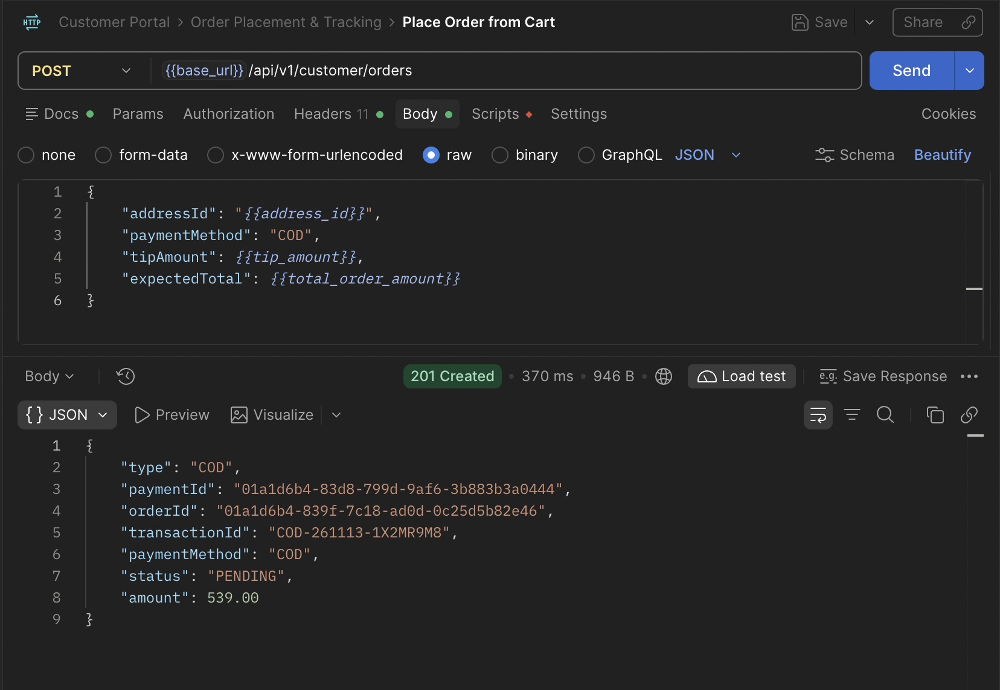

---

#### Option B: Place Online Order (`UPI` / `NET_BANKING`) & Complete Razorpay Checkout

1. **Place Online Order (`UPI` or `NET_BANKING`)**:
   In `Place Order from Cart`, change `paymentMethod` from `COD` to `UPI` or `NET_BANKING` and send the request. The order is created in `AWAITING_PAYMENT` status and returns a Razorpay gateway order payload:

   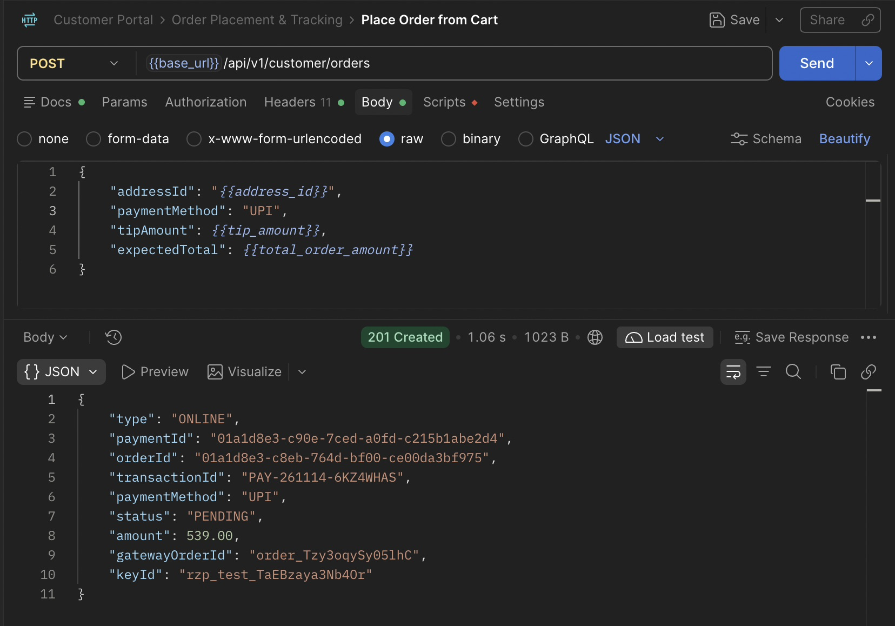

2. **Copy Placed Order Response JSON**:
   Copy the entire JSON response returned from placing the online order:

   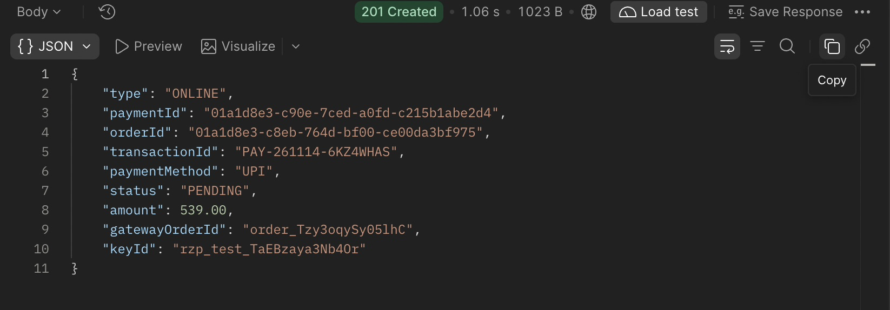

3. **Paste JSON into Local Checkout Page**:
   Open `http://localhost:8080/checkout.html` in your browser, paste the copied JSON response data, and click **Next** to review the payment details:

   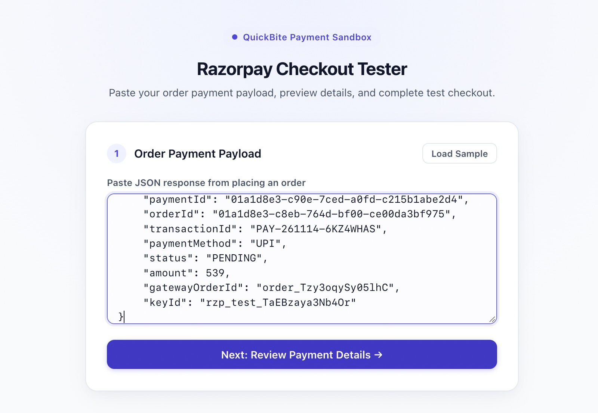

4. **Preview Payment Details & Launch Razorpay**:
   Review the parsed order and payment breakdown on the preview screen, then click **Pay Now with Razorpay**:

   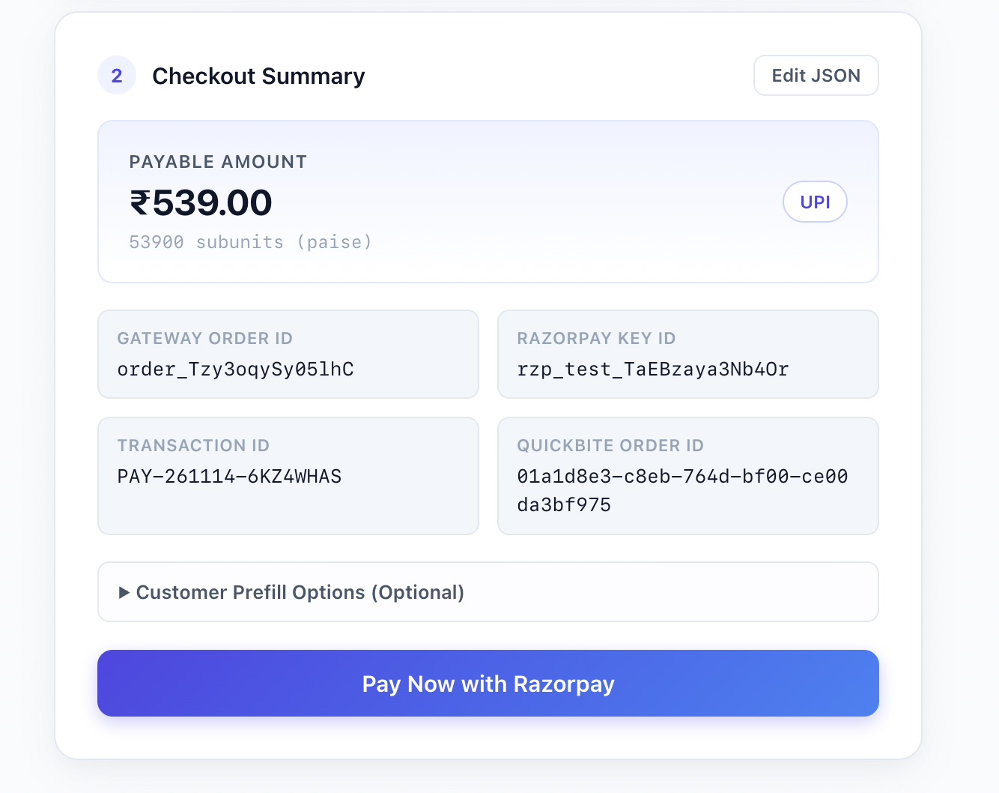

5. **Select Netbanking in Razorpay Checkout Popup**:
   In the Razorpay checkout popup, enter the required contact information, select **Netbanking**, and choose any bank for the demo *(note: UPI will not work in the local demo popup)*:

   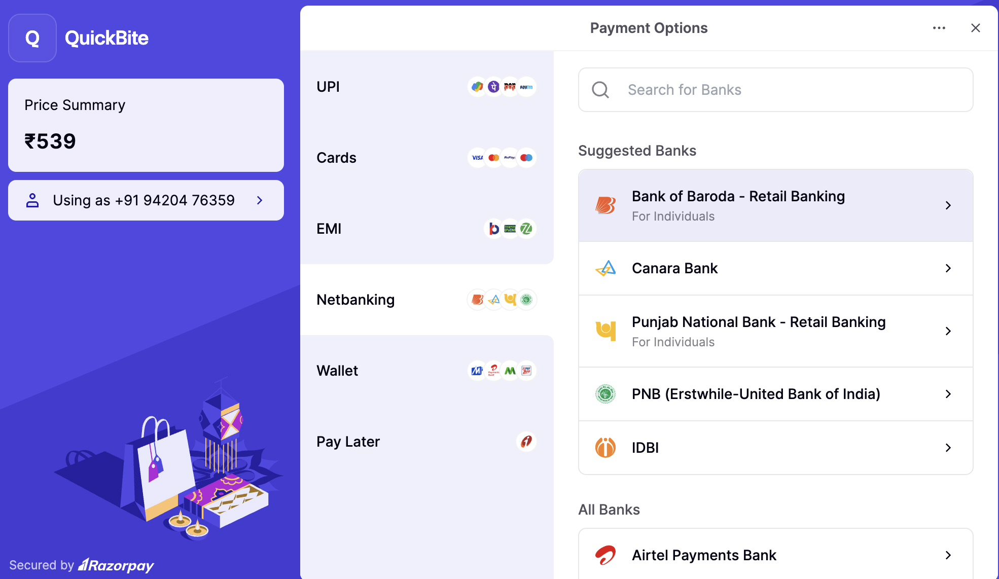

6. **Simulate Payment Success**:
   On the Razorpay mock bank verification page, click the **Success** button:

   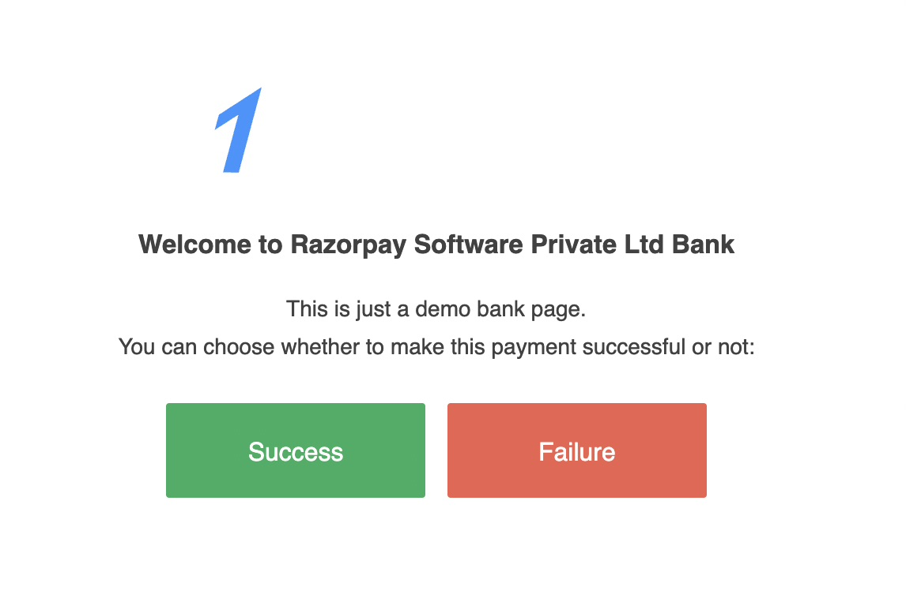

7. **Razorpay Payment Transition**:
   Wait a moment while Razorpay completes the payment transition callback:

   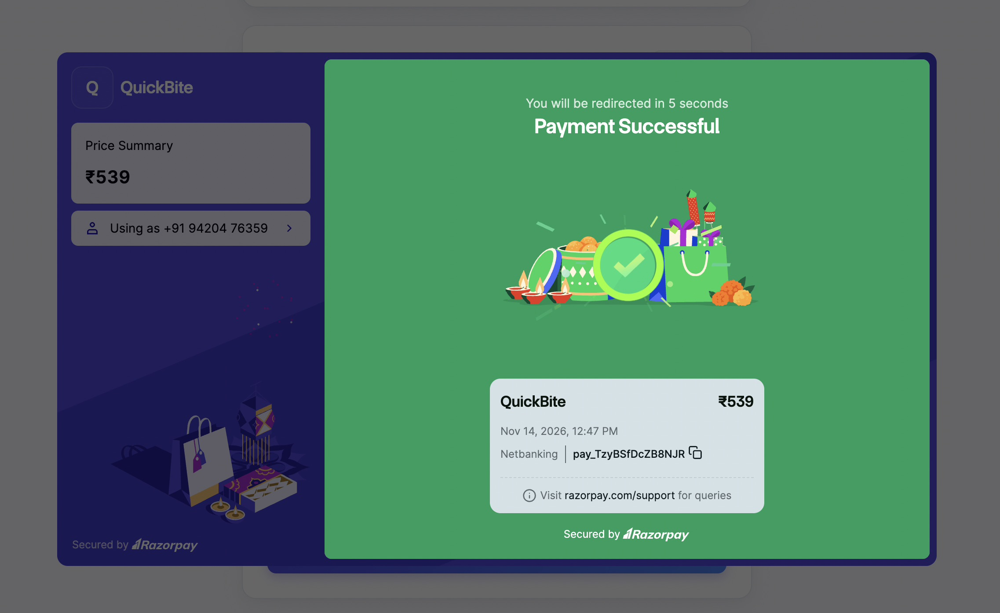

8. **Copy Online Payment Result JSON**:
   Once payment succeeds, `checkout.html` displays the cryptographic payment result (`gatewayOrderId`, `gatewayPaymentId`, `gatewaySignature`). Copy the JSON data:

   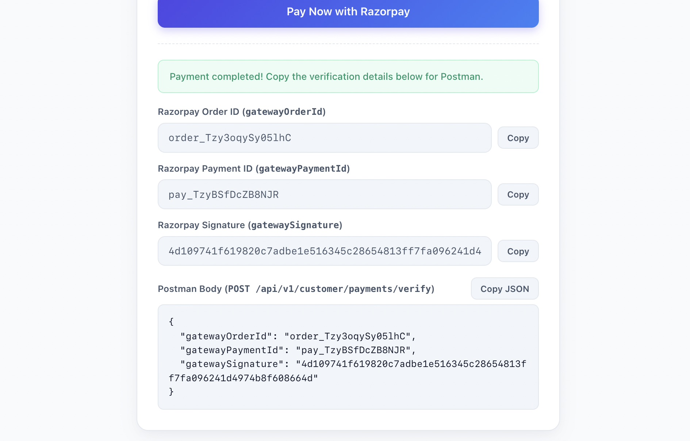

9. **Verify Online Payment in Postman**:
   Open `Online Payment Verification → Verify Online Payment Signature` (`POST /api/v1/customer/payments/verify`) in Postman, paste the payment result JSON into the request body, and send it to verify the payment and transition the order to `PLACED`:

   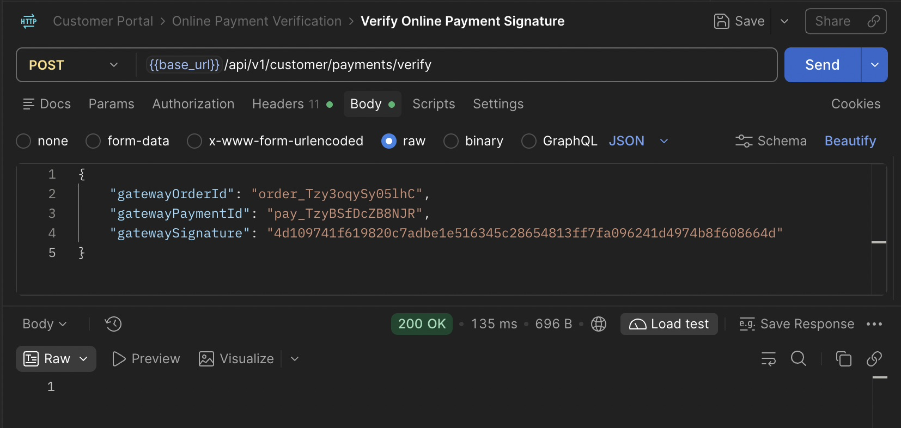

---

### Step 5: Restaurant Owner Accepts & Prepares Order (Triggers Dispatch)

#### 5.1 Restaurant Accepts Incoming Order
Once the order is in `PLACED` status (either via `COD` or verified online payment), switch to the **Restaurant Owner Portal** collection (`Kitchen Order Fulfillment → Accept Incoming Order`, `POST /api/v1/restaurant-owner/orders/{{order_id}}/accept?restaurantId={{restaurant_id}}`) and accept the incoming order within the 2-minute acceptance deadline. This transitions the order to `ACCEPTED` and triggers asynchronous radial delivery dispatch:

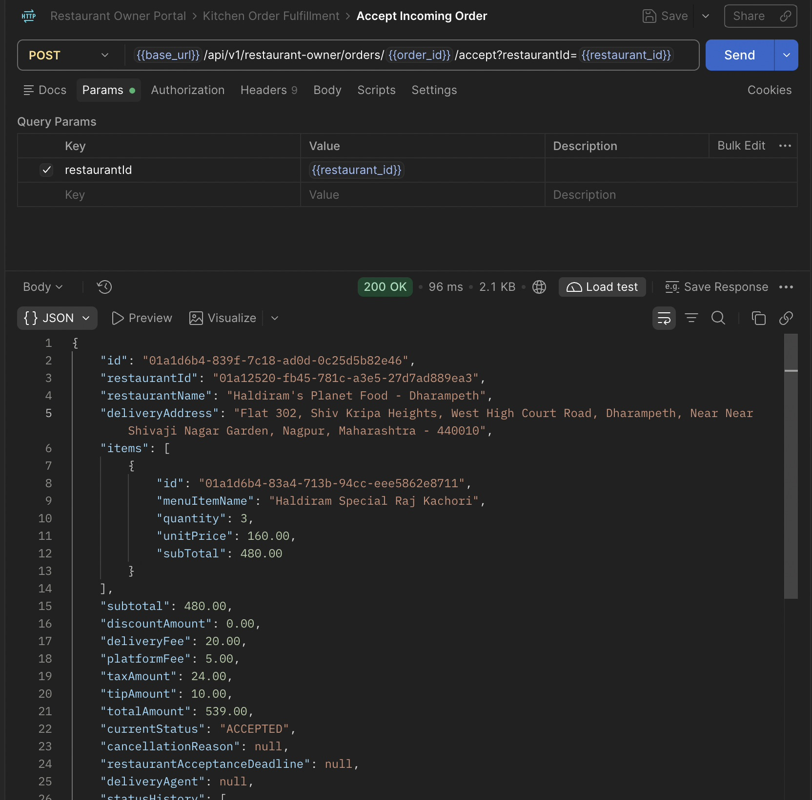

#### 5.2 Restaurant Marks Order as Preparing
Next, call `Kitchen Order Fulfillment → Mark Order as Preparing` (`POST /api/v1/restaurant-owner/orders/{{order_id}}/mark-preparing?restaurantId={{restaurant_id}}`) to transition the order to `PREPARING`:

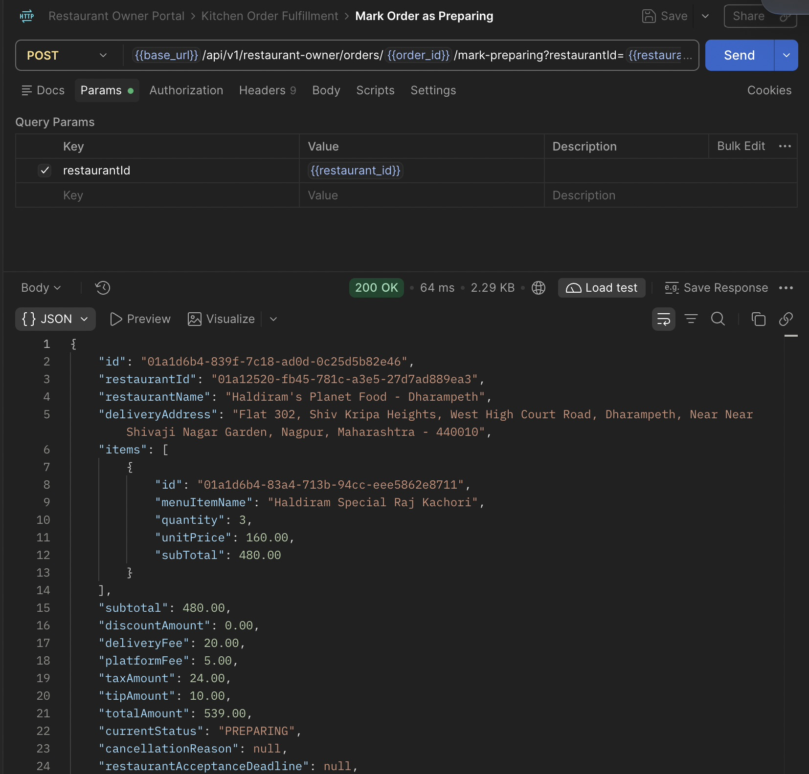

---

### Step 6: Accept Dispatch Offer in Python CLI & Mark Order Ready

#### 6.1 Inspect Incoming Offer in the Delivery Tracker CLI
Switch to the terminal running [`track_delivery_offers.py`](./scripts/track_delivery_offers.py). The live delivery offer card appears automatically for the nearest logged-in delivery agent with full allotment, restaurant pickup, customer drop-off, distance, and payout details:

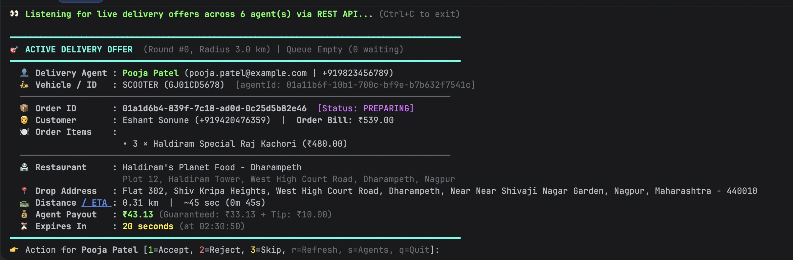

#### 6.2 Accept the Offer & Copy Delivery Agent Email
Enter `1` in the terminal prompt to accept the incoming delivery offer, and **copy the email address** of the assigned delivery agent shown in the terminal output:

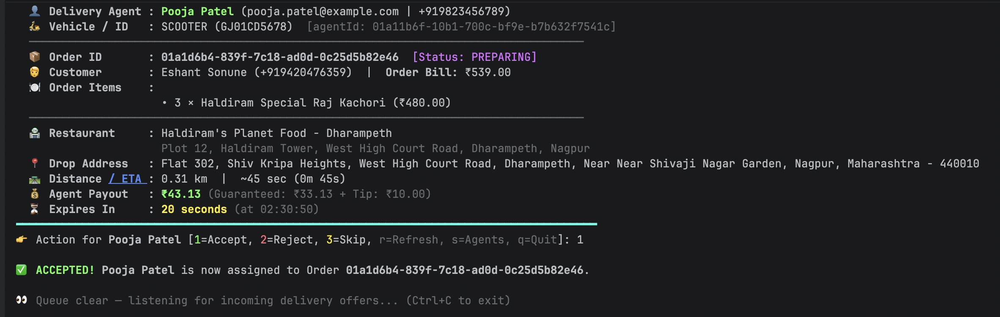

#### 6.3 Restaurant Marks Order Ready for Pickup
Back in the **Restaurant Owner Portal** collection, call `Kitchen Order Fulfillment → Mark Order Ready for Pickup` (`POST /api/v1/restaurant-owner/orders/{{order_id}}/mark-ready?restaurantId={{restaurant_id}}`) to advance the order to `READY_FOR_PICKUP`:

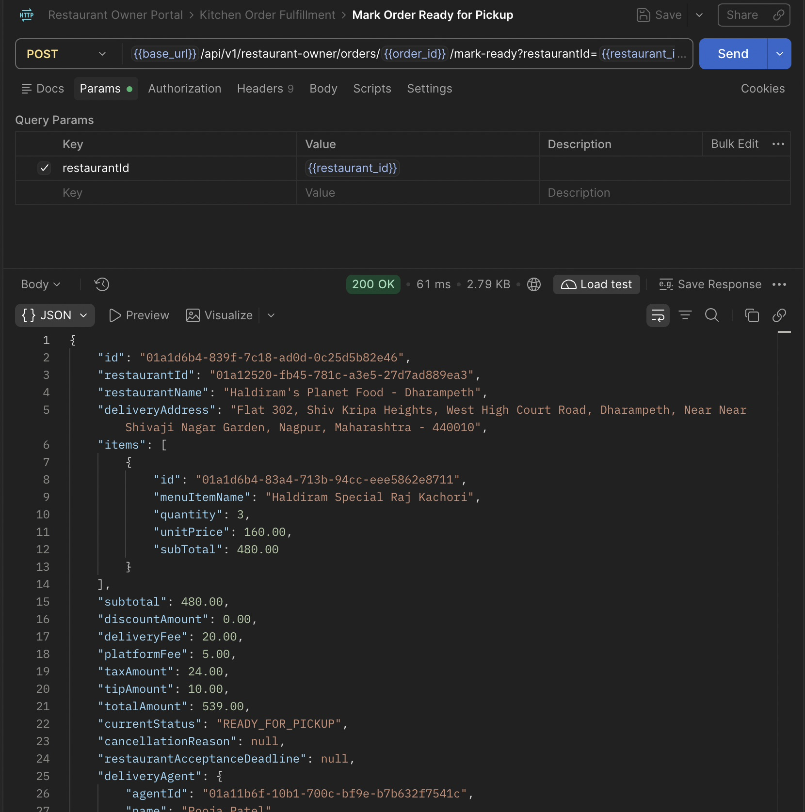

---

### Step 7: Delivery Agent Login, Session Challenge & Order Delivery

Now switch to the **Delivery Agent Portal** collection in Postman to log in as the assigned courier, resolve a concurrent device session challenge (`409 Conflict`) if needed, and complete the pickup and delivery.

#### 7.1 Login as Assigned Delivery Agent (`409 Conflict` Session Limit Challenge)
Open `Auth & Session Management → Login & Token Refresh → Login with Email & Password`, paste the assigned delivery agent's email address (the password remains `Password@123`), and send the request.
* If the agent has reached the maximum concurrent device session limit, the server returns **`409 Conflict`** with `"error": "session_limit_exceeded"`.
* The Postman test script **automatically captures `challengeToken`** into the `challenge_token` collection variable — simply proceed to **7.2** below to evict an old session and claim the login:

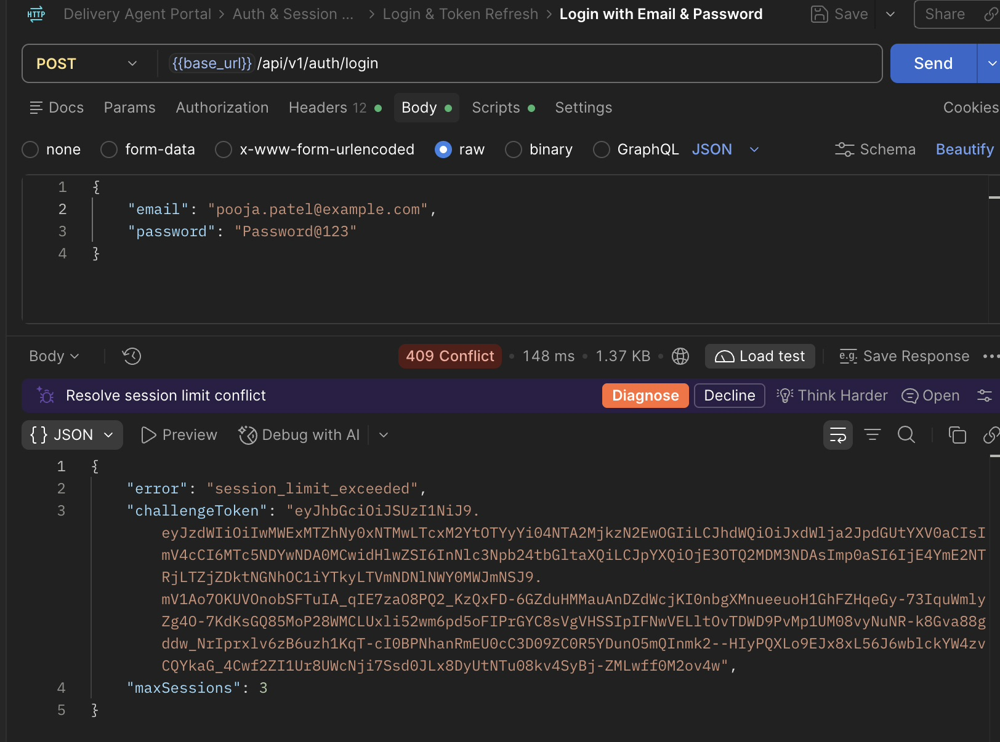

#### 7.2 List Active Device Sessions
Open `Auth & Session Management → Device Session Management → List Active Device Sessions` (`GET /api/v1/auth/sessions`, which automatically uses `Bearer {{challenge_token}}`). Send the request and **copy the first `sessionId`** from the response list:

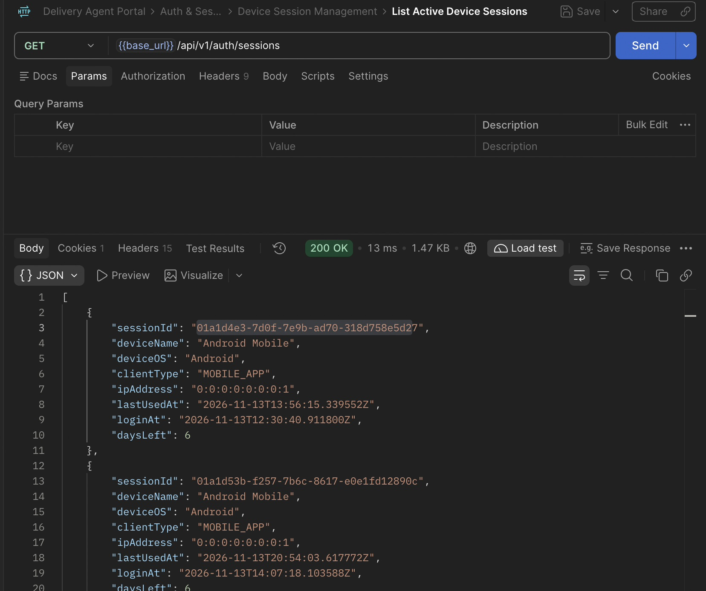

#### 7.3 Revoke an Existing Device Session
Open `Device Session Management → Revoke Device Session` (`DELETE /api/v1/auth/sessions/{{session_id}}`), paste the copied `sessionId` into the URL/variable as shown, and send the request (`204 No Content`) to free a session slot:

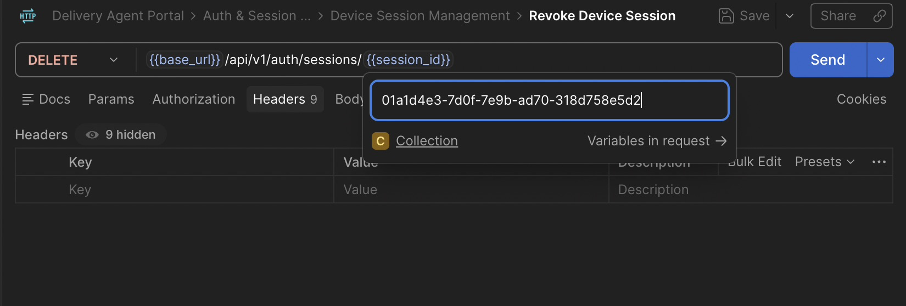

#### 7.4 Claim Challenged Session
Open `Device Session Management → Claim Challenged Session` (`POST /api/v1/auth/claim-session`) and send the request. Your new device session is now active and the Postman test script automatically saves your fresh `access_token` and `refresh_token` into the collection variables:

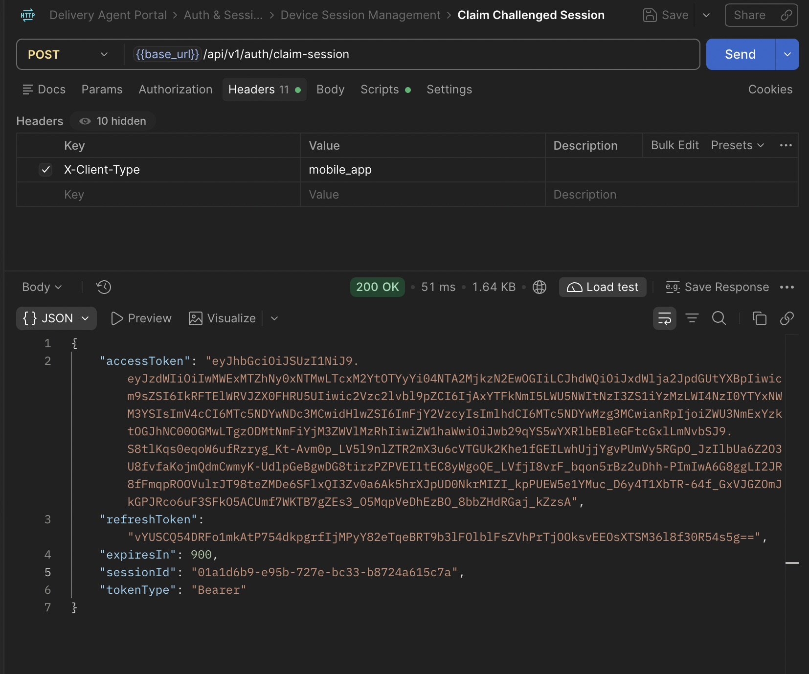

#### 7.5 Set `order_id` in Delivery Agent Collection Variables
Open the **Delivery Agent Portal** collection variables tab and paste the active `order_id`:

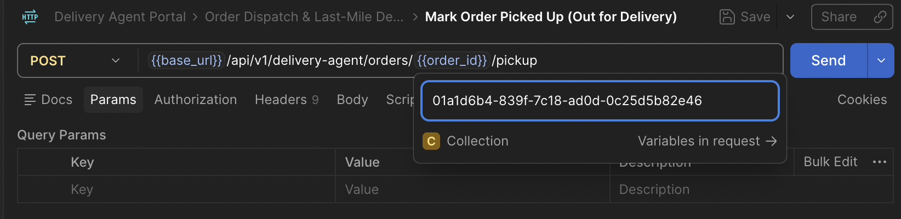

#### 7.6 Mark Order Picked Up (`OUT_FOR_DELIVERY`)
Call `Order Dispatch & Last-Mile Delivery → Mark Order Picked Up (Out for Delivery)` (`POST /api/v1/delivery-agent/orders/{{order_id}}/pickup`). This confirms restaurant package handoff and transitions the order to `OUT_FOR_DELIVERY`:

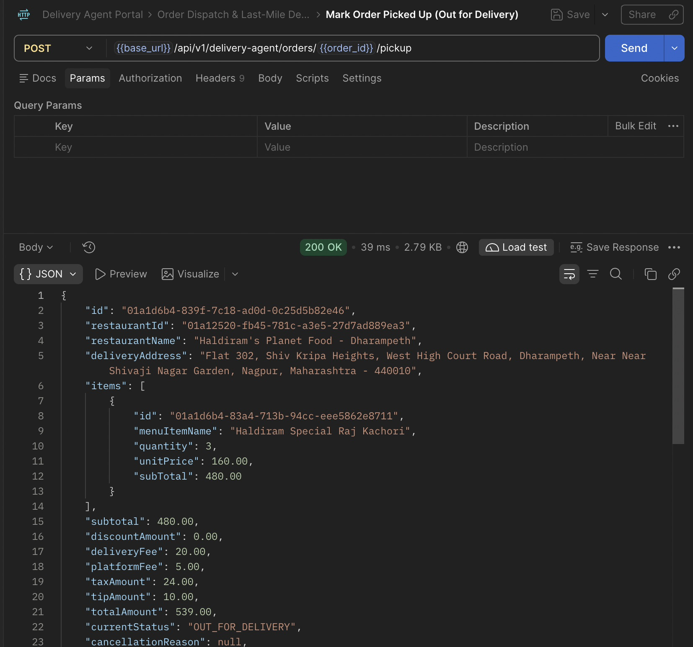

#### 7.7 Mark Order Delivered (`DELIVERED`)
Finally, call `Order Dispatch & Last-Mile Delivery → Mark Order Delivered` (`POST /api/v1/delivery-agent/orders/{{order_id}}/delivered`) to confirm customer handoff. The order is now in its terminal `DELIVERED` state (and for COD orders, the `PENDING` payment transitions synchronously to `SUCCESS` upon delivery)! 🎉

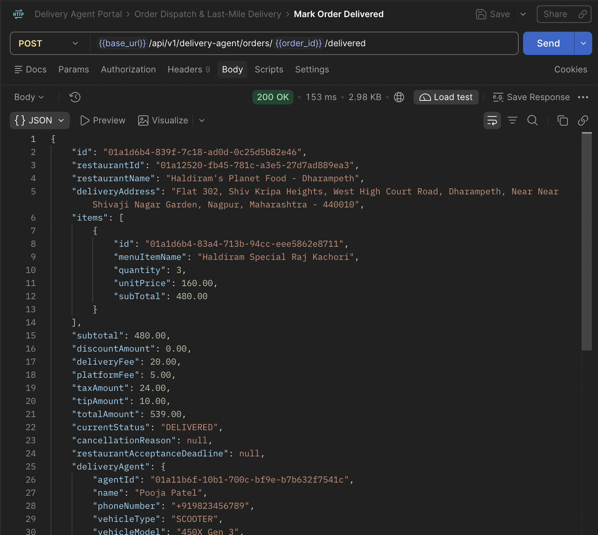

---

## Documentation Directory

For in-depth architectural guides and developer specifications, consult the [`docs/`](docs/) directory:

* [**Documentation Hub (`docs/README.md`)**](docs/README.md) — Complete documentation index.
* [**System Architecture & Domain Design (`docs/architecture.md`)**](docs/architecture.md) — Event choreography, state machines, and concurrency patterns.
* [**Order & Cart Lifecycle Guide (`docs/order-process.md`)**](docs/order-process.md) — End-to-end cart, pricing chain, price-drift check, Redisson delayed queues, and fulfillment flow.
* [**REST API Reference & Security Matrix (`docs/api-guide.md`)**](docs/api-guide.md) — Comprehensive guide to all 35+ REST controllers.
* [**Dispatch Engine & Geospatial Routing (`docs/dispatch-and-routing.md`)**](docs/dispatch-and-routing.md) — Concentric dispatch, Redis GEO, and OSRM routing.
* [**Payments & Automated Reconciliation (`docs/payments-and-reconciliation.md`)**](docs/payments-and-reconciliation.md) — Razorpay integration, webhooks, and multi-attempt reconciliation.
* [**Installation & Environment Setup (`docs/installation.md`)**](docs/installation.md) — Detailed deployment and setup instructions.
* [**Client JWT & Session Integration Guide (`docs/jwt.md`)**](docs/jwt.md) — Guide for frontend and mobile client authentication.
* [**Authentication & Session Architecture (`docs/authentication.md`)**](docs/authentication.md) — Deep dive into dual tokens and family rotation.

---

## Project Status & Milestone Checklist

- [x] **Core Architecture & Framework Setup** (Spring Boot 4.1.0 on Java 25, Flyway V1–V35, Envers Auditing)
- [x] **Dual-JWT & Stateful Session Engine** (Self-issued `RS256`, Refresh Token Family Rotation, 409 Session Challenge)
- [x] **PostgreSQL & Spatial Foundation** (PostGIS 18.1, JTS geometries, GiST indexing, spatial `/nearby` search with multi-criteria filtering)
- [x] **Redis & Distributed Concurrency** (Redisson locks for orders/payments/dispatch, Redis GEO real-time driver tracking)
- [x] **Kafka Event-Driven Messaging** (7 aggregate event streams, Jackson inferred polymorphic conversion, `.DLT` error handling)
- [x] **Multi-Step Onboarding & Allotment** (Restaurant, Driver, and Vehicle pipelines with Workload-Balanced Admin Allotment)
- [x] **Cart & Order Management** (Single-restaurant auto-clearing carts, dynamic fee engine, 2-minute kitchen acceptance deadline, delivered earnings analytics, actor-attributed status audit trail)
- [x] **Multi-Round Dispatch Subsystem** (3km/6km/10km expanding rounds, 45s driver offer timeout, fair assignment)
- [x] **Payment Processing & Webhooks** (Razorpay gateway, COD/Online strategies, HMAC-SHA256 verification, auto-reconciliation)
- [x] **Multi-Tier Routing Gateway** (Local native OSRM on port 5001 + Mapbox fallback + Haversine fallback)
- [x] **AWS S3 File Storage** (Presigned PUT URLs for direct client uploads with 10-minute expiry)
- [x] **Reviews & Automatic Ratings** (Kafka-driven restaurant rating and review count recalculation)
- [x] **Comprehensive Test Suite** (102 test classes / 574 tests across all domains covering unit, controller, and integration flows)
- [ ] WebSocket / SSE live order tracking updates for customer frontend
- [ ] Push notification gateway integration (Firebase Cloud Messaging / Apple APNs)
- [ ] Multi-region MSK Kafka deployment configuration