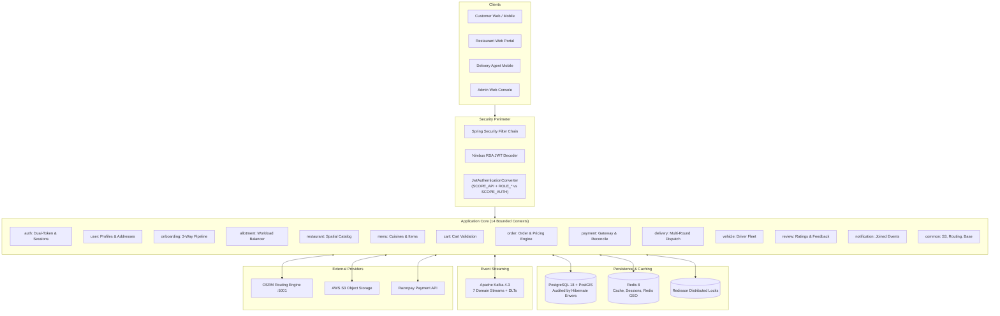
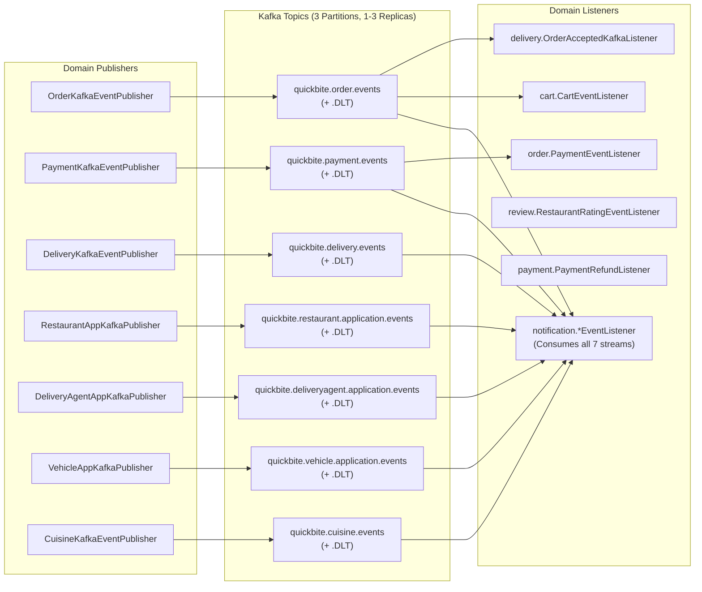
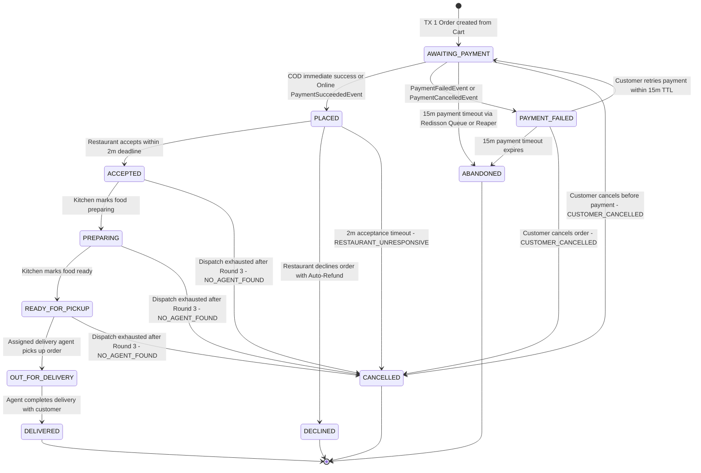
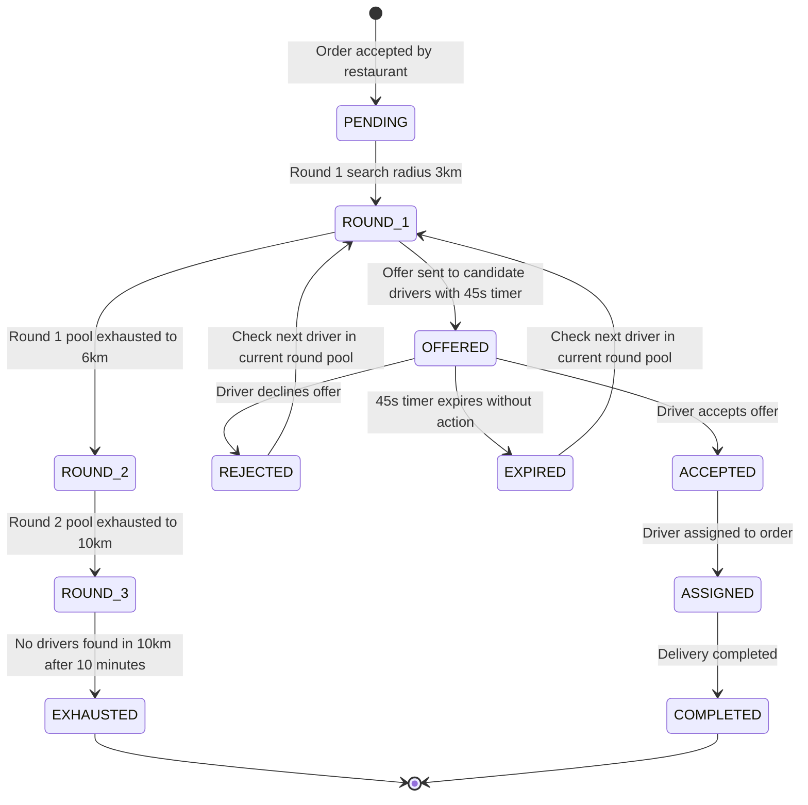
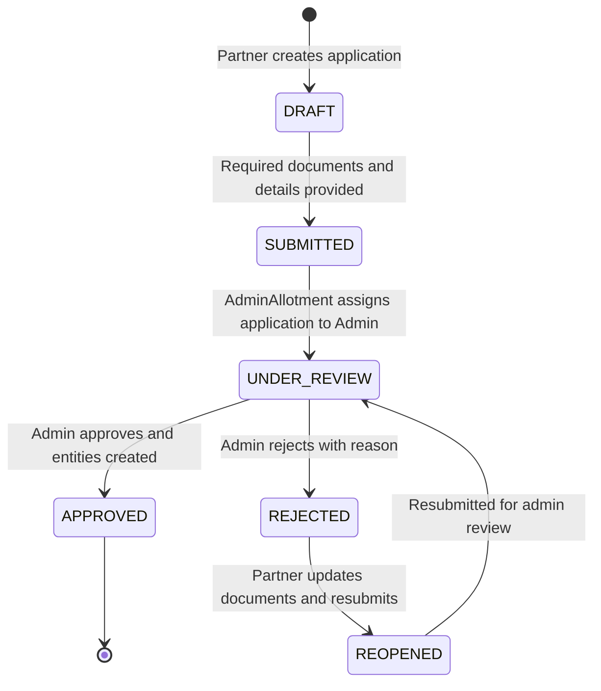
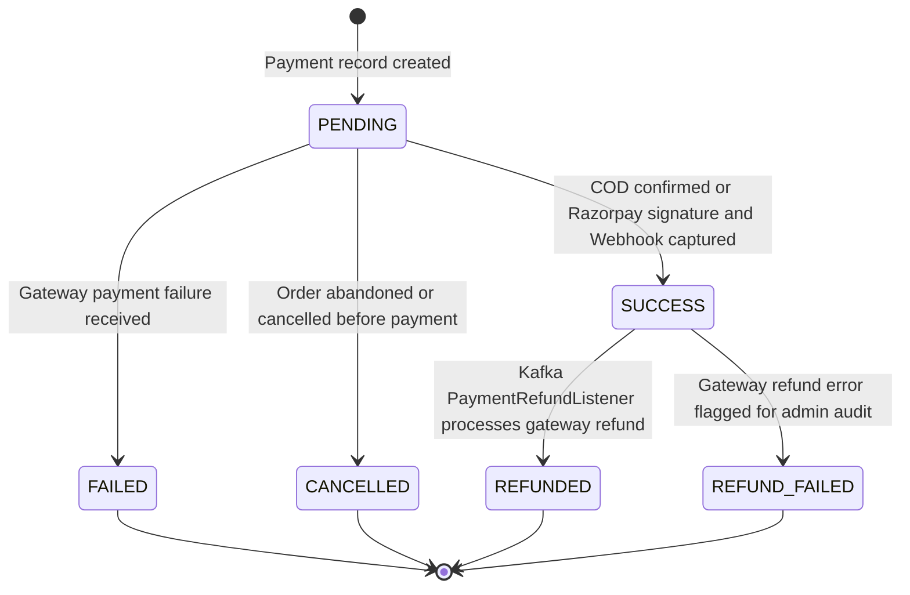

# QuickBite System Architecture & Domain Design

This document provides a comprehensive architectural breakdown of the QuickBite backend platform, detailing its Domain-Driven Vertical Slice architecture, event-driven messaging topology, core state machines, and concurrency control models.

---

## 1. System Overview & Technology Stack

QuickBite is an enterprise-grade food ordering, restaurant management, and hyper-local delivery platform built with a modular, domain-driven vertical slice structure.



### Core Technology Stack

| Component | Technology | Version | Purpose |
| :--- | :--- | :--- | :--- |
| **Runtime & Language** | Java | 25 | Latest enterprise JVM with virtual threads & pattern matching |
| **Framework** | Spring Boot | 4.1.0 | Core microservice framework (Spring Data, WebMVC, Security) |
| **Primary Database** | PostgreSQL + PostGIS | 18.1 / 3.4 | Authoritative relational storage with native geospatial capabilities |
| **Auditing** | Hibernate Envers | Bundled | Historical audit trails on key aggregates (`User`, `Restaurant`, `Order`, `Payment`, `DeliveryAgent`) |
| **Cache & In-Memory** | Redis | 8.4-alpine | Session TTLs, token rotation grace windows, and real-time geospatial driver tracking |
| **Distributed Locks** | Redisson | 4.7.0 | Distributed concurrency locks (`RLock`) for critical transactions |
| **Event Broker** | Apache Kafka | 4.3.0 | Asynchronous domain event streaming with Dead Letter Queues (`.DLT`) |
| **File Storage** | AWS S3 SDK | 2.31.0 | S3 presigned PUT URLs for direct client document/image uploads |
| **Routing Engine** | OSRM / Mapbox | Native / Cloud | Multi-tier routing gateway for street-level travel distances and driving duration |
| **Payment Gateway** | Razorpay SDK | 1.4.10 | Multi-method payments (UPI, Cards, NetBanking, COD) and webhook processing |

---

## 2. Domain-Driven Vertical Slice Architecture

QuickBite is strictly structured as **independent bounded contexts** located within `com.quickbite.quickbite.<domain>`.

### Package Architecture Rules
1. **Vertical Isolation**: Each domain owns its `controller/`, `service/`, `dto/`, `model/`, `repository/`, and `exception/` packages.
2. **Zero Entity Leakage**: Entities are private to their domain. Controllers never serialize JPA entities directly; all requests and responses use immutable Java `record` DTOs.
3. **Cross-Domain Communication**:
   - Asynchronous communication is preferred via **Kafka domain events**.
   - Synchronous interactions between domains are mediated through dedicated integration services or shared DTOs defined in `common/`.
   - Domains **never** import another domain's internal JPA repositories or mutate another domain's entities directly.
4. **Data Inheritance**: All database entities extend `common.model.Base`, which provides time-ordered **UUIDv7** primary keys, `createdAt`, and `updatedAt` audit timestamps.

```
com.quickbite.quickbite.<domain>/
├── controller/          # REST controllers — thin, HTTP status codes, delegation
├── dto/                 # Request & Response records (immutable data contracts)
├── exception/           # Domain-specific runtime exceptions
├── model/               # JPA entities, Hibernate spatial types, and PostgreSQL enums
├── repository/          # Spring Data JPA repositories
├── service/             # Business logic interfaces and implementations
│   └── strategy/        # Strategy pattern implementations (e.g., assignment, payment)
└── util/                # Domain-specific helpers and mappers
```

---

## 3. Event-Driven Architecture with Apache Kafka

Asynchronous decoupling across bounded contexts is implemented using **Apache Kafka**. Domain publishers emit strongly-typed event DTOs, and independent listener services consume events with idempotent processing and retry mechanisms.

### Kafka Topic Topology & Consumer Mapping

The system declares **7 primary aggregate streams** alongside automated Dead Letter Topics (`.DLT`):



### Poison-Pill Resilience & Dead Letter Strategy
- **Error Handler**: Configured via `DefaultErrorHandler` with `FixedBackOff(1_000L, 3)`.
- **Dead Letter Recovery**: Messages failing after 3 consecutive retry attempts are automatically rerouted to `<topic>.DLT` via Spring Kafka's `DeadLetterPublishingRecoverer`.
- **Polymorphic Serialization**: `RecordMessageConverter` uses `StringJacksonJsonMessageConverter` with Jackson `INFERRED` type mapping so consumers receive typed Java DTOs directly without boilerplate parsing.

---

## 4. Core Domain State Machines

### 4.1 Order State Machine (`OrderStatus`)

The complete order lifecycle encompasses price-drift-protected checkout (`AWAITING_PAYMENT`), payment verification (`PLACED`), 2-minute restaurant acceptance (`ACCEPTED`), food preparation (`PREPARING`, `READY_FOR_PICKUP`), multi-round delivery dispatch, and delivery confirmation (`DELIVERED`).



### 4.2 Delivery Dispatch & Offer State Machine (`DeliveryDispatchStatus`, `DeliveryOfferStatus`)

Orders requiring delivery trigger the automated multi-round dispatch engine upon restaurant acceptance (`OrderStatus.ACCEPTED`).



### 4.3 Onboarding Application State Machine (`ApplicationStatus`)

Applies to Restaurant Applications, Delivery Agent Applications, and Vehicle Applications.



### 4.4 Payment State Machine (`PaymentStatus`)



---

## 5. Distributed Concurrency, Locking & Data Consistency

### 5.1 Redisson Distributed Locks (`RLock`) & Delayed Queues (`RDelayedQueue`)
Distributed coordination across nodes is powered by Redisson:
- **Order Placement Cooldown**: Bucket `quickbite:cooldown:place-order:{customerId}` (`SET NX EX 5s`) prevents rapid duplicate checkout submissions; automatically released if validation fails.
- **Payment Retry Lock**: Lock `quickbite:lock:retry-payment:{orderId}` (30s lease) prevents parallel payment retry and reconciliation races.
- **Order Lifecycle Delayed Queues**: `OrderTimeoutQueueService` schedules 15-minute payment abandonment (`quickbite:order:queue:abandonment-timeout`) and 2-minute kitchen acceptance (`quickbite:order:queue:acceptance-timeout`) timeouts into Redisson `RDelayedQueue`, consumed via atomic `BLPOP` by `OrderTimeoutConsumer` alongside safety-net cron reapers.
- **Delivery Offer Acceptance**: Locked per dispatch to ensure only the first accepting driver wins the offer; subsequent race attempts fail gracefully.
- **Session Concurrency & Token Rotation**: Per-user lock (`quickbite:session-lock:{userId}`) during login/claim and per-token-hash lock (`quickbite:refresh-lock:{hash}`) during refresh rotation.

### 5.2 PostgreSQL Optimistic Locking (`@Version`)
Aggregates subject to concurrent modifications (e.g., `Order`, `Payment`, `DeliveryAgent`, `DeliveryOffer`, `Cart`) feature integer `@Version` columns. If an outdated process attempts a write, Hibernate throws an `OptimisticLockException`, protecting authoritative data from lost updates.

### 5.3 Authoritative Session Enforcement & Redis Grace Cache
- Active user sessions and concurrent session limits (`max-concurrent-sessions = 3`) are authoritatively stored and validated against **PostgreSQL**.
- When a refresh token is rotated, the previous token hash is stored in **Redis for 2 seconds**. If duplicate concurrent requests arrive from the same browser tab, they receive the cached new token instead of erroneously triggering family breach invalidation.

---

## 6. Geospatial & Routing Architecture

### 6.1 PostGIS Spatial Storage
- Geolocation coordinates are stored using JTS (Java Topology Suite) `Point` objects mapped to SRID **4326** (WGS 84).
- Column definition: `GEOMETRY(POINT, 4326)`.
- Spatial indices are created using PostgreSQL `GIST` indexes for fast bounding box and radius queries (`ST_DWithin`, `ST_DistanceSphere`).

### 6.2 Redis GEO Real-Time Tracking
- Driver GPS pings are updated in Redis using `GEOADD quickbite:delivery:agent:locations <longitude> <latitude> <agentId>`.
- Nearby candidate drivers within dispatch radius are queried in sub-millisecond time using `GEORADIUSBYMEMBER`.
- Driver location is backed by a 60-second Redis TTL heartbeat.
- A background scheduler (`DeliveryLocationSyncScheduler`) synchronizes active driver locations from Redis into PostgreSQL every 30 seconds for audit and tracking persistence.

### 6.3 3-Tier Composite Routing Gateway
All distance and travel duration calculations flow through a composite fallback chain:
1. **Primary: OSRM Routing Adapter** — Local high-performance routing machine querying native street graphs on port `5001`.
2. **Secondary: Mapbox Routing Adapter** — Cloud API fallback used when OSRM is offline or disabled.
3. **Tertiary: Haversine Fallback Adapter** — Pure mathematical great-circle distance calculator with estimated urban driving speeds (25 km/h) ensuring zero system downtime.
