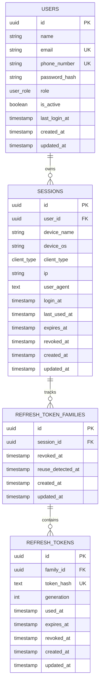
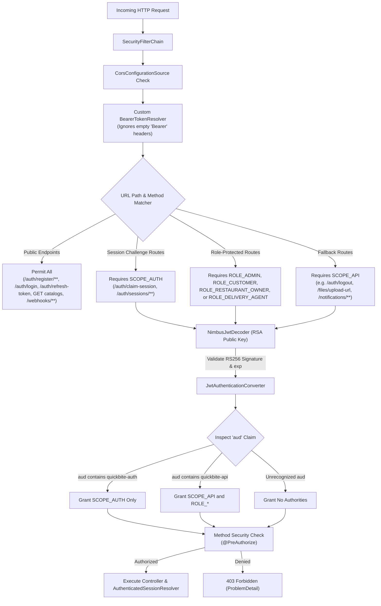
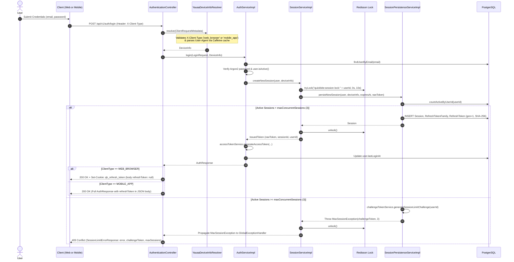
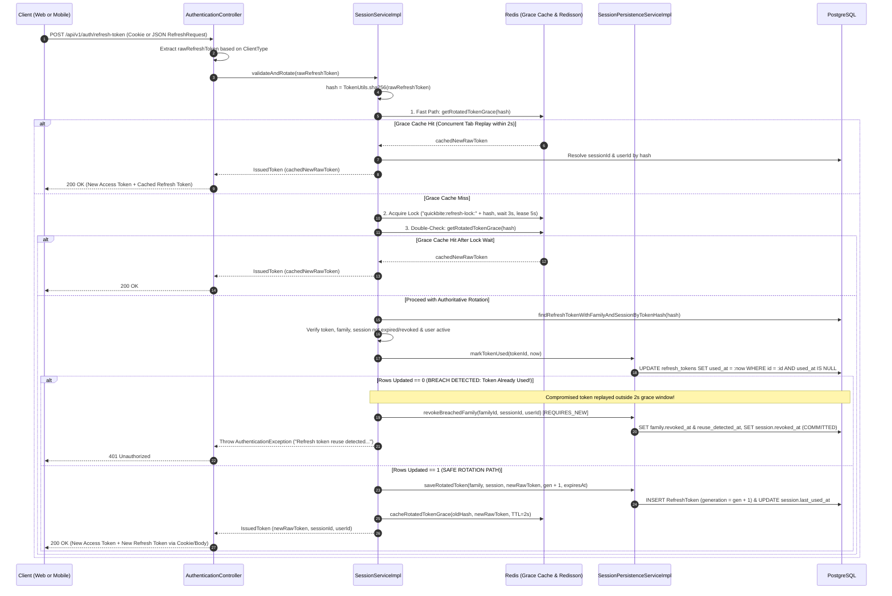
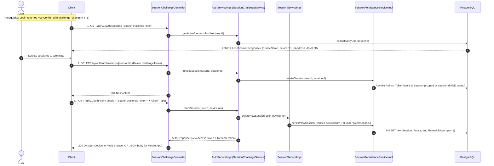

# QuickBite Authentication & Session Management Architecture

This document provides a comprehensive architectural analysis of the `com.quickbite.quickbite.auth` package and its supporting security infrastructure in QuickBite.

---

## 1. Executive Summary & Core Philosophy

QuickBite implements a **Hybrid Stateful-Session / Stateless-Token Authentication System** built on **Spring Boot 4.1.0**, **Java 25**, **Spring Security 6+**, **PostgreSQL 18**, and **Redis 8 / Redisson**.

### Architectural Pillars
* **Self-Issued Asymmetric JWTs**: Acts as its own OAuth 2.0 Authorization Server and Resource Server using 2048-bit RSA key pairs (`private.pem` and `public.pem`), supporting both local resource URIs and raw PEM injection from AWS Secrets Manager.
* **Dual JWT Segregation**: Strictly isolates business API access (`aud: quickbite-api`, `type: access`, 15m TTL) from concurrent session challenge resolution (`aud: quickbite-auth`, `type: session-limit`, 5m TTL).
* **Client-Aware Hybrid Refresh Token Transport**:
  * **`WEB_BROWSER` (`X-Client-Type: web_browser`)**: Refresh tokens are transported exclusively via `HttpOnly`, `Secure`, `SameSite=Strict` cookies (`qb_refresh_token`) and stripped (`null`) from JSON response bodies to neutralize XSS token theft.
  * **`MOBILE_APP` (`X-Client-Type: mobile_app`)**: Refresh tokens are returned directly in the `AuthResponse` JSON payload and accepted via the `RefreshRequest` JSON body so native apps can store them in iOS Keychain or Android Keystore.
* **Generation-Tracked Token Families & Breach Detection**: Refresh tokens belong to a `RefreshTokenFamily` tied to a `Session` with monotonically increasing `generation` numbers (`1, 2, 3...`). Attempting to reuse an already-rotated token (`used_at != null`) outside the 2-second grace window triggers a security breach protocol, revoking the family (`reuse_detected_at`) and session in an independent transaction (`Propagation.REQUIRES_NEW`).
* **Authoritative Persistence & Distributed Concurrency**: Active session counts and states are authoritatively enforced in **PostgreSQL**, coordinated by **Redisson** distributed locks (`RLock`) per user (for session creation) and per token hash (for double-checked rotation), alongside a **2-second Redis grace cache** for concurrent tab/network retries.
* **Bounded Storage via Automated Cleanup**: `RefreshTokenCleanupScheduler` purges used, expired, or revoked token records older than a 30-day retention window, preventing unbounded table growth while preserving recent history for breach detection.

---

## 2. Package & Component Structure

The `com.quickbite.quickbite.auth` domain follows strict **Interface Segregation (ISP)** and **Adapter Pattern** boundaries:

```
com.quickbite.quickbite.auth
├── controller
│   ├── AuthenticationController.java            # POST /login and POST /refresh-token (Web Cookie vs Mobile Body)
│   ├── LogoutController.java                    # POST /logout and POST /logout-all (Requires SCOPE_API)
│   ├── SessionChallengeController.java          # GET /sessions, DELETE /sessions/{id}, POST /claim-session (Requires SCOPE_AUTH)
│   └── UserRegistrationController.java          # POST /register/{customer, delivery-agent, restaurant-owner}
├── dto
│   ├── AuthResponse.java                        # Response record (accessToken, refreshToken, expiresIn, sessionId, tokenType)
│   ├── AuthenticatedSession.java                # Resolved principal tuple (userId, sessionId)
│   ├── ClientRequestMetadata.java               # Raw request inputs (userAgent, clientType, ipAddress)
│   ├── DeviceInfo.java                          # Parsed metadata (deviceName, deviceOs, osVersion, clientType, ip, userAgent)
│   ├── IssuedToken.java                         # Internal session/token tuple (rawToken, sessionId, userId)
│   ├── LoginRequest.java                        # Email & password credentials
│   ├── RefreshRequest.java                      # Mobile refresh request body (refreshToken)
│   ├── RegisterRequest.java                     # Registration payload with JSON/XSS escaping
│   ├── SessionLimitErrorResponse.java           # HTTP 409 payload (error, challengeToken, maxSessions)
│   └── SessionResponse.java                     # Public session projection (sessionId, deviceName, deviceOS, daysLeft, etc.)
├── exception
│   ├── AuthenticationException.java             # Domain auth failure (mapped to HTTP 401 ProblemDetail)
│   └── MaxSessionException.java                 # Concurrent session limit breach (mapped to HTTP 409)
├── model
│   ├── ClientType.java                          # PostgreSQL Enum (WEB_BROWSER, MOBILE_APP)
│   ├── RefreshToken.java                        # Hashed token entity with generation counter & usedAt/revokedAt timestamps
│   ├── RefreshTokenFamily.java                  # Lineage aggregate root tracking session rotation & reuse breaches
│   └── Session.java                             # Active device session entity
├── repository
│   ├── RefreshTokenFamilyRepository.java        # JPQL bulk revocation & breach updates
│   ├── RefreshTokenRepository.java              # Eager family/session fetch, atomic markTokenUsed, & stale token purge
│   └── SessionRepository.java                   # Active session counting, listing, lastUsed updates, & user-scoped revocation
├── scheduler
│   └── RefreshTokenCleanupScheduler.java        # Daily cron (03:00 AM) purging stale tokens older than 30 days
├── service
│   ├── AuthCookieService.java                   # Cookie management contract
│   ├── AuthCookieServiceImpl.java               # Builds HttpOnly, Secure, SameSite=Strict ResponseCookies
│   ├── AuthenticationService.java               # Narrow interface for login & refresh
│   ├── LogoutService.java                       # Narrow interface for single & global session logout
│   ├── SessionChallengeService.java             # Narrow interface for SCOPE_AUTH session challenge workflows
│   ├── AuthServiceImpl.java                     # Implements AuthenticationService, SessionChallengeService, LogoutService
│   ├── UserRegistrationService.java             # Narrow interface for multi-role user registration
│   ├── UserRegistrationServiceImpl.java         # Validates email/phone uniqueness, Argon2 hashes password, saves User
│   ├── SessionService.java                      # Session & token lifecycle contract
│   ├── SessionServiceImpl.java                  # Redisson lock coordinator & double-checked grace cache manager
│   ├── SessionPersistenceService.java           # Transactional DB worker contract
│   ├── SessionPersistenceServiceImpl.java       # @Transactional PostgreSQL persistence & REQUIRES_NEW breach handler
│   ├── SessionStoreService.java                 # Volatile grace cache abstraction
│   ├── SessionRedisStoreService.java            # Redis implementation (quickbite:token-grace:<hash>)
│   └── token
│       ├── AccessTokenService.java              # Mints & verifies API Access Tokens (aud: quickbite-api, type: access)
│       ├── ChallengeTokenService.java           # Mints & verifies Challenge Tokens (aud: quickbite-auth, type: session-limit)
│       ├── SpringSecurityTokenService.java      # Bridges TokenService with Nimbus JwtEncoder / JwtDecoder
│       └── TokenService.java                    # Low-level JWT claim encoding & decoding contract
└── util
    ├── AuthenticatedSessionResolver.java        # Contract for extracting userId & sessionId from Spring Security Jwt
    ├── AuthenticatedSessionResolverImpl.java    # Validates sub and session_id claims
    ├── DeviceInfoResolver.java                  # Adapter interface for device/user-agent resolution
    ├── YauaaDeviceInfoResolver.java             # YAUAA implementation backed by a 10,000-entry Caffeine W-TinyLFU cache
    └── TokenUtils.java                          # 64-byte SecureRandom generator & SHA-256 Base64 hasher
```

---

## 3. Domain Entity & Data Model

The persistence model uses **timestamp-based state tracking** (`used_at`, `revoked_at`, `reuse_detected_at`, `expires_at`) rather than destructive updates or simple booleans, preserving a complete forensic audit trail. All entities extend `common.model.Base` (UUIDv7 primary keys, `created_at`, `updated_at`).



### Key Database Invariants & Indexes
1. **Active Session Index (`idx_sessions_user_active`)**: Composite index on `(user_id, revoked_at, expires_at)` accelerates `countActiveByUserId` and `findActiveByUserId` queries (`WHERE user_id = :userId AND revoked_at IS NULL AND expires_at > CURRENT_TIMESTAMP`).
2. **Unique Token Hash**: `refresh_tokens.token_hash` has a unique constraint and index, enabling single-query `JOIN FETCH` lookup of `RefreshToken` + `RefreshTokenFamily` + `Session` + `User`.
3. **Atomic Single-Use Transition**: `RefreshTokenRepository.markTokenUsed` executes `UPDATE RefreshToken rt SET rt.usedAt = :now WHERE rt.id = :id AND rt.usedAt IS NULL`. An update count of `1` proves first use; `0` proves the token was already consumed (breach).

---

## 4. Token & Security Architecture

### 4.1 Token Specification Matrix

| Attribute | Access Token (AT) | Challenge Token (CT) | Refresh Token (RT) |
| :--- | :--- | :--- | :--- |
| **Format** | Signed JWT (RS256) | Signed JWT (RS256) | 64-Byte `SecureRandom` (Base64) |
| **Default Lifetime** | 15 Minutes (`PT15M`) | 5 Minutes (`PT5M`) | 7 Days (`P7D`) |
| **Audience (`aud`)** | `quickbite-api` | `quickbite-auth` | N/A |
| **Custom `type` Claim** | `"access"` | `"session-limit"` | N/A |
| **Embedded Claims** | `sub` (userId), `session_id`, `email`, `role`, `jti`, `iat`, `exp` | `sub` (userId), `jti`, `iat`, `exp` | N/A (Opaque) |
| **Granted Authorities** | `SCOPE_API` + `ROLE_<ROLE>` | `SCOPE_AUTH` | N/A |
| **Web Browser Transport** | `Authorization: Bearer <AT>` | `Authorization: Bearer <CT>` | Cookie `qb_refresh_token` (`HttpOnly`, `Secure`, `SameSite=Strict`, `Path=/api/v1/auth`) |
| **Mobile App Transport** | `Authorization: Bearer <AT>` | `Authorization: Bearer <CT>` | JSON Body (`AuthResponse.refreshToken` / `RefreshRequest.refreshToken`) |
| **Server Storage** | Stateless | Stateless | PostgreSQL (`SHA-256` hash) + Redis (2s rotation grace cache) |

### 4.2 Client-Aware Transport Branching (`X-Client-Type`)

Every endpoint that issues or consumes a refresh token (`/login`, `/refresh-token`, `/claim-session`) resolves `ClientRequestMetadata` via `YauaaDeviceInfoResolver`:

1. **Header Validation**: Requires `X-Client-Type` header with value `'web_browser'` or `'mobile_app'`. Missing or unrecognized values immediately fail with `400 Bad Request`.
2. **Web Browser (`ClientType.WEB_BROWSER`)**:
   - **Issuance**: Attaches `Set-Cookie: qb_refresh_token=<rawToken>; Path=/api/v1/auth; Max-Age=604800; Secure; HttpOnly; SameSite=Strict` and overwrites `refreshToken` to `null` in the `AuthResponse` JSON body.
   - **Consumption (`/refresh-token`)**: Reads the token exclusively from the `qb_refresh_token` cookie via `AuthCookieService.extractRefreshTokenFromCookie`.
3. **Mobile App (`ClientType.MOBILE_APP`)**:
   - **Issuance**: Returns the full `AuthResponse` JSON containing the raw `refreshToken` field; no cookie header is set.
   - **Consumption (`/refresh-token`)**: Reads the token exclusively from the `@RequestBody RefreshRequest` JSON payload.

### 4.3 Spring Security Request Lifecycle



---

## 5. End-to-End Sequence Flows

### 5.1 Multi-Role Registration Flow

`UserRegistrationController` exposes dedicated registration endpoints for each non-admin persona:
* `POST /api/v1/auth/register/customer` &rarr; `UserRole.CUSTOMER`
* `POST /api/v1/auth/register/delivery-agent` &rarr; `UserRole.DELIVERY_AGENT`
* `POST /api/v1/auth/register/restaurant-owner` &rarr; `UserRole.RESTAURANT_OWNER`

1. **Sanitization**: `RegisterRequest` escapes JSON/XSS control characters across `name`, `email`, `phoneNumber`, and `password`.
2. **Conflict Checks**: `UserRegistrationServiceImpl` verifies neither `email` nor `phoneNumber` is already registered (throwing `409 Conflict` via `ResourceConflictException` if found).
3. **Password Hashing**: Encodes the password using `Argon2PasswordEncoder.defaultsForSpringSecurity_v5_8()` and persists the active `User`.
4. **Admin Provisioning**: Initial super-admin is seeded at boot by `AdminBootstrapRunner` (`quickbite.bootstrap.admin.*`), and subsequent admins are created via `POST /api/v1/admin/users/admins`.

---

### 5.2 User Authentication & Login Flow



---

### 5.3 Refresh Token Rotation, Grace Cache & Reuse Breach Detection

When an Access Token expires, the client calls `POST /api/v1/auth/refresh-token`. `SessionServiceImpl.validateAndRotate` implements **double-checked locking** with a **2-second Redis grace window** (`quickbite:token-grace:<oldHash>`) to handle concurrent requests from multiple browser tabs or network retries without false-positive breach lockouts.



---

### 5.4 Max Session Limit Challenge & 3-Step Eviction Flow

When login returns `409 Conflict` (`SessionLimitErrorResponse`), the client uses the returned `challengeToken` (`aud: quickbite-auth` &rarr; `SCOPE_AUTH`) to inspect active sessions, revoke one or more sessions, and claim the new session.



---

### 5.5 Single-Device vs. Global Logout Flow (`LogoutController`)

Protected by `@PreAuthorize("hasAuthority('SCOPE_API')")`:
1. **`POST /api/v1/auth/logout` (Current Device)**:
   - `AuthenticatedSessionResolver.currentSession(jwt)` extracts both `sub` (`userId`) and `session_id` (`sessionId`) from the Access Token.
   - `logoutService.logoutCurrentSession(userId, sessionId)` revokes only that session and its `RefreshTokenFamily`.
   - Returns `204 No Content` with `Set-Cookie: qb_refresh_token=""; Path=/api/v1/auth; Max-Age=0; Secure; HttpOnly; SameSite=Strict`.
2. **`POST /api/v1/auth/logout-all` (All Devices)**:
   - Extracts `userId` from the Access Token.
   - `logoutService.logoutAllSessions(userId)` bulk-revokes all active sessions and token families belonging to the user.
   - Returns `204 No Content` and clears the refresh cookie.

---

## 6. Device Resolution & Background Maintenance

### 6.1 YAUAA Adapter & Caffeine Cache (`YauaaDeviceInfoResolver`)
* **Adapter Pattern**: `YauaaDeviceInfoResolver` implements `DeviceInfoResolver`, isolating the heavy `nl.basjes.parse.useragent.UserAgentAnalyzer` library from the rest of the domain.
* **Selective Field Extraction**: Configures `UserAgentAnalyzer` to extract only `DEVICE_NAME`, `DEVICE_BRAND`, `OPERATING_SYSTEM_NAME`, `OPERATING_SYSTEM_VERSION`, `AGENT_NAME`, and `AGENT_VERSION_MAJOR`.
* **W-TinyLFU Caching**: Wraps parsing in a Caffeine cache (`maximumSize = 10_000`, `expireAfterAccess = 24h`), reducing repeated User-Agent parsing overhead to sub-microsecond map lookups.

### 6.2 Stale Refresh Token Cleanup (`RefreshTokenCleanupScheduler`)
* **Schedule**: Runs daily at `03:00 AM` (`quickbite.auth.cleanup-cron = 0 0 3 * * *`).
* **Retention Window**: Defaults to `30` days (`quickbite.auth.stale-token-retention-days = 30`).
* **Purge Query**:
  ```sql
  DELETE FROM refresh_tokens
  WHERE (revoked_at IS NOT NULL OR used_at IS NOT NULL OR expires_at < :now)
    AND created_at < :cutoff
  ```
* **Rationale**: Retaining rotated (`used_at IS NOT NULL`) tokens for 30 days ensures that if an attacker replays a stolen refresh token days after rotation, `findRefreshTokenWithFamilyAndSessionByTokenHash` still locates the historical token record and triggers breach revocation on the active session.

---

## 7. Configuration Reference (`application.properties`)

```properties
# 1. Session Concurrency & Cleanup
quickbite.auth.max-concurrent-sessions=3
quickbite.auth.stale-token-retention-days=30
quickbite.auth.cleanup-cron=0 0 3 * * *

# 2. Cookie Transport Layer (Web Browser Clients)
quickbite.auth.cookie.refresh-token-name=qb_refresh_token
quickbite.auth.cookie.refresh-token-path=/api/v1/auth

# 3. JWT Crypto & Token Lifetimes
quickbite.auth.jwt.private-key=${JWT_SECRET:classpath:certs/private.pem}
quickbite.auth.jwt.public-key=${JWT_PUBLIC_KEY:classpath:certs/public.pem}
quickbite.auth.jwt.access-token-expiry=PT15M
quickbite.auth.jwt.access-token-audience=quickbite-api
quickbite.auth.jwt.refresh-token-expiry=P7D
quickbite.auth.jwt.challenge-token-expiry=PT5M
quickbite.auth.jwt.challenge-token-audience=quickbite-auth

# 4. CORS Allowed Origins
quickbite.auth.cors.allowed-origins=http://localhost:3000,http://localhost:8080,https://localhost:8080

# 5. Super Admin Bootstrap
quickbite.bootstrap.admin.enabled=${ADMIN_BOOTSTRAP_ENABLED:true}
quickbite.bootstrap.admin.name=${ADMIN_BOOTSTRAP_NAME:Super Admin}
quickbite.bootstrap.admin.email=${ADMIN_BOOTSTRAP_EMAIL:super.admin@quickbite.com}
quickbite.bootstrap.admin.phone-number=${ADMIN_BOOTSTRAP_PHONE:+911234567890}
quickbite.bootstrap.admin.password=${ADMIN_BOOTSTRAP_PASSWORD:Admin@123}
```
