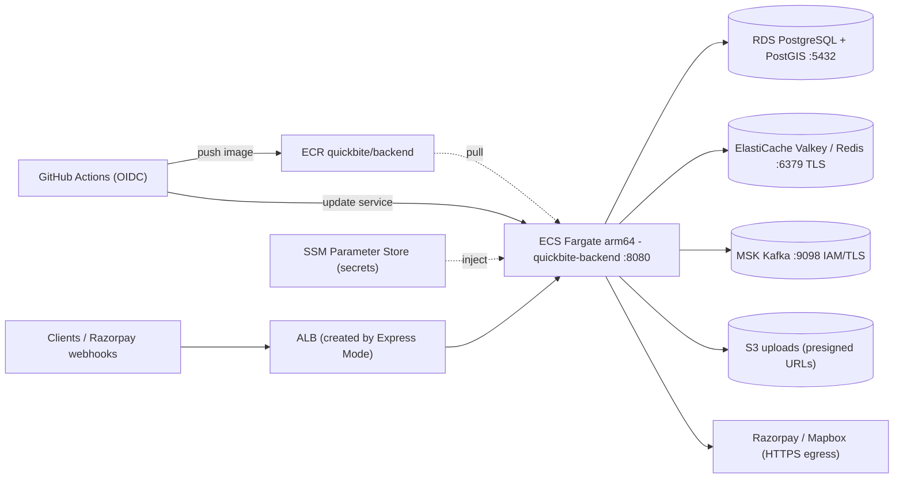

# QuickBite AWS Deployment Guide

End-to-end guide to deploy the QuickBite backend on AWS using **Amazon ECS Express Mode (Fargate, `arm64`)**, **RDS PostgreSQL/PostGIS**, **ElastiCache Valkey / Redis**, **Amazon MSK (IAM auth)**, **S3**, **ECR**, **SSM Parameter Store**, and **GitHub Actions (OIDC)**.

> **Values used in this guide** — replace if yours differ:
> | Item | Value |
> | :--- | :--- |
> | AWS account | `262007030965` |
> | Region | `ap-south-1` (Mumbai) |
> | ECR repository | `quickbite/backend` |
> | ECS cluster / service | `default` / `quickbite-backend` |
> | Container port / health path | `8080` / `/actuator/health` |
> | CPU architecture | `arm64` (Graviton) |
> | SSM prefix | `/quickbite/prod/` |
> | GitHub repo | `eshant52/quickbite-backend` |

---

## 1. Target Architecture



Deployment order matters — follow the sections in sequence:
**Network → Data tier → Secrets → ECR → IAM → ECS service → CI/CD → Verify.**

---

## 2. Prerequisites

- AWS account with admin access (for initial setup), AWS CLI v2 configured: `aws configure` (region `ap-south-1`).
- `openssl` (JWT key generation), `docker` (optional local image test).
- Razorpay **live** keys + webhook secret, Mapbox access token.
- Application behaviour you must respect (all verified in the codebase):
  - Production **must** set `SPRING_PROFILES_ACTIVE=prod`; otherwise Spring defaults to `dev,razorpay` and tries `localhost` (`application.properties`: `spring.profiles.default=dev,razorpay`).
  - Schema is managed by Flyway (`V1`–`V35`); Hibernate is `ddl-auto=validate`. `V1` runs `CREATE EXTENSION postgis`, so the DB user must be able to create extensions (RDS master user can).
  - `RedissonConfig` uses `useSingleServer()` → ElastiCache must be **Cluster Mode Disabled**.
  - Prod Kafka uses `AWS_MSK_IAM` on port `9098`, `replication-factor=2`, `partitions=1`.

---

## 3. Step 1 — Network (VPC & Security Groups)

Use the default VPC for the simplest setup, or create `quickbite-vpc` (`10.0.0.0/16`, DNS hostnames enabled) with **2 AZs** (`ap-south-1a`, `ap-south-1b`). RDS subnet groups and MSK need subnets in at least 2 AZs.

**Important:** RDS, ElastiCache, MSK and the ECS service **must be in the same VPC**.

Create these Security Groups (SG chaining — never open data stores to `0.0.0.0/0`):

| SG | Inbound | Notes |
| :--- | :--- | :--- |
| `sg-ecs` | `8080` from the ALB's SG | Express Mode creates the ALB/SGs; after the service exists, add its task SG as the *source* in the three rules below |
| `sg-rds` | `5432` from `sg-ecs` | |
| `sg-redis` | `6379` from `sg-ecs` | |
| `sg-msk` | `9098` from `sg-ecs`; all traffic from `sg-msk` (self) | `9098` = SASL/IAM over TLS |

ECS tasks need outbound `443` to reach ECR, SSM, S3, CloudWatch, Razorpay and Mapbox. If tasks run in **public subnets with a public IP**, no NAT Gateway is needed (cheaper). If you put tasks in private subnets you need a NAT Gateway or VPC endpoints.

---

## 4. Step 2 — Data & Messaging Tier

### 4.1 RDS PostgreSQL (with PostGIS)
1. RDS → **Create database** → PostgreSQL (current major supported by RDS), Template **Free tier / Dev-Test**.
2. Instance: `db.t4g.micro` (Graviton), Single-AZ, **20 GB gp3**.
3. Credentials: master username/password → these become `DB_USERNAME` / `DB_PASSWORD`.
4. Connectivity: your VPC, **Public access = No**, SG = `sg-rds`.
5. Additional configuration → **Initial database name = `quickbite`**.
6. After creation, copy the endpoint and set:
   ```
   DATABASE_URL=jdbc:postgresql://<rds-endpoint>:5432/quickbite?sslmode=require
   ```
   Pool is `hikari.maximum-pool-size=20` in `application-prod.properties`; make sure your instance's `max_connections` comfortably exceeds `20 × number_of_tasks`.

### 4.2 ElastiCache (Valkey / Redis OSS)
1. Create a **node-based** cluster, **Cluster Mode = Disabled**, 1 node, `cache.t4g.micro` (or `cache.t3.micro`), SG = `sg-redis`, **IPv4** network type, and **private subnets only** (matching your IPv4-only VPC).
2. Enable **Encryption in transit** (TLS) and authentication (user/password or RBAC).
3. Set: `REDIS_HOST=<primary-endpoint>`, `REDIS_PORT=6379`, `REDIS_USERNAME=default` (or your RBAC user), `REDIS_PASSWORD=<secret>`, `REDIS_SSL=true`.
4. The user must be allowed the commands QuickBite uses (Redisson Lua scripts, `BLPOP`, `GEOADD`/`GEOSEARCH`, pub/sub). Avoid a restrictive ACL that blocks these.

### 4.3 Amazon MSK (Provisioned)
1. Create a **Provisioned** cluster using **Kafka 3.x (ZooKeeper mode)** (AWS disables `kafka.t3.small` under KRaft/4.x): **2 brokers**, `kafka.t3.small`, 2 GB storage per broker, subnets in 2 AZs, SG = `sg-msk`.
2. Access control: enable **IAM role-based authentication**; encryption in transit **TLS**.
3. After creation: Cluster → **View client information** → copy the **Private endpoint (SASL/IAM)** bootstrap string (port `9098`) → `KAFKA_SERVERS`.
4. Keep `KAFKA_REPLICATION_FACTOR=2` and `KAFKA_DEFAULT_PARTITIONS=1` (defaults in `application-prod.properties`; 2 brokers ⇒ RF ≤ 2).
5. Topics (`quickbite.order.events`, `quickbite.payment.events`, `quickbite.delivery.events`, `quickbite.cuisine.events`, three onboarding topics, plus `.DLT` variants) are created by the app at startup — the task role therefore needs `CreateTopic` (see §7.2).

### 4.4 S3 Uploads Bucket
1. Create `quickbite-uploads-<unique-suffix>` in `ap-south-1`; **Block all public access = ON**; default encryption SSE-S3.
2. CORS (browsers upload directly with presigned `PUT`, 10-minute expiry):
   ```json
   [{
     "AllowedOrigins": ["https://<your-frontend-domain>"],
     "AllowedMethods": ["PUT", "GET"],
     "AllowedHeaders": ["*"],
     "MaxAgeSeconds": 3000
   }]
   ```
3. Set `AWS_S3_BUCKET=<bucket-name>`.

---

## 5. Step 3 — Secrets in SSM Parameter Store

Generate a **production-only** RSA key pair (never reuse local dev keys):

```bash
openssl genpkey -algorithm RSA -out private.pem -pkeyopt rsa_keygen_bits:2048
openssl rsa -pubout -in private.pem -out public.pem
```

Create `SecureString` parameters (Standard tier is free):

```bash
P=/quickbite/prod
aws ssm put-parameter --name $P/DB_USERNAME              --type SecureString --value '<db-user>'
aws ssm put-parameter --name $P/DB_PASSWORD              --type SecureString --value '<db-pass>'
aws ssm put-parameter --name $P/REDIS_PASSWORD           --type SecureString --value '<redis-pass>'
aws ssm put-parameter --name $P/JWT_SECRET               --type SecureString --value file://private.pem
aws ssm put-parameter --name $P/JWT_PUBLIC_KEY           --type SecureString --value file://public.pem
aws ssm put-parameter --name $P/RAZORPAY_KEY_ID          --type SecureString --value '<rzp-key-id>'
aws ssm put-parameter --name $P/RAZORPAY_KEY_SECRET      --type SecureString --value '<rzp-key-secret>'
aws ssm put-parameter --name $P/RAZORPAY_WEBHOOK_SECRET  --type SecureString --value '<rzp-webhook-secret>'
aws ssm put-parameter --name $P/MAPBOX_ACCESS_TOKEN      --type SecureString --value '<mapbox-token>'
aws ssm put-parameter --name $P/ADMIN_BOOTSTRAP_PASSWORD --type SecureString --value '<strong-admin-pass>'
```

`JwtConfig` accepts a raw multi-line PEM string in `JWT_SECRET` / `JWT_PUBLIC_KEY`, so the whole PEM (with headers) can be stored as-is.

> ⚠️ **Override the admin bootstrap defaults.** `application.properties` defaults to `super.admin@quickbite.com` / `Admin@123` with bootstrap enabled. Always set `ADMIN_BOOTSTRAP_EMAIL` and `ADMIN_BOOTSTRAP_PASSWORD` in production.

---

## 6. Step 4 — ECR Repository

1. ECR → **Create repository** (private) named `quickbite/backend`.
2. Add a **Lifecycle policy**: keep the last 3 images (stays inside the 500 MB free tier). `latest` plus the newest SHA tags are enough.
3. Image URI: `262007030965.dkr.ecr.ap-south-1.amazonaws.com/quickbite/backend:<tag>`.

The first ECS Express service creation needs an image to exist. Either let the first CI run push it (§9), or push once manually:

```bash
aws ecr get-login-password --region ap-south-1 | docker login --username AWS --password-stdin 262007030965.dkr.ecr.ap-south-1.amazonaws.com
docker buildx build --platform linux/arm64 -t 262007030965.dkr.ecr.ap-south-1.amazonaws.com/quickbite/backend:latest --push .
```

---

## 7. Step 5 — IAM Roles

Four roles. Create them **before** the ECS service wizard (except the infrastructure role, which the wizard can create).

### 7.1 Task Execution Role — `ecsTaskExecutionRole`
Used by the ECS agent to pull from ECR, write logs, and inject secrets **before** your container starts.

- Trusted entity: `ecs-tasks.amazonaws.com`
- Managed policy: `AmazonECSTaskExecutionRolePolicy`
- Inline policy `quickbite-ssm-read`:
```json
{
  "Version": "2012-10-17",
  "Statement": [{
    "Effect": "Allow",
    "Action": ["ssm:GetParameters", "ssm:GetParameter", "kms:Decrypt"],
    "Resource": [
      "arn:aws:ssm:ap-south-1:262007030965:parameter/quickbite/prod/*"
    ]
  }]
}
```
`kms:Decrypt` is only needed if you encrypt with a customer-managed KMS key; the default `aws/ssm` key is covered by the SSM permission, so scope it to your key ARN if you use a CMK.

### 7.2 Task Role — `quickbiteEcsTaskRole`
Used by **your application code** at runtime (S3 presigned URLs, MSK IAM auth). Select this in the *Task role* field.

- Trusted entity: `ecs-tasks.amazonaws.com`
- Inline policy `quickbite-runtime`:
```json
{
  "Version": "2012-10-17",
  "Statement": [
    {
      "Sid": "S3Uploads",
      "Effect": "Allow",
      "Action": ["s3:PutObject", "s3:GetObject", "s3:DeleteObject"],
      "Resource": "arn:aws:s3:::<YOUR_BUCKET>/*"
    },
    {
      "Sid": "MskCluster",
      "Effect": "Allow",
      "Action": ["kafka-cluster:Connect", "kafka-cluster:DescribeCluster"],
      "Resource": "arn:aws:kafka:ap-south-1:262007030965:cluster/<MSK_CLUSTER_NAME>/*"
    },
    {
      "Sid": "MskTopics",
      "Effect": "Allow",
      "Action": [
        "kafka-cluster:CreateTopic",
        "kafka-cluster:DescribeTopic",
        "kafka-cluster:AlterTopic",
        "kafka-cluster:WriteData",
        "kafka-cluster:ReadData"
      ],
      "Resource": "arn:aws:kafka:ap-south-1:262007030965:topic/<MSK_CLUSTER_NAME>/*/quickbite.*"
    },
    {
      "Sid": "MskGroups",
      "Effect": "Allow",
      "Action": ["kafka-cluster:AlterGroup", "kafka-cluster:DescribeGroup"],
      "Resource": "arn:aws:kafka:ap-south-1:262007030965:group/<MSK_CLUSTER_NAME>/*/quickbite-group"
    }
  ]
}
```
The consumer group is `quickbite-group` (`spring.kafka.consumer.group-id`). The `quickbite.*` topic pattern also covers the `.DLT` topics.

### 7.3 Infrastructure Role — `ecsInfrastructureRoleForExpressServices`
Used by ECS Express Mode to create/manage the ALB, target group, security groups and auto-scaling on your behalf.

- Easiest: choose **Create new role** in the wizard (AWS attaches the managed Express infrastructure policy).
- Trusted entity: `ecs.amazonaws.com`.

### 7.4 GitHub Actions Deploy Role — `quickbiteGithubDeployRole`
Lets the workflow authenticate with **OIDC** (no stored AWS keys).

1. IAM → Identity providers → **Add provider** → OpenID Connect: URL `https://token.actions.githubusercontent.com`, audience `sts.amazonaws.com` (skip if it already exists).
2. Trust policy:
```json
{
  "Version": "2012-10-17",
  "Statement": [{
    "Effect": "Allow",
    "Principal": { "Federated": "arn:aws:iam::262007030965:oidc-provider/token.actions.githubusercontent.com" },
    "Action": "sts:AssumeRoleWithWebIdentity",
    "Condition": {
      "StringEquals": {
        "token.actions.githubusercontent.com:aud": "sts.amazonaws.com",
        "token.actions.githubusercontent.com:sub": "repo:eshant52/quickbite-backend:environment:prod"
      }
    }
  }]
}
```
> Because `push-image` and `deploy` declare `environment: prod`, GitHub mints OIDC tokens with `sub: repo:eshant52/quickbite-backend:environment:prod` instead of `ref:refs/heads/main`. Restrict the `prod` environment's **Deployment branches** in GitHub to `main`.
3. Permissions policy:
```json
{
  "Version": "2012-10-17",
  "Statement": [
    { "Sid": "EcrLogin", "Effect": "Allow", "Action": "ecr:GetAuthorizationToken", "Resource": "*" },
    {
      "Sid": "EcrPush", "Effect": "Allow",
      "Action": [
        "ecr:BatchCheckLayerAvailability", "ecr:InitiateLayerUpload", "ecr:UploadLayerPart",
        "ecr:CompleteLayerUpload", "ecr:PutImage", "ecr:BatchGetImage", "ecr:GetDownloadUrlForLayer"
      ],
      "Resource": "arn:aws:ecr:ap-south-1:262007030965:repository/quickbite/backend"
    },
    {
      "Sid": "EcsDeploy", "Effect": "Allow",
      "Action": [
        "ecs:UpdateExpressGatewayService",
        "ecs:DescribeExpressGatewayService",
        "ecs:DescribeServices",
        "ecs:DescribeTaskDefinition",
        "ecs:RegisterTaskDefinition"
      ],
      "Resource": "*"
    },
    {
      "Sid": "PassRoles", "Effect": "Allow", "Action": "iam:PassRole",
      "Resource": [
        "arn:aws:iam::262007030965:role/ecsTaskExecutionRole",
        "arn:aws:iam::262007030965:role/quickbiteEcsTaskRole",
        "arn:aws:iam::262007030965:role/ecsInfrastructureRoleForExpressServices"
      ]
    }
  ]
}
```
> The ECS Express action names above follow the service's CLI naming (`update-express-gateway-service`). Confirm them against the current IAM docs / `aws ecs update-express-gateway-service help` for your CLI version; if a deploy fails with `AccessDenied`, the error message names the exact missing action.

4. **GitHub → Settings → Environments → Create `prod`** (set **Deployment branches and tags → Selected branches: `main`**):

   | Key | Value | Environment type |
   | :--- | :--- | :--- |
   | `AWS_ROLE_ARN` | `arn:aws:iam::262007030965:role/quickbiteGithubDeployRole` | Secret |
   | `AWS_REGION` | `ap-south-1` | Variable |
   | `ECR_REPOSITORY` | `quickbite/backend` | Variable |
   | `ECS_CLUSTER` | `default` | Variable |
   | `ECS_SERVICE` | `quickbite-backend` | Variable |

   > Express Mode updates the service directly via `update-express-gateway-service`, so `ECS_TASK_DEFINITION` and `CONTAINER_NAME` are not required. The workflow builds the service ARN from `AWS_REGION`, account ID, `ECS_CLUSTER`, and `ECS_SERVICE` (you can optionally set `ECS_EXPRESS_SERVICE_ARN` as a Variable to override it).


---

## 8. Step 6 — Create the ECS Express Mode Service

ECS → **Express mode** → **Create**.

### 8.1 "Let's set up your app"
| Field | Value |
| :--- | :--- |
| Image URI | `262007030965.dkr.ecr.ap-south-1.amazonaws.com/quickbite/backend:latest` |
| Private registry authentication | Off (same-account ECR) |
| CPU architecture | `arm64` (must match the image built in CI) |
| Task execution role | `ecsTaskExecutionRole` (from §7.1) |
| Infrastructure role | `ecsInfrastructureRoleForExpressServices` (§7.3) |

### 8.2 "Additional configurations"
| Field | Value |
| :--- | :--- |
| Cluster | `default` (Express Mode default) |
| Name | `quickbite-backend` |
| Container port | **`8080`** (not 80) |
| Health check path | **`/actuator/health`** (not `/` — `/` is protected by Spring Security) |
| Command | **Leave empty** — the Dockerfile `ENTRYPOINT` already launches the app with `-XX:MaxRAMPercentage=75.0` |
| Task role | `quickbiteEcsTaskRole` (§7.2) — **do not leave empty** |

### 8.3 Compute & networking (scroll down in the wizard)
- **CPU/Memory:** at least **0.5 vCPU / 1 GB** (Spring Boot 4 + Java 25 + Argon2id will struggle below this).
- **Networking:** select the same VPC/subnets as the data tier, if the wizard exposes this. Afterwards, add the service's task security group as an allowed source on `sg-rds` (5432), `sg-redis` (6379) and `sg-msk` (9098).
- **Scaling:** start with min 1 / max 2 tasks. The first boot also runs all Flyway migrations, so allow a generous startup/health-check grace period; if several tasks start at once, Flyway serializes migrations with its database lock.

### 8.4 Environment variables
**Plain text** (use *Bulk edit*):
```env
SPRING_PROFILES_ACTIVE=prod
AWS_REGION=ap-south-1
AWS_S3_BUCKET=<bucket-name>
DATABASE_URL=jdbc:postgresql://<rds-endpoint>:5432/quickbite?sslmode=require
REDIS_HOST=<elasticache-primary-endpoint>
REDIS_PORT=6379
REDIS_USERNAME=default
REDIS_SSL=true
KAFKA_SERVERS=<msk-bootstrap-9098>
KAFKA_REPLICATION_FACTOR=2
KAFKA_DEFAULT_PARTITIONS=1
CORS_ALLOWED_ORIGINS=https://<your-frontend-domain>
ADMIN_BOOTSTRAP_EMAIL=<admin-email>
```

**Secrets** (type = Secret, value = SSM parameter ARN `arn:aws:ssm:ap-south-1:262007030965:parameter/quickbite/prod/<NAME>`):

| Variable | SSM parameter |
| :--- | :--- |
| `DB_USERNAME` | `/quickbite/prod/DB_USERNAME` |
| `DB_PASSWORD` | `/quickbite/prod/DB_PASSWORD` |
| `REDIS_PASSWORD` | `/quickbite/prod/REDIS_PASSWORD` |
| `JWT_SECRET` | `/quickbite/prod/JWT_SECRET` |
| `JWT_PUBLIC_KEY` | `/quickbite/prod/JWT_PUBLIC_KEY` |
| `RAZORPAY_KEY_ID` | `/quickbite/prod/RAZORPAY_KEY_ID` |
| `RAZORPAY_KEY_SECRET` | `/quickbite/prod/RAZORPAY_KEY_SECRET` |
| `RAZORPAY_WEBHOOK_SECRET` | `/quickbite/prod/RAZORPAY_WEBHOOK_SECRET` |
| `MAPBOX_ACCESS_TOKEN` | `/quickbite/prod/MAPBOX_ACCESS_TOKEN` |
| `ADMIN_BOOTSTRAP_PASSWORD` | `/quickbite/prod/ADMIN_BOOTSTRAP_PASSWORD` |

Click **Create**. Express Mode provisions the ALB, target group, service, logging and an HTTPS URL for you; note the service **ARN** and **endpoint** from the service page.

---

## 9. Step 7 — CI/CD with GitHub Actions

The repository workflow is [`.github/workflows/deploy.yml`](../.github/workflows/deploy.yml):

1. **`build`** — Runs `./mvnw clean verify -B` on pushes and pull requests to `main` without `environment: prod`, so PR checks aren't blocked by production branch/protection rules.
2. **`push-image`** — Uses `environment: prod` with GitHub OIDC (`sub: repo:eshant52/quickbite-backend:environment:prod`), builds `linux/arm64` via Docker Buildx + QEMU (GHA cache), and pushes `:<git-sha>` and `:latest` to `ECR_REPOSITORY`.
3. **`deploy`** — Uses `environment: prod`, fetches the service's current `activeConfigurations[0].primaryContainer` JSON via `aws ecs describe-express-gateway-service`, swaps only `.image` with `jq` (preserving all console-configured environment variables, SSM secrets, container port, and CloudWatch logging settings), calls `aws ecs update-express-gateway-service`, and waits with `aws ecs wait services-stable`.

> Note: Express Mode updates the container definition in place without dropping omitted fields only when you pass the full `primaryContainer` object — fetching it first and patching `.image` guarantees existing env vars and SSM secrets stay intact.

GitHub `prod` environment setup checklist (matches §7.4 step 4):
- Restrict **Deployment branches and tags → Selected branches: `main`**.
- Secret `AWS_ROLE_ARN` = ARN of `quickbiteGithubDeployRole`.
- Variables: `AWS_REGION` (`ap-south-1`), `ECR_REPOSITORY` (`quickbite/backend`), `ECS_CLUSTER` (`default`), `ECS_SERVICE` (`quickbite-backend`), and optionally `ECS_EXPRESS_SERVICE_ARN`.
- The AWS IAM OIDC trust `sub` must be `repo:eshant52/quickbite-backend:environment:prod`.

---

## 10. Step 8 — First Deployment & Verification

1. Push to `main` (or run the workflow manually via **Actions → Run workflow**).
2. **CloudWatch Logs** (log group created by Express Mode): confirm in order
   - Flyway applies `V1`–`V35` with no errors (PostGIS extension created).
   - Kafka admin connects with IAM and topics are created.
   - Redis (Lettuce + Redisson over `rediss://`) connects.
   - `Started QuickBiteApplication`.
3. Health check:
   ```bash
   curl https://<express-endpoint>/actuator/health
   # {"status":"UP"}
   ```
4. Smoke test: log in with the bootstrap admin (the email/password you configured), then run the Postman collections from `postman/exports` against the deployed base URL.

---

## 11. Post-Deployment Configuration

- **Razorpay webhook:** Dashboard → Webhooks → URL `https://<express-endpoint>/api/v1/webhooks/payments/razorpay`, events `payment.captured` and `payment.failed`, secret = the value stored in `RAZORPAY_WEBHOOK_SECRET`.
- **Custom domain / HTTPS:** attach your domain to the service/ALB (ACM certificate) and update `CORS_ALLOWED_ORIGINS`.
- **Rotate bootstrap admin password** after first login.
- **Observability:** `management.endpoints.web.exposure.include=health,info` in prod; add CloudWatch alarms on ALB 5xx, target response time, and ECS CPU/memory.

---

## 12. Operations

| Task | How |
| :--- | :--- |
| View logs | CloudWatch Logs group for the service |
| Roll back | Update the service to the previous image tag (a prior `:<git-sha>` in ECR), or use Express Mode's built-in rollback if the deployment health alarm trips |
| Scale | Adjust min/max tasks or CPU/memory in the Express service settings |
| Update a secret | Change the SSM parameter, then force a new deployment so the task re-reads it (secrets are injected at task start) |
| Schema change | Add a Flyway migration `V36__...sql`; it runs automatically at startup |
| Cost reference | Calculator estimate for this stack in `ap-south-1`: ~$147.66/month On-Demand (see report); Express Mode's ALB is part of that estimate's ALB line. Re-run the AWS Pricing Calculator if you change sizes |

---

## 13. Troubleshooting

| Symptom | Likely cause | Fix |
| :--- | :--- | :--- |
| `exec format error` at task start | Image arch ≠ task arch | Build `linux/arm64` and keep service CPU architecture `arm64` |
| Tasks fail health check / ALB `502/503` | Wrong port or path | Container port `8080`, health path `/actuator/health` |
| Container exits: cannot connect to `localhost:5430` | Missing `SPRING_PROFILES_ACTIVE=prod` | Add the env var |
| `ResourceInitializationError: unable to pull secrets` | Execution role lacks SSM read, wrong ARN, or no route to SSM | Check §7.1 policy, parameter ARNs, and outbound `443` |
| `CannotPullContainerError` | Execution role / ECR repo or tag mismatch | Verify image URI and that the tag exists |
| `FATAL: no pg_hba.conf entry` / timeout to RDS | SG or SSL | Allow `sg-ecs` → `sg-rds:5432`; keep `sslmode=require` |
| Flyway fails on `CREATE EXTENSION postgis` | DB user lacks privilege | Use the RDS master user (has `rds_superuser`) |
| Redis connection timeout / `SSL` errors | Wrong SG, TLS off on one side | Allow `6379`; `REDIS_SSL=true` with in-transit encryption enabled |
| Redisson errors against ElastiCache | Cluster mode enabled | Recreate with Cluster Mode **Disabled** |
| `Failed to create topics` / `TopicAuthorizationException` | Task role missing MSK IAM actions | Re-check §7.2, cluster/topic/group ARNs |
| `AccessDenied` on S3 upload URLs | Task role missing S3 permissions | Check bucket ARN in §7.2 |
| GitHub: `Not authorized to perform sts:AssumeRoleWithWebIdentity` | Trust `sub`/`aud` mismatch | Match repo, branch, and `sts.amazonaws.com` audience |
| GitHub: `iam:PassRole` denied | Missing PassRole | Add the three role ARNs in §7.4 |
| Deploy drops env vars/secrets | `--primary-container` replaced the container block | Include `environment` and `secrets` in the update JSON |
| Dockerfile `HEALTHCHECK` shows unhealthy locally | `curl` may not exist in the JRE image | ECS/ALB use their own health check; add `curl` to the image if you want the Docker one |

---

## 14. Security Checklist

- [ ] RDS, ElastiCache, MSK have **no public access**; only reachable from `sg-ecs`.
- [ ] S3 bucket blocks all public access.
- [ ] All secrets are SSM `SecureString`; none in the image, repo, or plain env vars.
- [ ] Production JWT keys are newly generated (not the dev `certs/` files; `src/main/resources/certs/` is excluded by `.dockerignore`).
- [ ] Bootstrap admin email/password overridden and rotated.
- [ ] GitHub OIDC trust limited to `repo:eshant52/quickbite-backend:environment:prod` with `prod` environment restricted to `main`.
- [ ] Task role and deploy role follow least privilege (scoped ARNs above).
- [ ] CORS limited to the real frontend origin.
- [ ] Razorpay **live** keys only in production; webhook secret matches the dashboard.
