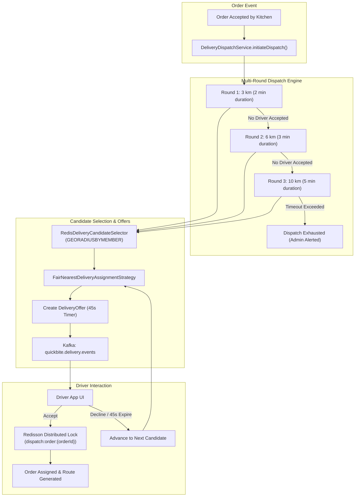
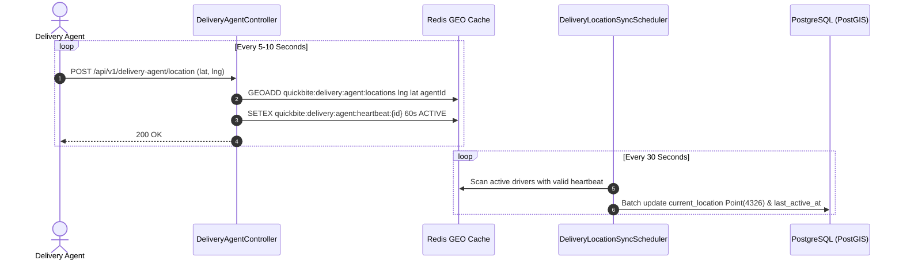

# QuickBite Dispatch Engine & Geospatial Routing

This document details the architecture, algorithms, and configuration of QuickBite's automated order dispatch engine, real-time Redis geospatial tracking subsystem, and multi-tier routing gateway.

---

## 1. Subsystem Architecture Overview

The delivery subsystem is responsible for matching preparing orders with available delivery partners, tracking driver positions in real-time, calculating road-network travel distances, and calculating delivery fees and driver earnings.



---

## 2. Multi-Round Dispatch Engine

When a restaurant marks an order as accepted or preparing, an `OrderDispatch` record is initiated. Dispatch execution is governed by `DeliveryDispatchScheduler`, which polls active dispatches every 5 seconds.

### 2.1 Expanding Radius Rounds

The dispatch engine searches for candidates in expanding concentric circles to minimize customer delivery wait times while offering orders to the closest available drivers first.

| Dispatch Round | Search Radius | Round Duration | Driver Pool Target | Fallback Action on Expiry |
| :--- | :--- | :--- | :--- | :--- |
| **Round 1** | **3 Kilometers** | 2 Minutes (`PT2M`) | Up to 10 nearest drivers | Escalate to Round 2 |
| **Round 2** | **6 Kilometers** | 3 Minutes (`PT3M`) | Up to 10 nearest drivers | Escalate to Round 3 |
| **Round 3** | **10 Kilometers** | 5 Minutes (`PT5M`) | Up to 10 nearest drivers | Transition to `EXHAUSTED` |

### 2.2 Driver Offer Lifecycle & 45-Second Timeout

1. **Offer Generation**: An offer is dispatched to candidate drivers sequentially or in small prioritized batches.
2. **Offer Window**: Drivers have a strict **45-second acceptance window** (`quickbite.dispatch.driver-offer-timeout = PT45S`).
3. **Offer Expiration**: If a driver neither accepts nor rejects within 45 seconds, `DeliveryDispatchScheduler` automatically marks the offer as `EXPIRED` and dispatches an offer to the next best candidate.
4. **Race-Condition Defense**: When a driver taps "Accept", the request acquires a Redisson lock (`dispatch:order:{orderId}`). If two drivers accept simultaneously, only the first transaction commits; the second receives an `OfferExpiredException`.
5. **Dispatch Exhaustion**: If Round 3 expires without driver acceptance, the dispatch enters `EXHAUSTED` state and publishes a `DeliveryDispatchExhaustedEvent` to alert administrators.

---

## 3. Real-Time Geospatial Driver Tracking

QuickBite utilizes a **hybrid in-memory (Redis GEO) + persistent (PostgreSQL PostGIS)** tracking architecture.



### 3.1 Redis GEO Storage Patterns
- **Spatial Hash Set**: Key `quickbite:delivery:agent:locations` stores driver longitude and latitude coordinates using Redis native geospatial indexing.
- **Liveness Heartbeat**: Key `quickbite:delivery:agent:heartbeat:<agentId>` is set with a **60-second TTL**. If a driver loses connectivity or closes the app, their heartbeat expires, immediately excluding them from dispatch queries.
- **Candidate Lookup**: `RedisDeliveryCandidateSelector` invokes `GEORADIUSBYMEMBER` around the restaurant's coordinate to retrieve active drivers within the current round's radius.

### 3.2 Persistent Sync Scheduler (`DeliveryLocationSyncScheduler`)
Every 30 seconds (`quickbite.delivery.geo.sync-interval-ms = 30000`), a background cron job syncs the coordinates of all active drivers from Redis into the PostgreSQL `delivery_agents` table, persisting spatial `Point(4326)` geometries for audit trails and customer tracking.

---

## 4. 3-Tier Composite Routing Gateway

Street-level road network distances and travel durations are resolved via `CompositeRoutingGateway`, which implements a prioritized fallback chain (`RoutingProviderChain`).

```mermaid
flowchart TD
    RouteReq["Route Request (Origin, Destination)"] --> OSRMAdapter{"Tier 1: OSRM Routing Adapter<br/>(Local Native :5001)"}
    
    OSRMAdapter -->|Success (Sub-10ms)| RouteFound["Return RouteResult (Distance, Duration)"]
    OSRMAdapter -->|Timeout / Offline| MapboxAdapter{"Tier 2: Mapbox Routing Adapter<br/>(Cloud REST API)"}
    
    MapboxAdapter -->|Success| RouteFound
    MapboxAdapter -->|Error / Disabled| HaversineAdapter["Tier 3: Haversine Fallback Adapter<br/>(Mathematical Great-Circle)"]
    
    HaversineAdapter --> RouteFound
```

### 4.1 Tier 1: Local OSRM Adapter (`OsrmRoutingAdapter`)
* **Endpoint**: `http://localhost:5001/table/v1/driving/{coords}`
* **Characteristics**: Zero network latency, sub-5ms response times, tuned for two-wheeler / bicycle urban delivery profiles.
* **Timeout**: 5 seconds.

### 4.2 Tier 2: Mapbox Routing Adapter (`MapboxRoutingAdapter`)
* **Endpoint**: `https://api.mapbox.com/directions/v5/mapbox/driving`
* **Characteristics**: Cloud-based fallback with global coverage and real-time traffic heuristics. Disabled in local development by default.

### 4.3 Tier 3: Haversine Fallback Adapter (`HaversineFallbackAdapter`)
* **Mechanism**: Great-circle formula calculating spherical distance:
  $$\Delta\sigma = 2 \arcsin \sqrt{\sin^2\left(\frac{\Delta\phi}{2}\right) + \cos\phi_1\cos\phi_2\sin^2\left(\frac{\Delta\lambda}{2}\right)}$$
* **Assumed Urban Velocity**: Standardized at 25 km/h (with a 1.25x road curvature factor) to calculate an estimated travel duration when all routing engines are unavailable. Guarantees that checkout and dispatch never throw critical errors due to routing provider failure.

---

## 5. Pricing & Earnings Engine

### 5.1 Dynamic Customer Delivery Fee

The customer delivery fee is computed dynamically during cart checkout preview and order creation using a chain of fee calculators:

$$\text{Delivery Fee} = \text{clamp}\Big(\text{Base Fee} + (\text{Distance km} \times \text{Rate per km}) + \text{Surge Fee}, \; \text{Min Fee}, \; \text{Max Fee}\Big)$$

| Parameter | Configuration Property | Default Value | Description |
| :--- | :--- | :--- | :--- |
| **Base Fee** | `quickbite.fee.base-fee` | ₹15.00 | Standard pickup/drop fee |
| **Rate per Km** | `quickbite.fee.rate-per-km` | ₹8.00 / km | Variable transit rate |
| **Minimum Fee** | `quickbite.fee.min-fee` | ₹20.00 | Minimum delivery charge floor |
| **Maximum Fee** | `quickbite.fee.max-fee` | ₹80.00 | Maximum fee cap for long distances |
| **Platform Fee** | `quickbite.pricing.platform-fee` | ₹5.00 | Flat platform maintenance fee |
| **GST Rate** | `quickbite.pricing.gst-rate` | 0.05 (5%) | Government tax applied to cart subtotal + fees |

### 5.2 Driver Earnings Calculation (`DeliveryEarningsCalculator`)

Driver payouts are calculated separately from customer delivery charges to ensure attractive, guaranteed compensation for delivery partners:

$$\text{Driver Payout} = \text{Base Payout} + (\text{Trip Distance km} \times \text{Rate per km})$$

| Parameter | Configuration Property | Default Value | Description |
| :--- | :--- | :--- | :--- |
| **Base Payout** | `quickbite.dispatch.earnings.base-payout` | ₹30.00 | Guaranteed compensation per pickup |
| **Rate per Km** | `quickbite.dispatch.earnings.rate-per-km` | ₹10.00 / km | Payout per road kilometer travelled |

---

## 6. Configuration Reference

```properties
# Redis Geospatial Tracking
quickbite.delivery.geo.enabled=true
quickbite.delivery.geo.heartbeat-ttl=PT60S
quickbite.delivery.geo.sync-interval-ms=30000

# Dispatch Engine Rounds
quickbite.dispatch.rounds[0].radius-km=3
quickbite.dispatch.rounds[0].round-duration=PT2M
quickbite.dispatch.rounds[1].radius-km=6
quickbite.dispatch.rounds[1].round-duration=PT3M
quickbite.dispatch.rounds[2].radius-km=10
quickbite.dispatch.rounds[2].round-duration=PT5M
quickbite.dispatch.driver-offer-timeout=PT45S
quickbite.dispatch.scheduler-poll-interval-ms=5000
quickbite.dispatch.candidate-limit=10

# Driver Payouts
quickbite.dispatch.earnings.base-payout=30.00
quickbite.dispatch.earnings.rate-per-km=10.00

# Routing Engine
quickbite.routing.osrm-base-url=http://localhost:5001
quickbite.routing.osrm-enabled=true
quickbite.routing.mapbox-enabled=false
quickbite.routing.timeout=5s
```
