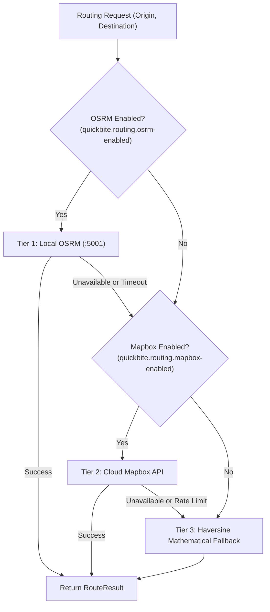

# Installation and Configuration Guide

This guide details the complete setup, infrastructure provisioning, environment configuration, and verification steps required to run the QuickBite backend locally or in production.

---

## 1. Prerequisites

Before starting, ensure the following software is installed on your host system:
* **Java Development Kit (JDK) 25** (e.g., Eclipse Temurin or GraalVM). Verify with `java -version`.
* **Docker & Docker Compose** (v2.20+ recommended).
* **OpenSSL** (for RSA JWT key pair generation).
* *(Optional, recommended for macOS/Linux)* **Homebrew & OSRM** (`brew install osrm-backend`) for native routing performance.

---

## 2. Infrastructure Setup with Docker Compose

QuickBite relies on three primary infrastructure containers: **PostgreSQL 18 (with PostGIS)**, **Redis 8 (with ACL enabled)**, and **Apache Kafka 4.3 (KRaft mode)**.

### Step 1: Clone Repository
```bash
git clone https://github.com/eshant52/quickbite-backend.git
cd quickbite-backend
```

### Step 2: Configure Local Infrastructure Environment
Create the `.env.local` file used by `docker-compose.yml`:
```bash
cp .env.local.example .env.local
```

Ensure the ports and credentials match your preferences:
```env
POSTGRES_USER=eshant
POSTGRES_PASSWORD=mypg2510
POSTGRES_DB=quickbite

REDIS_USERNAME=quickbite
REDIS_PASSWORD=redistest

KAFKA_SERVERS=localhost:9092
```

### Step 3: Launch Containers
Start the infrastructure services in detached mode:
```bash
docker compose --env-file .env.local --profile full up -d
```

Verify all containers report `healthy`:
```bash
docker ps
```

| Service | Container Name | Host Port | Internal Port | Healthcheck |
| :--- | :--- | :--- | :--- | :--- |
| **PostgreSQL + PostGIS** | `my-postgres` | `5430` | `5432` | `pg_isready` |
| **Redis (ACL Protected)** | `my-redis` | `6377` | `6379` | `redis-cli ping` |
| **Apache Kafka (KRaft)** | `my-kafka` | `9092` | `9092` | `kafka-topics.sh --list` |

---

## 3. Database & Cryptographic Key Initialization

### Step 4: Verify PostGIS Extension
The `postgres-setup/initdb-postgis.sh` script automatically installs PostGIS when the container is first created. To verify manually:
```bash
docker exec -it my-postgres psql -U eshant -d quickbite -c "SELECT PostGIS_Version();"
```
If not installed, enable it with:
```sql
CREATE EXTENSION IF NOT EXISTS postgis;
```

### Step 5: Generate RSA Key Pair for JWT Issuance
QuickBite self-issues asymmetric RSA256 tokens using a private/public key pair:
```bash
mkdir -p src/main/resources/certs
openssl genrsa -out src/main/resources/certs/private.pem 2048
openssl rsa -in src/main/resources/certs/private.pem -pubout -out src/main/resources/certs/public.pem
```

> [!CAUTION]
> Never commit `private.pem` to source control. In production environments, load the private key via the `JWT_SECRET` environment variable or AWS Secrets Manager.

---

## 4. Kafka Topic Management

When the Spring Boot application boots, `KafkaConfig.java` **automatically creates** all 7 domain topics and their corresponding Dead Letter Topics (`.DLT`) via `NewTopic` beans.

If you prefer to initialize the topics manually prior to application startup, run:
```bash
# Order Events
docker exec -it my-kafka /opt/kafka/bin/kafka-topics.sh --bootstrap-server localhost:9092 --create --topic quickbite.order.events --partitions 3 --replication-factor 1
docker exec -it my-kafka /opt/kafka/bin/kafka-topics.sh --bootstrap-server localhost:9092 --create --topic quickbite.order.events.DLT --partitions 1 --replication-factor 1

# Payment Events
docker exec -it my-kafka /opt/kafka/bin/kafka-topics.sh --bootstrap-server localhost:9092 --create --topic quickbite.payment.events --partitions 3 --replication-factor 1
docker exec -it my-kafka /opt/kafka/bin/kafka-topics.sh --bootstrap-server localhost:9092 --create --topic quickbite.payment.events.DLT --partitions 1 --replication-factor 1

# Delivery Events
docker exec -it my-kafka /opt/kafka/bin/kafka-topics.sh --bootstrap-server localhost:9092 --create --topic quickbite.delivery.events --partitions 3 --replication-factor 1
docker exec -it my-kafka /opt/kafka/bin/kafka-topics.sh --bootstrap-server localhost:9092 --create --topic quickbite.delivery.events.DLT --partitions 1 --replication-factor 1

# Restaurant Application Events
docker exec -it my-kafka /opt/kafka/bin/kafka-topics.sh --bootstrap-server localhost:9092 --create --topic quickbite.restaurant.application.events --partitions 3 --replication-factor 1
docker exec -it my-kafka /opt/kafka/bin/kafka-topics.sh --bootstrap-server localhost:9092 --create --topic quickbite.restaurant.application.events.DLT --partitions 1 --replication-factor 1

# Delivery Agent Application Events
docker exec -it my-kafka /opt/kafka/bin/kafka-topics.sh --bootstrap-server localhost:9092 --create --topic quickbite.deliveryagent.application.events --partitions 3 --replication-factor 1
docker exec -it my-kafka /opt/kafka/bin/kafka-topics.sh --bootstrap-server localhost:9092 --create --topic quickbite.deliveryagent.application.events.DLT --partitions 1 --replication-factor 1

# Vehicle Application Events
docker exec -it my-kafka /opt/kafka/bin/kafka-topics.sh --bootstrap-server localhost:9092 --create --topic quickbite.vehicle.application.events --partitions 3 --replication-factor 1
docker exec -it my-kafka /opt/kafka/bin/kafka-topics.sh --bootstrap-server localhost:9092 --create --topic quickbite.vehicle.application.events.DLT --partitions 1 --replication-factor 1

# Cuisine Events
docker exec -it my-kafka /opt/kafka/bin/kafka-topics.sh --bootstrap-server localhost:9092 --create --topic quickbite.cuisine.events --partitions 3 --replication-factor 1
docker exec -it my-kafka /opt/kafka/bin/kafka-topics.sh --bootstrap-server localhost:9092 --create --topic quickbite.cuisine.events.DLT --partitions 1 --replication-factor 1
```

---

## 5. Routing Engine Configuration (OSRM & Mapbox)

QuickBite utilizes a **3-Tier Composite Routing Gateway** (`CompositeRoutingGateway`) to compute road-network driving distances, route durations, and delivery fees:
1. **Tier 1 (OSRM)**: High-speed, self-hosted local OpenStreetMap routing engine (sub-10ms latency).
2. **Tier 2 (Mapbox)**: Cloud Directions & Matrix API with live traffic data.
3. **Tier 3 (Haversine)**: Pure mathematical great-circle fallback (always available, guarantees zero downtime).



---

### 5.1 Setting Up Local OSRM (Optional for Dev)

By default in `dev` mode (`application-dev.properties`), OSRM is enabled on port `5001`:

1. **Install OSRM**:
   ```bash
   brew install osrm-backend
   ```
2. **Download OSM Data** (e.g., regional or India map):
   ```bash
   mkdir -p ~/osrm-data && cd ~/osrm-data
   curl -O http://download.geofabrik.de/asia/india-latest.osm.pbf
   ```
3. **Extract, Partition & Customize**:
   ```bash
   osrm-extract -p /opt/homebrew/share/osrm/profiles/bicycle.lua india-latest.osm.pbf
   osrm-partition india-latest.osrm
   osrm-customize india-latest.osrm
   ```
4. **Run OSRM Server** on port **5001** (avoids conflict with macOS AirPlay on port 5000):
   ```bash
   osrm-routed --algorithm mld -p 5001 india-latest.osrm
   ```

*(Note: If OSRM is not running, the application catches the connection failure and automatically falls back to Mapbox or Haversine without interrupting execution).*

---

### 5.2 Enabling & Disabling Routing Providers

You can switch between local OSRM, cloud Mapbox, or pure mathematical Haversine calculation by toggling properties in `src/main/resources/application-dev.properties` or passing environment variables / JVM arguments.

#### Routing Configuration Modes

| Mode | `quickbite.routing.osrm-enabled` | `quickbite.routing.mapbox-enabled` | `MAPBOX_ACCESS_TOKEN` | Description |
| :--- | :--- | :--- | :--- | :--- |
| **A. OSRM Only (Default Dev)** | `true` | `false` | Not required | Uses local OSRM (`http://localhost:5001`) with automatic Haversine fallback. |
| **B. Mapbox in Dev (No Local OSRM)** | `false` | `true` | Required (`pk.eyJ1I...`) | Skips local OSRM and queries Mapbox Directions API directly. |
| **C. Hybrid (OSRM + Mapbox Fallback)** | `true` | `true` | Required (`pk.eyJ1I...`) | Uses OSRM first; if OSRM is down, falls back to Mapbox before Haversine. |
| **D. Zero-Setup (Haversine Only)** | `false` | `false` | Not required | Mathematical great-circle distance with 25 km/h urban velocity. Ideal for fast test runs without external services. |
| **E. Production Profile (`prod`)** | `false` | `true` | Required (`pk.eyJ1I...`) | Mapbox primary with Haversine fallback. OSRM is strictly omitted in production. |

---

### 5.3 Step-by-Step: Enabling Mapbox in Dev Mode

To use Mapbox instead of or alongside OSRM in local development:

1. **Obtain a Mapbox Token**:
   - Create a free account at [account.mapbox.com](https://account.mapbox.com/).
   - Copy your Public Default Access Token (`pk.eyJ1I...`).

2. **Add Token to `.env`**:
   Uncomment `MAPBOX_ACCESS_TOKEN` in your `.env` file:
   ```env
   # Mapbox Routing API
   MAPBOX_ACCESS_TOKEN=pk.eyJ1Ixxxxxxxxxxxxxxxxxxxxxxxxxxxx
   ```

3. **Toggle Properties in `application-dev.properties`**:
   To use Mapbox as primary in dev (disabling local OSRM):
   ```properties
   quickbite.routing.osrm-enabled=false
   quickbite.routing.mapbox-enabled=true
   quickbite.routing.mapbox-access-token=${MAPBOX_ACCESS_TOKEN:}
   ```

   *Alternatively, pass JVM arguments when running Spring Boot without changing files:*
   ```bash
   ./mvnw spring-boot:run -Dspring-boot.run.arguments="--quickbite.routing.osrm-enabled=false --quickbite.routing.mapbox-enabled=true"
   ```

---

## 6. Application Configuration & Startup

### Step 6: Create Application Environment File
Create the `.env` file for the Spring Boot application:
```bash
cp .env.example .env
```

Key environment properties configured in `.env`:
```env
# Database Credentials
DB_USERNAME=eshant
DB_PASSWORD=mypg2510

# Redis Credentials
REDIS_HOST=localhost
REDIS_PORT=6377
REDIS_USERNAME=quickbite
REDIS_PASSWORD=redistest

# Kafka Bootstrap Server
KAFKA_SERVERS=localhost:9092

# Razorpay Credentials (Leave dummy values if using test profile)
RAZORPAY_KEY_ID=rzp_test_TaEBzaya3Nb4Or
RAZORPAY_KEY_SECRET=0SMFp9Y8PLmWqWszHuU7KMGi
RAZORPAY_WEBHOOK_SECRET=your_webhook_secret

# Super Admin Initial Bootstrapper
ADMIN_BOOTSTRAP_ENABLED=true
ADMIN_BOOTSTRAP_NAME="Super Admin"
ADMIN_BOOTSTRAP_EMAIL="super.admin@quickbite.com"
ADMIN_BOOTSTRAP_PHONE="+911234567890"
ADMIN_BOOTSTRAP_PASSWORD="Admin@123"

# Mapbox Routing API (Optional for dev, required for prod)
# MAPBOX_ACCESS_TOKEN=pk.eyJ1I...
```

### Step 7: Profiles & Running the Application
QuickBite enables the `dev` and `razorpay` profiles by default (`spring.profiles.default=dev,razorpay`).

To start the application locally:
```bash
./mvnw spring-boot:run
```

To run with a custom profile:
```bash
./mvnw spring-boot:run -Dspring-boot.run.profiles=dev
```

### Step 8: Verify Application Health
Once started, verify the service is running and all health checks pass:
```bash
curl http://localhost:8080/actuator/health
```
Expected response:
```json
{
  "status": "UP"
}
```

---

## 7. Default Super Admin Bootstrap Account

QuickBite includes an automated admin bootstrapper (`AdminBootstrapRunner`) that seeds an administrative account on startup if none exists:

* **Email**: `super.admin@quickbite.com`
* **Password**: `Admin@123`
* **Role**: `ROLE_ADMIN`

You can use these credentials immediately to log in via `POST /api/v1/auth/login` and access `/api/v1/admin/**` endpoints.
