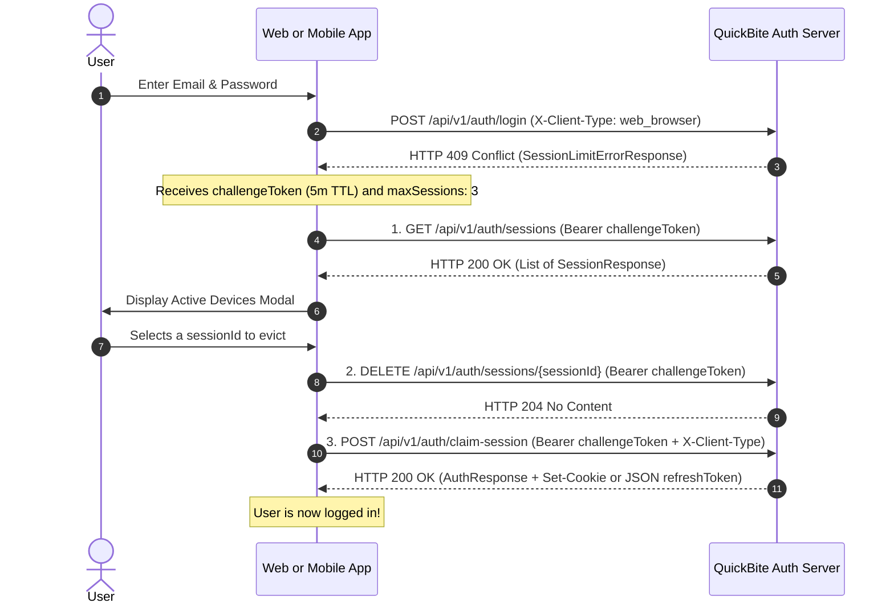

# Client JWT & Session Integration Guide

This guide provides frontend (web browser) and mobile app developers with the exact client integration patterns required to interact with QuickBite's **Dual-JWT & Hybrid Stateful-Session Authentication Architecture**.

---

## 1. Token Specification & Scopes

QuickBite issues two distinct cryptographic JWTs signed using RS256, segregated by the OAuth 2.0 `aud` (Audience) and `type` claims, alongside a 64-byte opaque Refresh Token.

| Token Type | Audience (`aud`) | `type` Claim | Granted Authorities | Lifetime | Transport Channel | Intended Purpose |
| :--- | :--- | :--- | :--- | :--- | :--- | :--- |
| **API Access Token** | `quickbite-api` | `"access"` | `SCOPE_API` + `ROLE_*` | 15 Min (`PT15M`) | `Authorization: Bearer <token>` | Standard business APIs (`/api/v1/customer/**`, `/api/v1/auth/logout`, etc.) |
| **Challenge Token** | `quickbite-auth` | `"session-limit"` | `SCOPE_AUTH` | 5 Min (`PT5M`) | `Authorization: Bearer <token>` | Resolving 409 session limits (`/api/v1/auth/sessions/**`, `/api/v1/auth/claim-session`) |
| **Refresh Token** | N/A (Opaque) | N/A | N/A | 7 Days (`P7D`) | **Web**: `qb_refresh_token` Cookie<br/>**Mobile**: JSON Request/Response Body | Rotating tokens via `POST /api/v1/auth/refresh-token` |

---

## 2. Client-Type Header & Hybrid Refresh Token Transport

### 2.1 Mandatory `X-Client-Type` Header
On `/api/v1/auth/login`, `/api/v1/auth/refresh-token`, and `/api/v1/auth/claim-session`, clients **must** send the `X-Client-Type` header with one of two exact lowercase values:
* `web_browser` &rarr; Maps to `ClientType.WEB_BROWSER`
* `mobile_app` &rarr; Maps to `ClientType.MOBILE_APP`

*(Omitting `X-Client-Type` or passing any other value returns `400 Bad Request`).*

### 2.2 How `X-Client-Type` Changes Token Delivery

| Behavior | `X-Client-Type: web_browser` | `X-Client-Type: mobile_app` |
| :--- | :--- | :--- |
| **Login / Refresh / Claim Response** | Sets `Set-Cookie: qb_refresh_token=<token>; Path=/api/v1/auth; HttpOnly; Secure; SameSite=Strict`. Sets `"refreshToken": null` in JSON body. | Returns raw `"refreshToken": "<token>"` inside the `AuthResponse` JSON body. No cookie is set. |
| **`POST /api/v1/auth/refresh-token` Input** | Reads token automatically from the `qb_refresh_token` cookie (request body can be empty). | Reads token from JSON body: `{ "refreshToken": "<token>" }`. |

### 2.3 `AuthResponse` Payload Structure
```json
{
  "accessToken": "eyJhbGciOiJSUzI1NiIs...",
  "refreshToken": null,
  "expiresIn": 900,
  "sessionId": "0195f3a4-726e-7000-848e-28b3a0e69b51",
  "tokenType": "Bearer"
}
```
*(Note: `refreshToken` is populated with the 64-byte Base64 string when `X-Client-Type: mobile_app`, and `null` when `X-Client-Type: web_browser`).*

---

## 3. Standard Authenticated API Calls

Pass the Access Token in the HTTP `Authorization` header:

```bash
curl -X GET http://localhost:8080/api/v1/customer/me \
     -H "Authorization: Bearer <ACCESS_TOKEN>" \
     -H "Content-Type: application/json"
```

---

## 4. Resolving the `409 Conflict` Session Challenge

QuickBite limits each user to **3 concurrent active sessions** (`quickbite.auth.max-concurrent-sessions = 3`).

When a user attempts to log in from a 4th device, `/api/v1/auth/login` rejects the attempt with **HTTP `409 Conflict`** and returns a `SessionLimitErrorResponse` containing a 5-minute **Challenge Token**.



### Step-by-Step cURL Walkthrough

#### Step 0: Receive `409 Conflict` on Login
```json
{
  "error": "session_limit_exceeded",
  "challengeToken": "eyJhbGciOiJSUzI1NiIs...",
  "maxSessions": 3
}
```

#### Step 1: List Active Sessions
```bash
curl -X GET http://localhost:8080/api/v1/auth/sessions \
     -H "Authorization: Bearer <CHALLENGE_TOKEN>"
```
Response (`200 OK`):
```json
[
  {
    "sessionId": "0195f3a4-726e-7000-848e-28b3a0e69b51",
    "deviceName": "Chrome 126",
    "deviceOS": "Mac OS X",
    "clientType": "WEB_BROWSER",
    "ipAddress": "192.168.1.10",
    "lastUsedAt": "2026-10-15T09:30:00Z",
    "loginAt": "2026-10-14T10:00:00Z",
    "daysLeft": 5
  }
]
```

#### Step 2: Evict a Remote Session
```bash
curl -X DELETE http://localhost:8080/api/v1/auth/sessions/0195f3a4-726e-7000-848e-28b3a0e69b51 \
     -H "Authorization: Bearer <CHALLENGE_TOKEN>"
```

#### Step 3: Claim the Freed Session Slot
```bash
curl -X POST http://localhost:8080/api/v1/auth/claim-session \
     -H "Authorization: Bearer <CHALLENGE_TOKEN>" \
     -H "X-Client-Type: web_browser"
```

---

## 5. Token Rotation & Refresh

### 5.1 Web Browser Refresh (`fetch`)
Because the refresh token resides in an `HttpOnly` cookie scoped to `/api/v1/auth`, browser requests must include `credentials: 'include'` and `X-Client-Type: web_browser`:

```javascript
async function refreshAccessTokenWeb() {
  const response = await fetch('/api/v1/auth/refresh-token', {
    method: 'POST',
    credentials: 'include', // Sends the qb_refresh_token cookie
    headers: {
      'X-Client-Type': 'web_browser'
    }
  });

  if (!response.ok) {
    window.location.href = '/login';
    return null;
  }

  const data = await response.json();
  return data.accessToken;
}
```

### 5.2 Mobile App Refresh
Mobile clients pass the stored refresh token in the JSON request body with `X-Client-Type: mobile_app`:

```bash
curl -X POST http://localhost:8080/api/v1/auth/refresh-token \
     -H "Content-Type: application/json" \
     -H "X-Client-Type: mobile_app" \
     -d '{ "refreshToken": "<STORED_REFRESH_TOKEN>" }'
```

### 5.3 Concurrent Tab Refresh Grace Window
If multiple browser tabs simultaneously call `/api/v1/auth/refresh-token` when an Access Token expires, QuickBite's **Redisson hash lock** (`quickbite:refresh-lock:<hash>`) and **2-second Redis grace cache** (`quickbite:token-grace:<hash>`) ensure all concurrent callers receive the newly rotated token without triggering a false-positive token reuse breach.

---

## 6. Logout Endpoints

Both endpoints require a valid Access Token (`SCOPE_API`) and automatically expire the `qb_refresh_token` cookie:

* **Single Device Logout**: `POST /api/v1/auth/logout` — Revokes only the session bound to the current Access Token's `session_id` claim.
* **Global Logout (All Devices)**: `POST /api/v1/auth/logout-all` — Revokes all active sessions and refresh token families for the user across every device.
