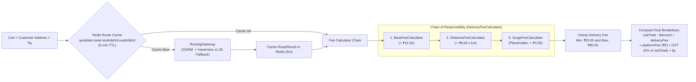
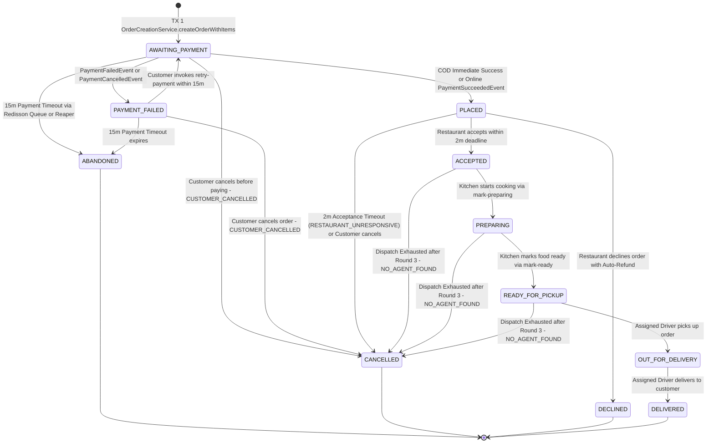
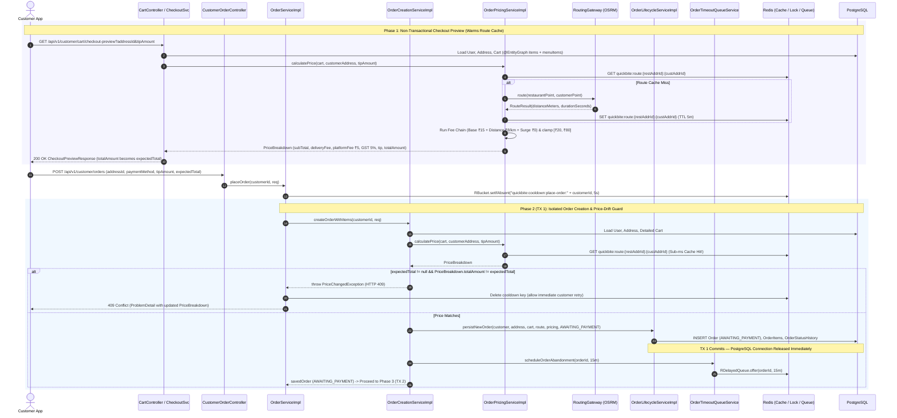
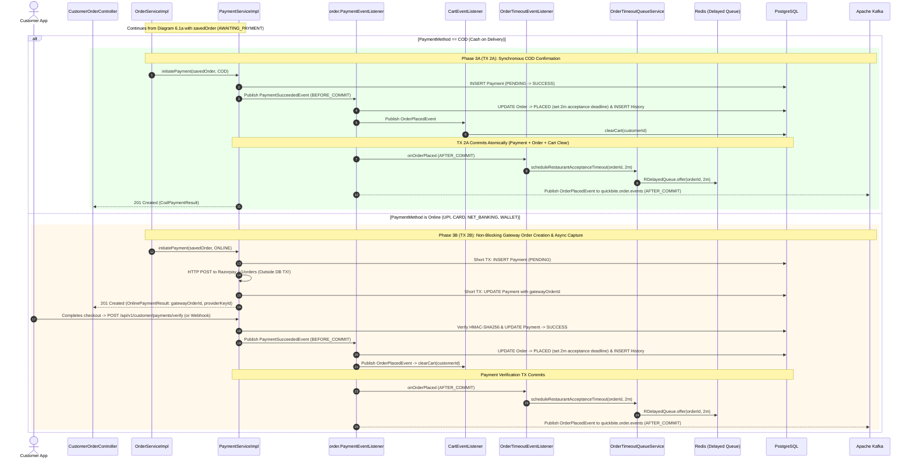
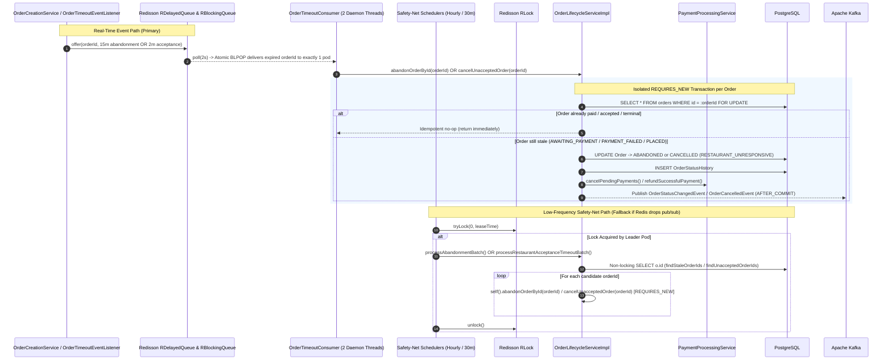
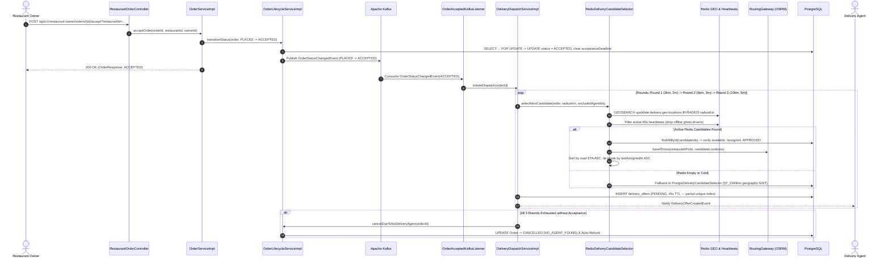
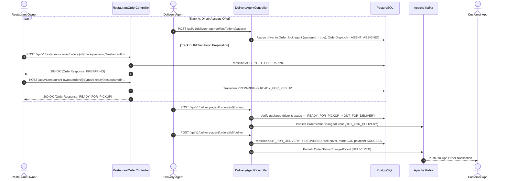

# QuickBite Order & Cart Lifecycle Guide

This document provides an end-to-end architectural and operational guide to QuickBite's **Shopping Cart (`cart`)** and **Order Management (`order`)** domains, detailing how an order progresses from cart assembly and price-drift-protected checkout through payment synchronization, dual-layer Redis delayed timeout queues, kitchen preparation, parallel driver dispatch, and final delivery.

---

## 1. Architectural Overview & Design Principles

The `cart` and `order` bounded contexts are engineered for high concurrency, zero connection holding during external network calls, and strict financial accuracy:

* **Non-Transactional Checkout Orchestration**: [`OrderServiceImpl.placeOrder`](file:///Users/eshant52/Documents/scaler/project/QuickBite/app/QuickBite/src/main/java/com/quickbite/quickbite/order/service/OrderServiceImpl.java), [`retryPayment`](file:///Users/eshant52/Documents/scaler/project/QuickBite/app/QuickBite/src/main/java/com/quickbite/quickbite/order/service/OrderServiceImpl.java), and [`CartCheckoutServiceImpl.getCheckoutPreview`](file:///Users/eshant52/Documents/scaler/project/QuickBite/app/QuickBite/src/main/java/com/quickbite/quickbite/cart/service/CartCheckoutServiceImpl.java) are intentionally non-`@Transactional` orchestrators. Database mutations are delegated to isolated, short-lived transactions (`OrderCreationServiceImpl`, `OrderLifecycleServiceImpl`, `PaymentLifecycleServiceImpl`) so external HTTP calls to routing engines (OSRM/Mapbox) and payment gateways (Razorpay) **never** hold open PostgreSQL connections or row locks.
* **Unified Pricing & Price-Drift Protection**: Both checkout preview (`GET /api/v1/customer/cart/checkout-preview`) and order placement (`POST /api/v1/customer/orders`) delegate to [`OrderPricingServiceImpl`](file:///Users/eshant52/Documents/scaler/project/QuickBite/app/QuickBite/src/main/java/com/quickbite/quickbite/order/service/OrderPricingServiceImpl.java). If a restaurant changes item prices or delivery fees shift between checkout preview and order placement, `OrderCreationServiceImpl` compares the client's `expectedTotal` against the freshly computed `PriceBreakdown.totalAmount()` and aborts with HTTP `409 Conflict` (`PriceChangedException`), returning the updated breakdown.
* **Synchronized Cross-Domain State via `BEFORE_COMMIT` Events**: The `payment` domain never imports `order` repositories. Instead, payment state transitions publish Spring application events (`PaymentSucceededEvent`, `PaymentFailedEvent`, `PaymentCancelledEvent`) handled by [`order.listener.PaymentEventListener`](file:///Users/eshant52/Documents/scaler/project/QuickBite/app/QuickBite/src/main/java/com/quickbite/quickbite/order/listener/PaymentEventListener.java) in `TransactionPhase.BEFORE_COMMIT` so payment and order updates commit or roll back atomically in the same database transaction.
* **Dual-Layer Distributed Timeout Engine**:
  1. **Primary (Real-Time Event-Driven)**: Redisson Delayed Queues (`RDelayedQueue` + `RBlockingQueue`) managed by [`OrderTimeoutQueueService`](file:///Users/eshant52/Documents/scaler/project/QuickBite/app/QuickBite/src/main/java/com/quickbite/quickbite/order/service/OrderTimeoutQueueService.java) and consumed via atomic `BLPOP` by [`OrderTimeoutConsumer`](file:///Users/eshant52/Documents/scaler/project/QuickBite/app/QuickBite/src/main/java/com/quickbite/quickbite/order/consumer/OrderTimeoutConsumer.java) for both the **15-minute payment abandonment window** and the **2-minute kitchen acceptance deadline**.
  2. **Secondary (Safety-Net Reapers)**: [`OrderAbandonmentScheduler`](file:///Users/eshant52/Documents/scaler/project/QuickBite/app/QuickBite/src/main/java/com/quickbite/quickbite/order/scheduler/OrderAbandonmentScheduler.java) and [`RestaurantAcceptanceTimeoutScheduler`](file:///Users/eshant52/Documents/scaler/project/QuickBite/app/QuickBite/src/main/java/com/quickbite/quickbite/order/scheduler/RestaurantAcceptanceTimeoutScheduler.java) periodically sweep PostgreSQL under Redisson distributed locks (`RLock`), fetching candidate IDs without batch locks and isolating each cancellation/abandonment in its own `REQUIRES_NEW` transaction.
* **Parallel Kitchen & Dispatch Execution**: As soon as a restaurant accepts an order (`PLACED` &rarr; `ACCEPTED`), [`OrderAcceptedKafkaListener`](file:///Users/eshant52/Documents/scaler/project/QuickBite/app/QuickBite/src/main/java/com/quickbite/quickbite/delivery/listener/OrderAcceptedKafkaListener.java) triggers the 3-round concentric driver dispatch (via in-memory Redis `GEOSEARCH` with PostGIS fallback) in parallel with kitchen preparation (`ACCEPTED` &rarr; `PREPARING` &rarr; `READY_FOR_PICKUP`).

---

## 2. Package & Component Structure

```
com.quickbite.quickbite
├── cart
│   ├── controller
│   │   └── CartController.java                       # /api/v1/customer/cart endpoints & checkout-preview
│   ├── dto
│   │   ├── AddCartItemRequest.java                   # (menuItemId, quantity)
│   │   ├── CartItemResponse.java                     # Line-item projection
│   │   ├── CartResponse.java                         # Active cart projection with 24h expiresAt
│   │   ├── CheckoutPreviewResponse.java              # Cart + full PriceBreakdown preview
│   │   └── UpdateCartItemRequest.java                # (quantity)
│   ├── exception
│   │   ├── CartConflictException.java                # Cross-restaurant item conflict (HTTP 409)
│   │   └── CartExpiredException.java                 # Expired cart on checkout (HTTP 410 / 400)
│   ├── listener
│   │   └── CartEventListener.java                    # Clears customer cart upon OrderPlacedEvent
│   ├── model
│   │   ├── Cart.java                                 # Customer cart entity (@Version optimistic lock)
│   │   └── CartItem.java                             # Snapshot of MenuItem quantity & unitPrice
│   └── service
│       ├── CartService.java / CartServiceImpl.java   # CRUD, single-restaurant guard, 24h rolling TTL
│       └── CartCheckoutService.java / Impl.java      # Non-transactional checkout preview & route pricing
│
└── order
    ├── consumer
    │   └── OrderTimeoutConsumer.java                 # SmartLifecycle BLPOP worker threads for delayed queues
    ├── controller
    │   ├── AdminOrderController.java                 # POST /api/v1/admin/orders/{orderId}/refund
    │   ├── CustomerOrderController.java              # Place, list, view, retry-payment, cancel, track agent
    │   └── RestaurantOrderController.java            # Kitchen queue: accept, decline, mark-preparing, mark-ready
    ├── dto
    │   ├── AdminRefundOrderRequest.java              # (reason)
    │   ├── AssignedDeliveryAgentResponse.java        # Assigned driver details & live coordinates
    │   ├── OrderItemResponse.java                    # Snapshot line item in order response
    │   ├── OrderResponse.java                        # Complete order detail with items & status history
    │   ├── OrderStatusHistoryDto.java                # Timestamped status audit entry
    │   ├── OrderSummaryResponse.java                 # Cursor-paginated list item projection
    │   └── PlaceOrderRequest.java                    # (addressId, paymentMethod, tipAmount, expectedTotal)
    ├── exception
    │   ├── OrderExpiredException.java                # Payment window expired
    │   ├── OrderNotFoundException.java               # Order lookup failure (HTTP 404)
    │   ├── OrderStateException.java                  # Invalid state transition (HTTP 409)
    │   └── PriceChangedException.java                # Price drift detected at checkout (HTTP 409)
    ├── listener
    │   ├── OrderTimeoutEventListener.java            # Schedules 2m acceptance timeout on OrderPlacedEvent (AFTER_COMMIT)
    │   └── PaymentEventListener.java                 # Syncs Order status on Payment events (BEFORE_COMMIT)
    ├── model
    │   ├── Order.java                                # Audited root aggregate (@Audited, @Version, PostGIS Point)
    │   ├── OrderCancellationReason.java              # RESTAURANT_UNRESPONSIVE, NO_AGENT_FOUND, CUSTOMER_CANCELLED
    │   ├── OrderItem.java                            # Immutable order line item
    │   ├── OrderStatus.java                          # 11-state lifecycle enum
    │   └── OrderStatusHistory.java                   # Append-only status transition audit log
    ├── repository
    │   ├── OrderRepository.java                      # Split cursor queries, @EntityGraph detail loads, lock queries
    │   ├── OrderItemRepository.java                  # Line-item persistence
    │   └── OrderStatusHistoryRepository.java         # Status audit trail persistence
    ├── scheduler
    │   ├── OrderAbandonmentScheduler.java            # Hourly safety-net reaper for stale AWAITING_PAYMENT orders
    │   └── RestaurantAcceptanceTimeoutScheduler.java # 30-min safety-net reaper for unaccepted PLACED orders
    └── service
        ├── AdminOrderService.java / Impl.java        # Post-delivery refund initiation for DELIVERED orders
        ├── CustomerOrderService.java                 # Narrow customer interface
        ├── RestaurantOrderService.java               # Narrow restaurant owner interface
        ├── OrderServiceImpl.java                     # Cooldown & lock orchestrator for Customer & Restaurant
        ├── OrderCreationService.java / Impl.java     # TX 1: Cart validation, pricing, drift check, Order creation
        ├── OrderLifecycleService.java / Impl.java    # Pessimistic locking (SELECT FOR UPDATE) & state machine transitions
        ├── OrderPricingService.java / Impl.java      # Route caching + Chain of Responsibility fee & tax calculation
        ├── OrderTimeoutQueueService.java             # Redisson RDelayedQueue & RBlockingQueue producer
        └── fee
            ├── DeliveryFeeCalculator.java            # Chain of Responsibility interface
            ├── BaseFeeCalculator.java                # Order(1): Base delivery fee (₹15.00)
            ├── DistanceFeeCalculator.java            # Order(2): Distance fee (₹8.00/km)
            └── SurgeFeeCalculator.java               # Order(3): Dynamic demand surge hook (currently +₹0.00)
```

---

## 3. API Surface & Request/Response Payloads

### 3.1 Checkout Preview — `GET /api/v1/customer/cart/checkout-preview`
* **Auth**: `ROLE_CUSTOMER`
* **Query Parameters**: `addressId` (UUID, required), `tipAmount` (BigDecimal $\ge 0.00$, optional)
* **Response (`200 OK` — `CheckoutPreviewResponse`)**:
```json
{
  "restaurantId": "91827364-5544-3322-1100-aabbccddeeff",
  "restaurantName": "Spice Garden",
  "items": [
    {
      "id": "11223344-5566-7788-9900-aabbccddeeff",
      "menuItemId": "aabbccdd-1122-3344-5566-77889900aabb",
      "menuItemName": "Paneer Butter Masala",
      "quantity": 2,
      "unitPrice": 225.00,
      "subTotal": 450.00
    }
  ],
  "priceBreakdown": {
    "subTotal": 450.00,
    "discountAmount": 0.00,
    "deliveryFee": 38.00,
    "platformFee": 5.00,
    "taxAmount": 22.50,
    "tipAmount": 20.00,
    "totalAmount": 535.50,
    "deliveryDistanceMeters": 3200.0,
    "estimatedDeliverySeconds": 540
  }
}
```

### 3.2 Place Order — `POST /api/v1/customer/orders`
* **Auth**: `ROLE_CUSTOMER`
* **Request Payload (`PlaceOrderRequest`)**:
```json
{
  "addressId": "550e8400-e29b-41d4-a716-446655440000",
  "paymentMethod": "UPI",
  "tipAmount": 20.00,
  "expectedTotal": 535.50
}
```
* **Price Drift Response (`409 Conflict` — `ProblemDetail`)**:
```json
{
  "type": "about:blank",
  "title": "Price Changed",
  "status": 409,
  "detail": "Order total has changed from ₹535.50 to ₹548.00. Please review the updated price.",
  "expectedTotal": 535.50,
  "currentTotal": 548.00,
  "priceBreakdown": {
    "subTotal": 462.50,
    "discountAmount": 0.00,
    "deliveryFee": 38.00,
    "platformFee": 5.00,
    "taxAmount": 22.50,
    "tipAmount": 20.00,
    "totalAmount": 548.00,
    "deliveryDistanceMeters": 3200.0,
    "estimatedDeliverySeconds": 540
  }
}
```

### 3.3 Complete Order Endpoints Summary

| Role | HTTP Method & Path | Controller Method | Description |
| :--- | :--- | :--- | :--- |
| `CUSTOMER` | `GET /api/v1/customer/cart/checkout-preview` | `CartController.getCheckoutPreview` | Computes live route, delivery fee, GST, and `totalAmount` |
| `CUSTOMER` | `POST /api/v1/customer/orders` | `CustomerOrderController.placeOrder` | Validates `expectedTotal`, creates order (TX 1), initiates payment (TX 2) |
| `CUSTOMER` | `GET /api/v1/customer/orders` | `CustomerOrderController.listMyOrders` | Cursor-paginated customer order history (`idx_orders_customer_id`) |
| `CUSTOMER` | `GET /api/v1/customer/orders/{orderId}` | `CustomerOrderController.getOrderById` | Full order detail loaded via `@EntityGraph` |
| `CUSTOMER` | `POST /api/v1/customer/orders/{orderId}/retry-payment` | `CustomerOrderController.retryPayment` | Reconciles prior attempts under `RLock` and initiates retry within 15m TTL |
| `CUSTOMER` | `DELETE /api/v1/customer/orders/{orderId}/cancel` | `CustomerOrderController.cancelOrder` | Cancels order if in `AWAITING_PAYMENT`, `PAYMENT_FAILED`, or `PLACED` |
| `CUSTOMER` | `GET /api/v1/customer/orders/{orderId}/delivery-agent` | `CustomerOrderController.getAssignedDeliveryAgent` | Returns assigned delivery agent details & live location |
| `RESTAURANT_OWNER` | `GET /api/v1/restaurant-owner/orders` | `RestaurantOrderController.listRestaurantOrders` | Cursor-paginated kitchen queue with optional `status` filter |
| `RESTAURANT_OWNER` | `GET /api/v1/restaurant-owner/orders/{orderId}` | `RestaurantOrderController.getRestaurantOrder` | Full order detail for restaurant owner via `@EntityGraph` |
| `RESTAURANT_OWNER` | `POST /api/v1/restaurant-owner/orders/{orderId}/accept` | `RestaurantOrderController.acceptRestaurantOrder` | Transitions `PLACED` &rarr; `ACCEPTED` within 2m deadline; triggers dispatch |
| `RESTAURANT_OWNER` | `POST /api/v1/restaurant-owner/orders/{orderId}/decline` | `RestaurantOrderController.declineRestaurantOrder` | Transitions `PLACED` &rarr; `DECLINED` and triggers auto-refund |
| `RESTAURANT_OWNER` | `POST /api/v1/restaurant-owner/orders/{orderId}/mark-preparing` | `RestaurantOrderController.markPreparingRestaurantOrder` | Transitions `ACCEPTED` &rarr; `PREPARING` |
| `RESTAURANT_OWNER` | `POST /api/v1/restaurant-owner/orders/{orderId}/mark-ready` | `RestaurantOrderController.markReadyForPickupRestaurantOrder` | Transitions `PREPARING` &rarr; `READY_FOR_PICKUP` |
| `ADMIN` | `POST /api/v1/admin/orders/{orderId}/refund` | `AdminOrderController.refundDeliveredOrder` | Issues post-delivery refund for `DELIVERED` order |

---

## 4. Shopping Cart & Dynamic Pricing Engine

### 4.1 Single-Restaurant Rule & Rolling 24-Hour TTL (`CartServiceImpl`)
1. **Single-Restaurant Invariant**: A customer can have at most one active `Cart` at a time, bound to a single `Restaurant`. Adding a `MenuItem` from a different restaurant throws `CartConflictException` (`409 Conflict`), prompting the user to clear their cart first.
2. **Rolling 24-Hour Expiration**: Every cart creation or item mutation resets `cart.expiresAt = Instant.now().plus(24, HOURS)`. If an expired cart is accessed during `getCart`, `addItem`, `getCheckoutPreview`, or `placeOrder`, it is automatically deleted.
3. **Auto-Clear on Order Placement**: The cart is **not** deleted while online payment is still pending (allowing the customer to modify their cart or retry if they abandon checkout). Only when an order reaches `OrderStatus.PLACED` (`OrderPlacedEvent`) does [`CartEventListener`](file:///Users/eshant52/Documents/scaler/project/QuickBite/app/QuickBite/src/main/java/com/quickbite/quickbite/cart/listener/CartEventListener.java) clear the customer's cart.

### 4.2 Checkout Preview & Chain-of-Responsibility Pricing (`OrderPricingServiceImpl`)
Calling `GET /api/v1/customer/cart/checkout-preview?addressId=<uuid>&tipAmount=20.00` (or placing an order) invokes `OrderPricingServiceImpl.calculatePrice`:



#### Price Breakdown Formula
$$\text{Delivery Fee} = \min\Big(₹80.00, \; \max\big(₹20.00, \; ₹15.00 + (₹8.00 \times \text{distance}_{\text{km}}) + \text{surge}\big)\Big)$$

$$\text{Tax Amount (GST)} = \text{round}(\text{SubTotal} \times 0.05, \; 2)$$

$$\text{Total Amount} = \text{SubTotal} - \text{Discount} + \text{Delivery Fee} + \text{Platform Fee (₹5.00)} + \text{Tax Amount} + \text{Tip Amount}$$

---

## 5. Authoritative Order State Machine (`OrderStatus`)

`OrderStatus` defines **11 states** partitioned into Pre-Payment, Active/Intermediate, and Terminal categories. Every transition is recorded in the append-only `order_status_history` table and guarded by pessimistic row locking (`SELECT ... FOR UPDATE`).



### Cancellation Reasons (`OrderCancellationReason`)
When an order enters `OrderStatus.CANCELLED`, `order.cancellationReason` records the exact cause:
* **`CUSTOMER_CANCELLED`**: Customer cancelled the order while in `AWAITING_PAYMENT`, `PAYMENT_FAILED`, or `PLACED` (before the restaurant accepted it). Once the restaurant accepts (`ACCEPTED`), customer cancellation is blocked (`409 Conflict`).
* **`RESTAURANT_UNRESPONSIVE`**: The restaurant failed to accept or decline the `PLACED` order within the **2-minute (`PT2M`)** acceptance deadline.
* **`NO_AGENT_FOUND`**: All 3 concentric dispatch rounds (`3km` &rarr; `6km` &rarr; `10km`) expired without an available delivery agent accepting the offer.

---

## 6. End-to-End Checkout Preview & Order Placement Flow

### 6.1 Unified Preview & Two-Transaction Checkout (`GET /checkout-preview` &rarr; `POST /orders`)

To prevent double-clicks, price drift, and HikariCP connection pool exhaustion:
1. **Checkout Preview (`CartCheckoutServiceImpl.getCheckoutPreview`)**: Runs without `@Transactional`. Loads User, Address, and Cart (via `@EntityGraph`), validates item availability, and invokes `OrderPricingServiceImpl.calculatePrice`. This warms the 5-minute Redis route cache (`quickbite:route:<restAddrId>:<custAddrId>`).
2. **5-Second Cooldown Guard**: `OrderServiceImpl.placeOrder` acquires a Redisson bucket `quickbite:cooldown:place-order:<customerId>` (`SET NX EX 5s`). If order validation fails, the cooldown key is immediately deleted in the `catch` block so the user can fix the issue and retry.
3. **TX 1 (`OrderCreationServiceImpl.createOrderWithItems`)**:
   - Validates customer, delivery address, active non-expired cart, and item availability.
   - Computes `PriceBreakdown` (hitting the warm Redis route cache) and verifies `req.expectedTotal()` (throws `PriceChangedException` on mismatch).
   - Persists `Order` in `AWAITING_PAYMENT` via `OrderLifecycleService.persistNewOrder`, snapshots `OrderItem` rows, writes initial `OrderStatusHistory`, and **commits TX 1** (releasing the DB connection).
   - Schedules the 15-minute abandonment timer in Redisson (`OrderTimeoutQueueService.scheduleOrderAbandonment`).
4. **TX 2 (`PaymentProcessingService.initiatePayment`)**: Branches by `PaymentMethod` (`COD` vs `ONLINE`).

#### Diagram 6.1a: Phase 1 (Checkout Preview) & Phase 2 (TX 1: Order Creation & Price-Drift Guard)



#### Diagram 6.1b: Phase 3 (TX 2: Payment Initiation, COD vs. Online Branches & Order Placement Sync)



---

### 6.2 Payment Failure, Multi-Attempt Reconciliation & Retry (`POST /api/v1/customer/orders/{orderId}/retry-payment`)

If an online payment attempt fails (or is cancelled), `PaymentEventListener` transitions the order from `AWAITING_PAYMENT` to `PAYMENT_FAILED`. The customer can retry payment within the 15-minute window:

1. **Distributed Retry Lock**: Acquires Redisson lock `quickbite:lock:retry-payment:<orderId>` (30s lease).
2. **Pessimistic Row Check**: `OrderLifecycleService.prepareOrderForRetry` locks the `Order` row (`SELECT ... FOR UPDATE`) and verifies it belongs to the customer and is not in a terminal state.
3. **Pre-Retry Gateway Reconciliation (`First-Success-Wins`)**: Calls `paymentService.reconcileAllPaymentAttempts(orderId)` before creating a new gateway order. If a prior attempt was actually captured at Razorpay (e.g., due to a dropped mobile connection), it reconciles that payment to `SUCCESS`, transitions the order to `PLACED`, and returns the winning result without charging the customer twice. If multiple prior attempts were captured, duplicate captures are automatically refunded.
4. **15-Minute Window Enforcement**: If no prior attempt succeeded and `order.createdAt` is older than 15 minutes, `OrderExpiredException` is thrown, caught by `OrderServiceImpl`, and the order is immediately transitioned to `ABANDONED` in an isolated `REQUIRES_NEW` transaction before returning HTTP `400 Bad Request`.
5. **New Payment Initiation**: Resets `PAYMENT_FAILED` &rarr; `AWAITING_PAYMENT` and initiates a fresh `Payment` attempt (even allowing the customer to switch payment methods, e.g., from `CARD` to `UPI` or `COD`).

### 6.3 Late Payment Capture Auto-Refund Guard
What happens if a customer's payment takes 16 minutes to clear at the bank, arriving via webhook **after** the order was already marked `ABANDONED` or `CANCELLED`?
* `PaymentEventListener.handlePaymentSucceeded` inspects `order.getCurrentStatus()`.
* If the order is in `ABANDONED`, `CANCELLED`, or `DECLINED`, it logs a warning and publishes `PaymentRefundRequestedEvent` (`AFTER_COMMIT`), which `PaymentRefundListener` consumes to issue an automatic full refund via Razorpay.

---

## 7. Dual-Layer Timeout Architecture (Redisson Delayed Queue + Safety-Net Reapers)

Instead of hammering PostgreSQL with high-frequency polling queries every few seconds, QuickBite uses an event-driven **Redisson Delayed Queue** paired with low-frequency **Safety-Net Reapers**:



| Timeout Type | Delay / TTL | Redis Queue Name | Safety-Net Reaper Interval | Action on Expiry |
| :--- | :--- | :--- | :--- | :--- |
| **Order Payment Abandonment** | **15 Minutes** (`abandon-ttl-minutes`) | `quickbite:order:queue:abandonment-timeout` | Hourly (`0 0 * * * *`) | If still in `AWAITING_PAYMENT` or `PAYMENT_FAILED`, transitions to `ABANDONED` and cancels pending payments. |
| **Restaurant Acceptance Deadline** | **2 Minutes** (`PT2M`) | `quickbite:order:queue:acceptance-timeout` | Every 30 Minutes (`1800000ms`) | If still in `PLACED`, transitions to `CANCELLED` (`RESTAURANT_UNRESPONSIVE`) and auto-refunds any captured payment. |

---

## 8. Kitchen Fulfillment & Parallel Delivery Dispatch

Once an order reaches `OrderStatus.PLACED`, it appears in the restaurant owner's live queue (`GET /api/v1/restaurant-owner/orders?restaurantId=<uuid>&status=PLACED`). When accepted, driver search uses in-memory **Redis GEO (`RedisDeliveryCandidateSelector`)** with automatic fallback to **PostGIS (`PostgisDeliveryCandidateSelector`)**.

#### Diagram 8.1: Restaurant Acceptance & Concentric Driver Dispatch (Redis GEO + PostGIS Fallback)



#### Diagram 8.2: Offer Acceptance, Kitchen Preparation, Pickup & Final Delivery



### Post-Delivery Admin Refunds (`AdminOrderController`)
If a customer reports a quality or fulfillment issue after an order has reached `OrderStatus.DELIVERED`, an administrator can trigger a post-delivery refund:
* **Endpoint**: `POST /api/v1/admin/orders/{orderId}/refund` (`ROLE_ADMIN`)
* **Payload**: `{ "reason": "Missing item reported by customer" }`
* **Behavior**: `AdminOrderServiceImpl.refundDeliveredOrder` verifies `order.getCurrentStatus() == OrderStatus.DELIVERED` and delegates to `paymentService.refundSuccessfulPayment(orderId, reason)`, which emits `PaymentRefundRequestedEvent` to refund the customer via Razorpay while keeping the historical order status as `DELIVERED`.

---

## 9. Performance & Metric Optimizations Achieved

### 9.1 Database Indexing (`V33` & `V34` Migrations)
* **Composite Cursor Pagination Indexes (`V33`)**:
  * `idx_orders_customer_id ON orders (customer_id, id DESC)`: Serves customer order history (`WHERE customer_id = ? AND id < ? ORDER BY id DESC LIMIT n`) via a pure B-tree index scan with zero sort step and $O(1)$ page depth.
  * `idx_orders_restaurant_status ON orders (restaurant_id, current_status, id DESC)` and `idx_orders_restaurant_id ON orders (restaurant_id, id DESC)`: Serves live kitchen filtering and restaurant order history.
  * **Split Derived Repository Queries**: Replaced conditional JPQL (`:cursor IS NULL OR o.id < :cursor`) in [`OrderRepository`](file:///Users/eshant52/Documents/scaler/project/QuickBite/app/QuickBite/src/main/java/com/quickbite/quickbite/order/repository/OrderRepository.java) with explicit un-cursored (`findByCustomerIdOrderByIdDesc`) and cursored (`findByCustomerIdAndIdLessThanOrderByIdDesc`) queries so PostgreSQL's planner always selects the composite index range scan.
* **Foreign Key & Timeline Indexes (`V33`)**:
  * `idx_order_items_order_id ON order_items (order_id)` and `idx_order_status_history_order_created ON order_status_history (order_id, created_at ASC)` eliminate sequential scans when hydrating order details.
  * `idx_payments_order_id_created ON payments (order_id, created_at ASC)` accelerates multi-attempt payment reconciliation.
* **PostGIS Functional Geography GiST Indexes (`V33`)**:
  * `idx_addresses_location_geog` and `idx_delivery_agents_location_geog` index `CAST(location AS geography)` using `GIST`, plus partial index `idx_delivery_agents_dispatch_available` (`WHERE is_available = true AND is_assigned = false AND current_status = 'APPROVED' AND current_vehicle_id IS NOT NULL`), ensuring `ST_DWithin` queries use spatial index scans instead of bypassing geometry indexes.
* **Redundant Index Pruning (`V34`)**:
  * Dropped duplicate/superseded indexes (`idx_delivery_agents_location_gist`, `idx_delivery_agents_user_id`, `idx_addresses_location`, `idx_delivery_agents_available_status`) to reduce `INSERT`/`UPDATE` write amplification.
* **N+1 Elimination via `@EntityGraph`**:
  * `findDetailedByIdAndCustomerId` and `findDetailedByIdAndRestaurantId` fetch `restaurant`, `deliveryAgent`, `deliveryAgent.user`, and `items` in a single SQL join query.

### 9.2 Stampede-Safe Redis Caching & Route Caching
* **Transaction-Aware Domain Caches (`RedisConfig`)**: Configured with `@Cacheable(..., sync = true)` (preventing cache stampedes under concurrent load) and `.transactionAware()` (delaying `@CacheEvict` until transaction commit):
  * `cuisines` (24h TTL), `restaurant_profile` (30m TTL), `restaurant_rating_summary` (1h TTL), `restaurant_menu` (15m TTL), `user_profile` (15m TTL), `user_addresses` (15m TTL), `notification_unread_count` (5m TTL).
* **OSRM Route Cache (`OrderPricingServiceImpl`)**: Caches `RouteResult` under `quickbite:route:<restAddrId>:<custAddrId>` for **5 minutes**. Because `GET /checkout-preview` populates this key, the subsequent `POST /orders` call achieves a sub-millisecond Redis hit, completely bypassing external OSRM HTTP latency during order placement.

### 9.3 Event-Driven Timeouts & In-Memory Geospatial Dispatch
* **Zero Idle DB Polling**: Replaced 30-second/5-minute DB polling sweeps with Redisson `RDelayedQueue` + `RBlockingQueue` (`BLPOP`), reducing idle timeout polling queries to ~0/hour while delivering sub-second timeout accuracy.
* **In-Memory Driver Selection (`RedisDeliveryCandidateSelector`)**: Queries `quickbite:delivery:geo:locations` via Redis `GEOSEARCH` and filters 60-second heartbeat keys (`quickbite:delivery:geo:heartbeat:<agentId>`) in RAM before hydrating only eligible drivers from PostgreSQL.

---

## 10. Configuration Reference (`application.properties`)

```properties
# Order Lifecycle & Timeouts
quickbite.order.abandon-ttl-minutes=15
quickbite.order.abandon-batch-size=100
quickbite.order.abandon-cron=0 0 * * * *
quickbite.order.place-cooldown-seconds=5
quickbite.order.restaurant-acceptance-window=PT2M
quickbite.order.delayed-queue-enabled=true
quickbite.order.acceptance-queue-name=quickbite:order:queue:acceptance-timeout
quickbite.order.abandonment-queue-name=quickbite:order:queue:abandonment-timeout
quickbite.order.acceptance-poll-interval-ms=1800000

# Delivery Fee Chain (Base + Distance + Surge)
quickbite.fee.base-fee=15.00
quickbite.fee.rate-per-km=8.00
quickbite.fee.min-fee=20.00
quickbite.fee.max-fee=80.00

# Platform Fee & Tax (GST)
quickbite.pricing.platform-fee=5.00
quickbite.pricing.gst-rate=0.05
```
