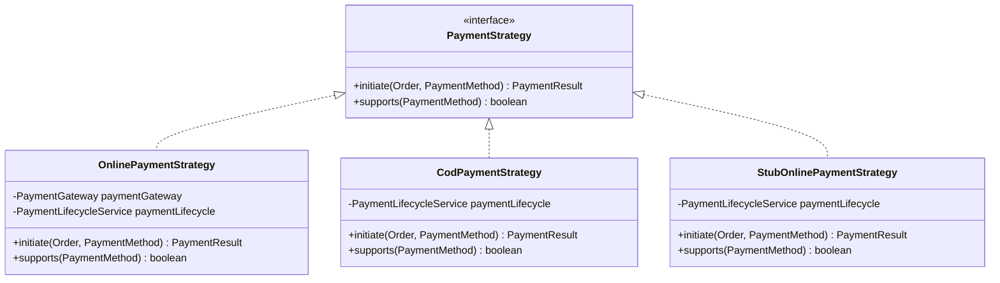
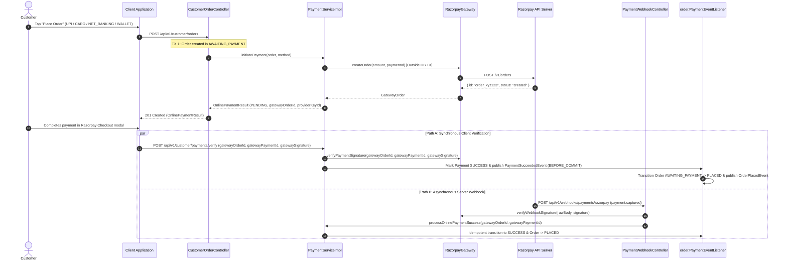
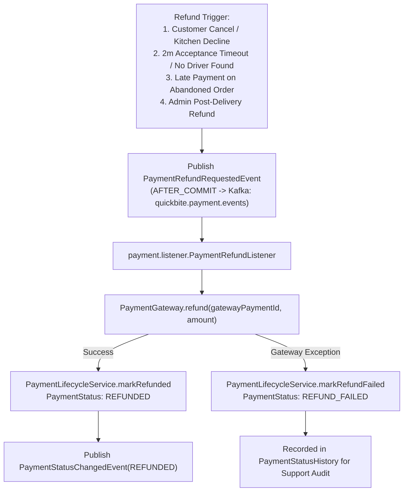

# QuickBite Payments, Webhooks & Automated Reconciliation

This document provides a comprehensive technical guide to QuickBite's payment processing architecture, multi-strategy payment engine, Razorpay gateway integration, webhook verification, background reconciliation schedulers, and Kafka-driven refund orchestration.

---

## 1. Architectural Overview & Strategy Pattern

Payment processing is built around the **Strategy Pattern** to support multiple payment methods without polluting domain entities or business logic with gateway-specific branching.



### Supported Payment Strategies & Methods (`PaymentMethod`)

| Strategy | Active Profiles | Supported `PaymentMethod` Values | Flow Description |
| :--- | :--- | :--- | :--- |
| **`OnlinePaymentStrategy`** | `!dev` or `razorpay` | `UPI`, `CARD`, `NET_BANKING`, `WALLET` (`method.isOnline()`) | Creates a `PENDING` payment in TX, calls `PaymentGateway.createOrder` **outside** TX, and updates `gatewayOrderId`. Order stays `AWAITING_PAYMENT` until verified or captured via webhook. |
| **`CodPaymentStrategy`** | All | `COD` | Creates a `PENDING` payment and immediately marks it `SUCCESS`, firing `PaymentSucceededEvent` (`BEFORE_COMMIT`) so the order transitions to `PLACED` and clears the cart. |
| **`StubOnlinePaymentStrategy`** | `dev & !razorpay` | `UPI`, `CARD`, `NET_BANKING`, `WALLET` | Development stub that returns a local `paymentUrl` without external Razorpay network calls. |

---

## 2. End-to-End Online Payment Lifecycle



---

## 3. Cryptographic Signature Verification & Webhooks

To guard against MITM tampering, both client-side verification and background webhook processing enforce strict **HMAC-SHA256 signature verification**.

### 3.1 Client Checkout Verification (`POST /api/v1/customer/payments/verify`)
When a customer completes checkout in the frontend Razorpay modal, the client submits `OnlinePaymentVerifyRequest`:
* `gatewayOrderId`
* `gatewayPaymentId`
* `gatewaySignature`

`RazorpayGateway.verifyPaymentSignature` validates the signature using:

$$\text{Expected Signature} = \text{HMAC-SHA256}\Big(\text{gatewayOrderId} + \text{"|"} + \text{gatewayPaymentId}, \; \text{keySecret}\Big)$$

If valid, `PaymentLifecycleServiceImpl.processOnlinePaymentSuccess` locks the payment row (`SELECT ... FOR UPDATE`), marks it `SUCCESS`, cancels any sibling pending attempts for the same order, and publishes `PaymentSucceededEvent` (`BEFORE_COMMIT`).

### 3.2 Webhook Signature & Idempotency Defense (`POST /api/v1/webhooks/payments/razorpay`)
Incoming webhooks include the header `X-Razorpay-Signature`:
* **Signature Check**: Verified via `HMAC-SHA256(rawBody, webhookSecret)`. Invalid signatures fail with `400 Bad Request`.
* **Handled Events**:
  - `payment.captured` &rarr; `processOnlinePaymentSuccess(gatewayOrderId, gatewayPaymentId)`
  - `payment.failed` &rarr; `processOnlinePaymentFailed(gatewayOrderId, failureReason)` (transitions Order to `PAYMENT_FAILED`)
* **Pessimistic Row Lock & Idempotency**: If both `/verify` and the `payment.captured` webhook arrive concurrently, `findByGatewayOrderIdForUpdate` serializes execution at the database row level; the second caller observes `PaymentStatus == SUCCESS` and exits as a no-op.

---

## 4. Timeout Queues, Abandonment & Active Reconciliation

### 4.1 Dual-Layer Order Abandonment (`OrderTimeoutConsumer` + `OrderAbandonmentScheduler`)
* **Problem**: Customers initiate online checkout (`OrderStatus = AWAITING_PAYMENT`), creating a pending payment, but close the app before paying.
* **Layer 1 (Real-Time Redisson Delayed Queue)**: `OrderCreationServiceImpl` schedules the order ID into `quickbite:order:queue:abandonment-timeout` with a **15-minute delay** (`quickbite.order.abandon-ttl-minutes = 15`). `OrderTimeoutConsumer` pops expired order IDs via atomic `BLPOP` and invokes `OrderLifecycleService.abandonOrderById`.
* **Layer 2 (Hourly Safety-Net Reaper)**: `OrderAbandonmentScheduler` runs on cron `0 0 * * * *` under a Redisson distributed lock to sweep any stale `AWAITING_PAYMENT` or `PAYMENT_FAILED` orders older than 15 minutes.
* **Effect**: Transitions the order to `ABANDONED` and cancels all `PENDING` payment records (`PaymentStatus.CANCELLED`).

### 4.2 Multi-Attempt Payment Reconciliation (`PaymentReconciliationServiceImpl`)
* **On-Demand Polling & Pre-Retry Reconciliation**: Whenever a client polls `GET /api/v1/customer/payments/order/{orderId}` (while the latest attempt is `PENDING`) or calls `POST /api/v1/customer/orders/{orderId}/retry-payment`, `reconcileAllPaymentAttempts(orderId)` queries Razorpay for every online attempt on that order.
* **First-Success-Wins & Duplicate Capture Protection**:
  - The earliest captured payment is marked `SUCCESS` and fulfills the order (`PLACED`).
  - If a customer accidentally paid twice across multiple attempts, any subsequent captured payments are automatically marked for refund via `PaymentRefundRequestedEvent`.
  - If a payment succeeded at the gateway *after* the order was already `ABANDONED`, `CANCELLED`, or `DECLINED`, `PaymentEventListener` automatically triggers a full gateway refund.

---

## 5. Kafka-Driven Refund Orchestration

When an order is cancelled (by the customer, 2-minute kitchen timeout, or dispatch exhaustion), declined by the restaurant, or refunded post-delivery by an admin:



---

## 6. Configuration Reference

```properties
# Razorpay Credentials (set in .env or environment)
razorpay.key-id=${RAZORPAY_KEY_ID}
razorpay.key-secret=${RAZORPAY_KEY_SECRET}
razorpay.webhook-secret=${RAZORPAY_WEBHOOK_SECRET}

# Order Abandonment & Timeouts
quickbite.order.abandon-ttl-minutes=15
quickbite.order.abandon-cron=0 0 * * * *
quickbite.order.abandon-batch-size=100
quickbite.order.place-cooldown-seconds=5
quickbite.order.restaurant-acceptance-window=PT2M
quickbite.order.delayed-queue-enabled=true
```
