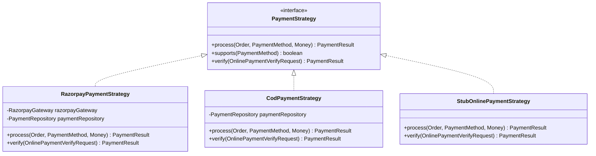
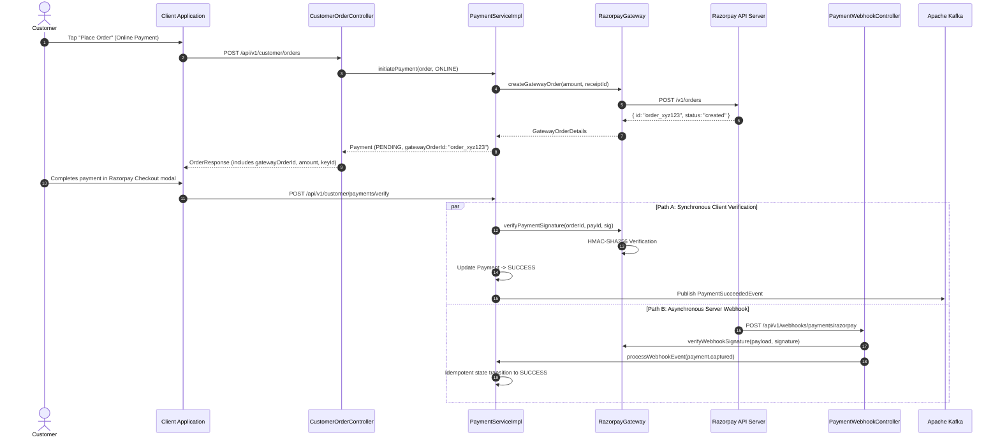

# QuickBite Payments, Webhooks & Automated Reconciliation

This document provides a comprehensive technical guide to QuickBite's payment processing architecture, multi-strategy payment engine, Razorpay gateway integration, webhook verification, background reconciliation schedulers, and Kafka-driven refund orchestration.

---

## 1. Architectural Overview & Strategy Pattern

Payment processing is built around the **Strategy Pattern** to support multiple payment methods without polluting domain entities or business logic with gateway-specific branching.



### Supported Payment Strategies

| Strategy | Supported Method | Flow Description |
| :--- | :--- | :--- |
| **`RazorpayPaymentStrategy`** | `ONLINE` | Generates a remote Razorpay Order ID; verifies cryptographic client signatures and processes asynchronous webhooks. |
| **`CodPaymentStrategy`** | `COD` | Immediately marks the order as confirmed with payment status `PENDING`; transitions to `SUCCESS` upon delivery confirmation. |
| **`StubOnlinePaymentStrategy`** | `ONLINE` (Stub Profile) | Development stub that simulates payment successes or failures without hitting external Razorpay servers. |

---

## 2. End-to-End Online Payment Lifecycle



---

## 3. Cryptographic Signature Verification & Webhooks

To guard against MITM tampering, both client-side verification and background webhook processing enforce strict **HMAC-SHA256 signature verification**.

### 3.1 Client Checkout Verification
When a customer completes a checkout in the frontend Razorpay modal, the client receives:
* `razorpay_order_id`
* `razorpay_payment_id`
* `razorpay_signature`

The server verifies the signature using:

$$\text{Expected Signature} = \text{HMAC-SHA256}\Big(\text{razorpay\_order\_id} + \text{"|"} + \text{razorpay\_payment\_id}, \; \text{key\_secret}\Big)$$

If the generated hash matches `razorpay_signature`, the payment is transitioned to `SUCCESS`.

### 3.2 Webhook Signature & Idempotency Defense
Incoming webhooks sent to `POST /api/v1/webhooks/payments/razorpay` contain the header `X-Razorpay-Signature`.

* **Signature Check**: Verified using `HMAC-SHA256(rawPayloadBytes, webhookSecret)`. Requests failing verification return `400 Bad Request` immediately.
* **Redisson Distributed Lock**: Each webhook event acquires a distributed lock on the order (`payment:order:{orderId}`). If both the client verify endpoint and the webhook fire simultaneously, only the first lock-holder mutates the state machine. The second execution observes `PaymentStatus == SUCCESS` and exits idempotently without firing duplicate Kafka events.

---

## 4. Background Automated Schedulers

### 4.1 Order Abandonment Scheduler (`OrderAbandonmentScheduler`)
* **Problem**: Customers initiate checkout, creating orders with `OrderStatus = PAYMENT_PENDING`, but abandon the transaction before completion.
* **Mechanism**: Runs on a background cron (`quickbite.order.abandon-cron = 0 0 * * * *`) every hour.
* **Logic**: Queries all orders remaining in `PAYMENT_PENDING` older than **15 minutes** (`quickbite.order.abandon-ttl-minutes = 15`), marks their status as `ABANDONED`, cancels the corresponding payment attempt, and frees held resources.

### 4.2 Payment Reconciliation Service (`PaymentReconciliationServiceImpl`)
* **Problem**: Network partitions or gateway drops may cause a payment to succeed on Razorpay without the server receiving the client callback or webhook.
* **Mechanism**: Schedulers scan pending payments older than a configured grace threshold and invoke `RazorpayGateway.fetchGatewayOrderStatus(gatewayOrderId)`.
* **State Correction**: If the gateway indicates `captured`, the internal record is reconciled to `SUCCESS` and an order status update event is published. If the gateway indicates `failed`, the payment is marked `FAILED`.

---

## 5. Kafka-Driven Refund Orchestration

When an order is cancelled or declined by a restaurant kitchen, an automated refund is executed asynchronously:

```mermaid
flowchart TD
    CancelEvent["OrderCancelledEvent<br/>(Restaurant Declined / Acceptance Timeout)"] --> PaymentRefundListener
    PaymentRefundListener --> RefundCheck{"Was PaymentMethod ONLINE<br/>and Status SUCCESS?"}
    
    RefundCheck -->|No (COD / Unpaid)| Skip["No Gateway Refund Required"]
    RefundCheck -->|Yes| RazorpayRefund["RazorpayGateway.refund(paymentId, amount)"]
    
    RazorpayRefund -->|Success| SuccessUpdate["PaymentStatus: REFUNDED<br/>OrderStatus: REFUNDED"]
    SuccessUpdate --> PubSuccess["Kafka: PaymentStatusChangedEvent(REFUNDED)"]
    
    RazorpayRefund -->|Gateway Error| FailUpdate["PaymentStatus: REFUND_FAILED<br/>(Flagged for Manual Admin Audit)"]
    FailUpdate --> PubFail["Kafka: PaymentStatusChangedEvent(REFUND_FAILED)"]
```

1. **Trigger**: An `OrderCancelledEvent` or `PaymentRefundRequestedEvent` is emitted on topic `quickbite.order.events` or `quickbite.payment.events`.
2. **Listener**: `payment.listener.PaymentRefundListener` receives the event.
3. **Execution**: If the order was paid online, `RazorpayGateway.refund(...)` executes a full refund via the Razorpay REST API.
4. **State Transition**: The payment status transitions to `REFUND_PENDING` and then `REFUNDED`. If an unrecoverable gateway error occurs, the status transitions to `REFUND_FAILED` for administrative review via `/api/v1/admin/orders/{orderId}/refund`.

---

## 6. Configuration Reference

```properties
# Razorpay Credentials (set in .env or environment)
razorpay.key-id=${RAZORPAY_KEY_ID}
razorpay.key-secret=${RAZORPAY_KEY_SECRET}
razorpay.webhook-secret=${RAZORPAY_WEBHOOK_SECRET}

# Order Abandonment & Reconciliation
quickbite.order.abandon-ttl-minutes=15
quickbite.order.abandon-cron=0 0 * * * *
quickbite.order.abandon-batch-size=100
quickbite.order.place-cooldown-seconds=5
```
