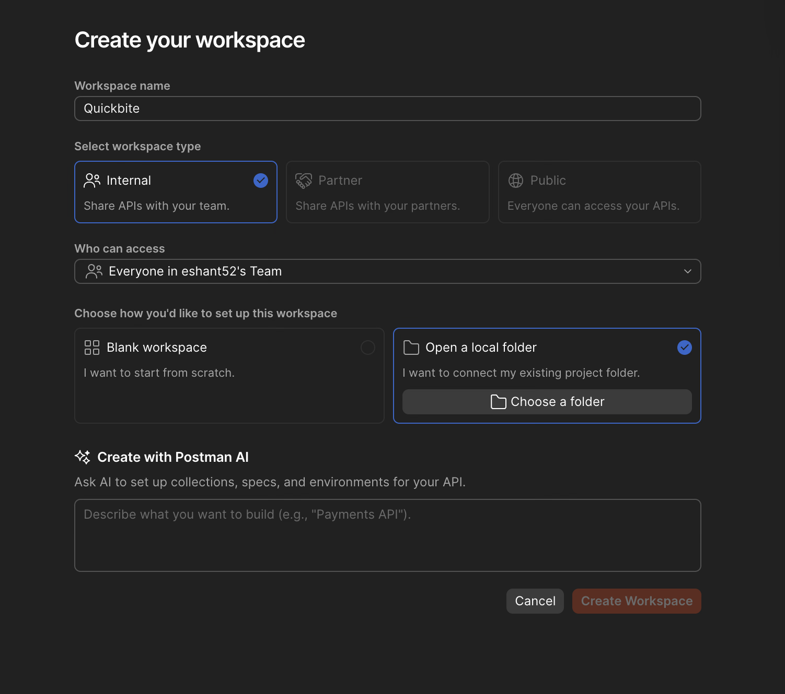
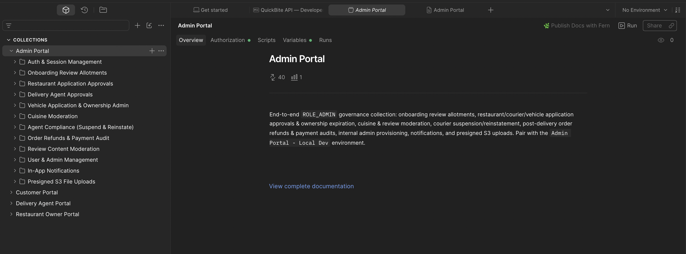

# QuickBite API — Developer Guide

> **Stack:** Spring Boot 4.1.0 · Java 25 · PostgreSQL/PostGIS · Redis & Redisson · Apache Kafka · OSRM / Mapbox · Razorpay · AWS S3  
> **Base URL (local):** `http://localhost:8080`  
> **OpenAPI 3.1.0 Spec:** `postman/specs/quickbite-api.yaml` (`156` endpoints across `135` paths)

---

## Table of Contents
1. [Workspace Overview](#workspace-overview)
2. [Getting Started](#getting-started)
3. [Authentication & Session Challenge Flow](#authentication--session-challenge-flow)
4. [Environments](#environments)
5. [Collections](#collections)
6. [API Surface Summary](#api-surface-summary)
7. [Key Variables Reference](#key-variables-reference)
8. [Order & Payment Lifecycle](#order--payment-lifecycle)
9. [Onboarding Flows](#onboarding-flows)
10. [Infrastructure Dependencies](#infrastructure-dependencies)

---

## Workspace Overview

This `postman/` directory contains the Postman Local View setup for the **QuickBite** food delivery platform. It is organized into **4 role-specific portal collections**, each paired with a dedicated local environment and isolated collection-level authentication tokens:

| Collection | Role | Matching Environment | Requests |
|---|---|---|---|
| **Customer Portal** | `ROLE_CUSTOMER` *(+ unauthenticated Public Catalog & Webhooks)* | `Customer Portal - Local Dev` | 51 |
| **Restaurant Owner Portal** | `ROLE_RESTAURANT_OWNER` | `Restaurant Owner Portal - Local Dev` | 51 |
| **Delivery Agent Portal** | `ROLE_DELIVERY_AGENT` | `Delivery Agent Portal - Local Dev` | 46 |
| **Admin Portal** | `ROLE_ADMIN` | `Admin Portal - Local Dev` | 40 |

---

## Getting Started

### 1. Start the local infrastructure & backend

```bash
# Start PostgreSQL/PostGIS (:5430), Redis (:6377), Kafka (:9092), and optional OSRM (:5001)
docker compose --env-file .env.local --profile full up -d

# Run the Spring Boot application on :8080 (loads local dev profile)
./mvnw spring-boot:run
```

### 2. Open Local Workspace in Postman

To import and use this workspace in Postman:
1. Open the Postman Desktop App.
2. Click **Workspaces** &rarr; **Create Workspace** (or link a local folder).
3. **Important**: When prompted for the workspace folder/location, **select the root path folder of the project** (`QuickBite/app/QuickBite`). Postman will automatically read `.postman/resources.yaml` and load the local workspace with all 4 collections, environments, and OpenAPI specs.

<!-- Screenshot 1: Creating workspace and selecting the project root folder -->


4. Once loaded, Postman will automatically display all 4 collections and matching local dev environments in the sidebar:

<!-- Screenshot 2: Collections UI in Postman -->


### 3. Select the matching environment

Open the environment selector (top-right in Postman) and select the environment matching the portal collection you are testing:
- **Customer Portal - Local Dev** → `Customer Portal`
- **Restaurant Owner Portal - Local Dev** → `Restaurant Owner Portal`
- **Delivery Agent Portal - Local Dev** → `Delivery Agent Portal`
- **Admin Portal - Local Dev** → `Admin Portal`

### 4. Register & Login

1. *(Optional — non-admin roles)* Run `Auth & Session Management → User Registration → Register ...` (`201 Created`). Registration creates the Argon2-hashed user account without starting a device session.
2. Run `Auth & Session Management → Login & Token Refresh → Login with Email & Password`.
   - Every collection root defines `Bearer {{access_token}}` inheritance, while `User Registration`, `Login & Token Refresh`, `Public Catalog`, and `Payment Gateway Webhooks` override auth with `No Auth`.
   - The `afterResponse` script automatically captures `access_token`, `refresh_token`, `challenge_token`, and `session_id` into **collection variables** (`pm.collectionVariables`), keeping each portal's active session isolated when switching tabs across roles.

---

## Authentication & Session Challenge Flow

QuickBite uses an **RSA-signed (`RS256`) Dual-JWT** architecture combined with **SHA-256 hashed refresh token rotation** and **hybrid client transport**:

| Token | Audience (`aud`) | Authorities | TTL | Transport |
|---|---|---|---|---|
| **Access Token** | `quickbite-api` | `SCOPE_API` + `ROLE_*` | `15m` | `Authorization: Bearer {{access_token}}` |
| **Challenge Token** | `quickbite-auth` | `SCOPE_AUTH` only | `5m` | `Authorization: Bearer {{challenge_token}}` *(inherited by `Device Session Management` folder)* |
| **Refresh Token** | — *(opaque)* | Family-rotated in PostgreSQL | `7d` | `HttpOnly; Secure; SameSite=Strict` cookie (`web_browser`) **or** JSON body (`mobile_app`) |

### Mandatory `X-Client-Type` Header

All session-issuing endpoints (`POST /api/v1/auth/login`, `POST /api/v1/auth/refresh-token`, `POST /api/v1/auth/claim-session`) require the `X-Client-Type` header:
- `X-Client-Type: web_browser` — Delivers the rotated `refreshToken` via an `HttpOnly` cookie (`Path=/api/v1/auth`) and omits it (`null`) from the JSON body.
- `X-Client-Type: mobile_app` — Returns `refreshToken` inside the `AuthResponse` JSON body and expects `{"refreshToken": "..."}` in `POST /api/v1/auth/refresh-token`.

### Concurrent Device Limit (`409 Conflict`) Resolution

Each user is capped at `max-sessions-per-user` concurrent active sessions (default `2`). Logging in from an additional device returns **`409 Conflict`** (`SessionLimitErrorResponse`) containing a 5-minute `challengeToken`:

```text
1. POST /api/v1/auth/login (X-Client-Type: web_browser | mobile_app)
   └─► 409 Conflict → { error, challengeToken, maxSessions: 2 }

2. GET /api/v1/auth/sessions (Authorization: Bearer {{challenge_token}})
   └─► 200 OK → Inspect active devices & copy a sessionId to evict

3. DELETE /api/v1/auth/sessions/{{session_id}} (Authorization: Bearer {{challenge_token}})
   └─► 204 No Content → Frees one session slot in PostgreSQL & Redis

4. POST /api/v1/auth/claim-session (Authorization: Bearer {{challenge_token}}, X-Client-Type: ...)
   └─► 200 OK → Issues fresh accessToken + refreshToken for the new device
```

---

## Environments

Each `.environment.yaml` file in `postman/environments/` scopes default credentials and resource UUIDs to one portal role, while active tokens (`access_token`, `refresh_token`, `challenge_token`, `session_id`) are written to **collection variables** by test scripts so all 4 portals can stay logged in simultaneously.

### Shared Variables (All Portals)

| Variable | Scope | Description |
|---|---|---|
| `base_url` | Environment | `http://localhost:8080` |
| `access_token` | Collection *(auto-set)* | `SCOPE_API` RSA JWT (`15m` TTL) |
| `refresh_token` | Collection *(auto-set)* | Opaque refresh token (`mobile_app` body or cookie reference) |
| `challenge_token` | Collection *(auto-set)* | `SCOPE_AUTH` RSA JWT (`5m` TTL) from `409 Conflict` login response |
| `session_id` | Collection *(auto-set)* | Active or target device session UUID |
| `notification_id` | Environment | UUID of an in-app notification |

### Customer Portal - Local Dev

| Variable | Description |
|---|---|
| `customer_email` / `customer_password` | Default customer login credentials |
| `address_id` | UUID of a saved customer delivery address |
| `cuisine_id` / `restaurant_id` / `menu_item_id` | Catalog discovery & cart item UUIDs |
| `cart_item_id` | UUID of a line item inside the active cart |
| `tip_amount` | Courier tip in INR (default `0`) |
| `total_order_amount` | *(Collection variable)* Auto-captured by **Get Checkout Preview** for `expectedTotal` |
| `order_id` / `payment_id` / `transaction_id` | Placed order, payment record, and stub webhook transaction IDs |
| `review_id` | UUID of a submitted customer review |

### Restaurant Owner Portal - Local Dev

| Variable | Description |
|---|---|
| `owner_email` / `owner_password` | Default merchant login credentials |
| `restaurant_application_id` | UUID of the merchant's restaurant onboarding application |
| `restaurant_id` | UUID of an approved restaurant owned by the merchant |
| `cuisine_id` / `cuisine_request_id` | Approved cuisine UUID / proposed cuisine moderation UUID |
| `menu_item_id` / `image_id` | Menu dish UUID / gallery or dish image UUID |
| `order_id` | UUID of an incoming or historical kitchen order |

### Delivery Agent Portal - Local Dev

| Variable | Description |
|---|---|
| `agent_email` / `agent_password` | Default courier login credentials |
| `agent_application_id` | UUID of the courier KYC onboarding application |
| `vehicle_application_id` | UUID of a standalone or embedded vehicle application |
| `ownership_id` / `vehicle_id` | UUID of an approved `VehicleOwnership` record |
| `order_id` / `order_dispatch_id` | UUID of an order / active delivery dispatch offer |
| `latitude` / `longitude` | Live courier GPS coordinates (Bengaluru defaults: `12.9716`, `77.5946`) |

### Admin Portal - Local Dev

| Variable | Description |
|---|---|
| `admin_email` / `admin_password` | Default administrator login credentials |
| `allotment_id` | UUID of a pending onboarding review allotment |
| `restaurant_application_id` / `agent_application_id` / `vehicle_application_id` | Onboarding applications under review |
| `agent_id` / `delivery_agent_id` | Delivery agent UUID for fleet inspection, suspension, or reinstatement |
| `cuisine_id` / `cuisine_request_id` | Proposed cuisine UUID under moderation |
| `order_id` / `review_id` / `user_id` | Order refund target, moderated review UUID, and user UUID |
| `rejection_reason` | Default rejection remarks payload |

---

## Collections

Folders inside every collection are ordered sequentially (`1000`, `2000`, `3000`, ...) to mirror the natural end-to-end user journey:

### 1. Customer Portal
End-to-end customer journey: register → login → browse PostGIS nearby catalog → manage cart & preview road-distance fees → place order → verify payment → track courier → submit review.

**Folders (in order):**
1. `Auth & Session Management` *(User Registration · Login & Token Refresh · Device Session Management · Logout)*
2. `Public Catalog` *(Cuisines Directory · Restaurant Discovery & Geo-Search · Public Menu Catalog · Public Reviews & Rating Summary · System Health & Info)*
3. `Customer Profile`
4. `Saved Delivery Addresses`
5. `Shopping Cart` *(Get Checkout Preview auto-captures `total_order_amount`)*
6. `Order Placement & Tracking`
7. `Online Payment Verification`
8. `Payment Gateway Webhooks` *(Local Stub & Razorpay HMAC receivers)*
9. `Customer Reviews`
10. `In-App Notifications`
11. `Presigned S3 File Uploads`

### 2. Restaurant Owner Portal
Merchant onboarding and daily kitchen operations: apply → get approved → propose cuisines → manage schedule & menu → accept & prepare `PLACED` orders → track delivered earnings.

**Folders (in order):**
1. `Auth & Session Management`
2. `Restaurant Onboarding Application` *(17-endpoint wizard)*
3. `Cuisine Proposals`
4. `Restaurant Operations & Schedule`
5. `Menu & Dish Management`
6. `Kitchen Order Fulfillment` *(includes `GET /api/v1/restaurant-owner/orders/earnings`)*
7. `In-App Notifications`
8. `Presigned S3 File Uploads`

### 3. Delivery Agent Portal
Courier KYC, fleet management, and last-mile fulfillment: register → submit KYC & vehicle docs → select active vehicle → go online & stream GPS → accept radial dispatch offer → pick up & deliver.

**Folders (in order):**
1. `Auth & Session Management`
2. `Agent KYC Onboarding` *(10-endpoint wizard with embedded vehicle)*
3. `Vehicle Onboarding Application` *(11-endpoint standalone vehicle flow)*
4. `Approved Fleet & Active Vehicle`
5. `Shift Availability & Live GPS`
6. `Order Dispatch & Last-Mile Delivery` *(+ `GET /api/v1/delivery-agent/offers/active` in OpenAPI spec)*
7. `In-App Notifications`
8. `Presigned S3 File Uploads`

### 4. Admin Portal
Platform governance, onboarding approvals, content moderation, and post-delivery refunds. *(Note: `ROLE_ADMIN` accounts cannot self-register; provision additional admins via `User & Admin Management → Create Admin User`.)*

**Folders (in order):**
1. `Auth & Session Management`
2. `Onboarding Review Allotments`
3. `Restaurant Application Approvals`
4. `Delivery Agent Approvals`
5. `Vehicle Application & Ownership Admin` *(+ `/admin/vehicles/agents/{agentId}` & `/admin/vehicles/ownerships/{ownershipId}/expire` in OpenAPI spec)*
6. `Cuisine Moderation`
7. `Agent Compliance (Suspend & Reinstate)`
8. `Order Refunds & Payment Audit`
9. `Review Content Moderation`
10. `User & Admin Management`
11. `In-App Notifications`
12. `Presigned S3 File Uploads`

---

## API Surface Summary

All **156** endpoints (`154` Spring MVC controller operations + `2` public Actuator probes) are documented in `postman/specs/quickbite-api.yaml`:

| Domain | Endpoints | Auth / Role Required |
|---|---|---|
| Auth & Device Sessions | 10 | Public (`register`, `login`, `refresh-token`), `SCOPE_AUTH` (`sessions`, `claim-session`), `SCOPE_API` (`logout`) |
| Customer Profile & Addresses | 7 | `ROLE_CUSTOMER` |
| Shopping Cart & Checkout Preview | 6 | `ROLE_CUSTOMER` |
| Orders (Customer) | 6 | `ROLE_CUSTOMER` |
| Payments (Customer) | 2 | `ROLE_CUSTOMER` |
| Reviews (Customer) | 5 | `ROLE_CUSTOMER` |
| Restaurant Onboarding | 17 | `ROLE_RESTAURANT_OWNER` |
| Restaurant Operations & Schedule | 7 | `ROLE_RESTAURANT_OWNER` |
| Menu & Dish Management | 5 | `ROLE_RESTAURANT_OWNER` |
| Kitchen Order Fulfillment & Earnings | 8 | `ROLE_RESTAURANT_OWNER` |
| Cuisine Proposals | 1 | `ROLE_RESTAURANT_OWNER` |
| Delivery Agent KYC Onboarding | 10 | `ROLE_DELIVERY_AGENT` |
| Vehicle Onboarding Applications | 11 | `ROLE_DELIVERY_AGENT` |
| Approved Fleet & Shift / Live GPS | 7 | `ROLE_DELIVERY_AGENT` |
| Order Dispatch & Last-Mile Delivery | 6 | `ROLE_DELIVERY_AGENT` |
| Admin — All Governance Domains | 31 | `ROLE_ADMIN` |
| In-App Notifications | 4 | Any authenticated role (`SCOPE_API`) |
| Presigned S3 File Uploads | 1 | Any authenticated role (`SCOPE_API`) |
| Payment Gateway Webhooks | 2 | Public (`X-Razorpay-Signature` HMAC / `dev` stub) |
| Public Catalog (Cuisines, Geo-Search, Menus, Reviews) | 8 | Public (`No Auth`) |
| Spring Boot Actuator (`/actuator/health`, `/actuator/info`) | 2 | Public (`ROLE_ADMIN` for other actuator endpoints) |
| **Total** | **156** | |

---

## Key Variables Reference

### Auto-Captured by Postman Scripts

| Variable | Set By | Scope |
|---|---|---|
| `access_token` | `Login with Email & Password` / `Refresh Access Token` / `Claim Challenged Session` | Collection variable |
| `refresh_token` | `Login with Email & Password` / `Refresh Access Token` / `Claim Challenged Session` | Collection variable |
| `challenge_token` | `Login with Email & Password` *(on `409 Conflict`)* | Collection variable |
| `session_id` | `Login with Email & Password` / `Refresh Access Token` / `Claim Challenged Session` | Collection variable |
| `total_order_amount` | `Get Checkout Preview` *(`priceBreakdown.totalAmount`)* | Collection variable (`Customer Portal`) |

### Resource UUIDs Populated During Workflows

| Variable | Obtained From |
|---|---|
| `address_id` | `Add Delivery Address` / `List Saved Delivery Addresses` |
| `cuisine_id` | `List Approved Cuisines` |
| `restaurant_id` | `List Approved Restaurants` / `List My Approved Restaurants` |
| `menu_item_id` | `Create Menu Item` / `List Restaurant Menu Items` |
| `cart_item_id` | `Get Active Cart` / `Add Item to Cart` |
| `order_id` | `Place Order from Cart` / `List Incoming & Past Restaurant Orders` |
| `transaction_id` | `Place Order from Cart` *(`STUB_ONLINE` payment result)* |
| `restaurant_application_id` | `Start Restaurant Onboarding Application` |
| `agent_application_id` | `Start Delivery Agent Application` |
| `vehicle_application_id` | `Start Standalone Vehicle Application` |
| `ownership_id` | `List My Approved Vehicles` |
| `allotment_id` | `List My Pending Onboarding Allotments` |
| `review_id` | `Submit Order Review` |

---

## Order & Payment Lifecycle

QuickBite enforces a strict **11-state `OrderStatus` state machine** (`OrderStatusHistoryDto` records `status`, `timestamp`, `changedById`, and `changedByName` for every transition):

```text
  [Place Order: Online (UPI / CARD / NET_BANKING / WALLET)]      [Place Order: COD]
                        │                                                │
                        ▼                                                │
               AWAITING_PAYMENT ◄──(retry-payment within 10m)──┐         │
                 │          │                                  │         │
  (10m TTL exp.) │          ├──(gateway failure)──► PAYMENT_FAILED       │
                 ▼          │                                            │
             ABANDONED      └──(verify / webhook)──► PLACED ◄────────────┘
                                                       │
                      ┌────────────────────────────────┼────────────────────────────────┐
         (decline)    │                 (accept ≤ 2m)  │          (customer cancel /    │
                      ▼                                ▼           2m kitchen timeout)  │
                  DECLINED                         ACCEPTED                             ▼
             (auto-refund if paid)                     │                            CANCELLED
                                                       ▼                      (auto-refund if paid;
                                                   PREPARING                   also triggered if all
                                                       │                       dispatch rounds fail)
                                                       ▼
                                               READY_FOR_PICKUP
                                                       │
                                          (courier pickup confirmed)
                                                       ▼
                                               OUT_FOR_DELIVERY
                                                       │
                                         (courier delivery confirmed)
                                                       ▼
                                                   DELIVERED
```

- **Price-Drift Guard (`expectedTotal`):** `POST /api/v1/customer/orders` compares `expectedTotal` (from `GET /api/v1/customer/cart/checkout-preview`) against live menu prices and road-distance fees, returning `409 Conflict` if totals drifted.
- **Customer Cancellation (`DELETE /api/v1/customer/orders/{orderId}/cancel`):** Allowed in `AWAITING_PAYMENT`, `PAYMENT_FAILED`, and `PLACED` (`CUSTOMER_REQUESTED`). Blocked once the restaurant marks the order `ACCEPTED`.
- **Automated Timeouts (Redisson Delayed Queues):**
  - Unpaid online orders expire after **`10m`** (`AWAITING_PAYMENT` / `PAYMENT_FAILED` → `ABANDONED`).
  - Unaccepted `PLACED` orders auto-cancel after **`2m`** (`CANCELLED` with `RESTAURANT_UNRESPONSIVE` + automatic refund).
  - Radial courier dispatch runs up to 3 expanding Redis Geo waves (`3km` → `5km` → `8km`); if no courier accepts, the order transitions to `CANCELLED` (`NO_AGENT_FOUND`) with an automatic refund.
- **Post-Delivery Admin Refunds (`POST /api/v1/admin/orders/{orderId}/refund`):** Transitions `PaymentStatus` to `REFUNDED` while `OrderStatus` remains `DELIVERED`.

---

## Onboarding Flows

### 1. Presigned S3 Direct Upload Flow
Before attaching restaurant images or verification documents (`RESTAURANT_IMAGE`, `RESTAURANT_DOCUMENT`):
```text
1. POST /api/v1/files/upload-url  { context, applicationId, contentType, fileName }
   └─► 200 OK → { uploadUrl, fileUrl }
2. PUT <uploadUrl>  (raw binary bytes directly to S3 — no Authorization header)
3. Attach `fileUrl` to the onboarding or restaurant image/document endpoint
```

### 2. Restaurant Onboarding (`17` endpoints)
```text
Start Application (DRAFT) → Save Basic Details → Save Address & GPS → Save Weekly Hours
→ Add Storefront/Kitchen Images → Attach Documents (FSSAI_LICENSE, GST, PAN, BANK_PROOF, BUSINESS_LICENSE)
→ Submit for Review (SUBMITTED)
→ [Admin: Accept Allotment → Inspect → Approve (provisions live Restaurant) / Reject]
→ (if REJECTED) Reopen (DRAFT) → Edit → Resubmit
```

### 3. Delivery Agent KYC Onboarding (`10` endpoints)
```text
Start Application (DRAFT) → Attach Identity Documents (AADHAR, DRIVING_LICENSE)
→ Start Embedded Vehicle Application → Save Vehicle Specs (BIKE / SCOOTER / BICYCLE / CAR)
→ Attach Vehicle Documents (RC, INSURANCE) → Submit Agent Application (SUBMITTED)
→ [Admin: Inspect → Approve (activates DeliveryAgent + VehicleOwnership) / Reject]
→ (if REJECTED) Reopen → Edit → Resubmit
```

### 4. Standalone Vehicle Onboarding (`11` endpoints)
```text
Check VIN Availability → Start Standalone Application → Save Specs & Number Plate
→ Attach Documents (RC, INSURANCE, TRANSFER_NOC) → Submit
→ [Admin: Inspect → Approve / Reject]
→ Select Active Delivery Vehicle (/api/v1/delivery-agent/vehicles/{ownershipId}/select)
```

---

## Infrastructure Dependencies

Configured via `.env` / `src/main/resources/application.properties` (and `application-dev.properties`):

| Service | Local Endpoint | Purpose |
|---|---|---|
| **PostgreSQL 16 + PostGIS** | `localhost:5430/quickbite` | Primary relational & spatial datastore (`ST_DWithin` restaurant search, Flyway migrations, Hibernate Envers audit tables) |
| **Redis + Redisson** | `localhost:6377` | Active session cache, `24h` shopping carts, `delivery:agents:locations` Geo index, distributed dispatch locks, and delayed timeout queues |
| **Apache Kafka** | `localhost:9092` | Asynchronous domain event bus (orders, payments, dispatch, onboarding allotments, notifications, emails) |
| **OSRM / Mapbox** | `localhost:5001` *(or Mapbox API)* | Road-network distance & driving ETA engine with automatic Haversine fallback |
| **Razorpay** *(or `dev` Stub)* | `api.razorpay.com` | Online payment order creation, HMAC signature verification, webhooks, and refunds |
| **AWS S3** | Configured bucket | Direct client uploads via short-lived presigned `PUT` URLs |

```bash
# Start full local infrastructure (including OSRM routing container)
docker compose --env-file .env.local --profile full up -d

# Start core infrastructure only (PostgreSQL, Redis, Kafka — uses Mapbox or Haversine fallback)
docker compose --env-file .env.local up -d

# Tear down containers
docker compose --env-file .env.local --profile full down
```

---

*Last updated: November 2026*
